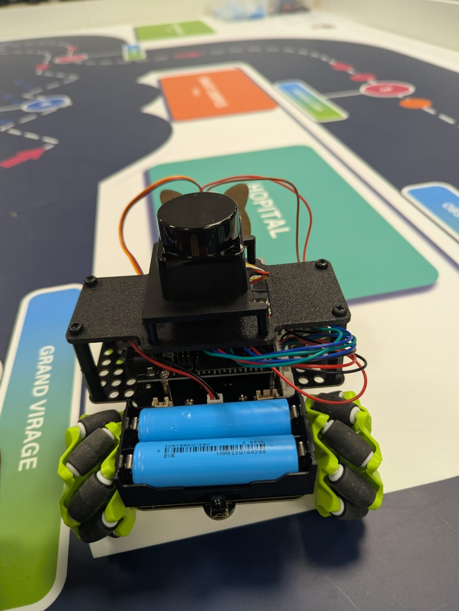
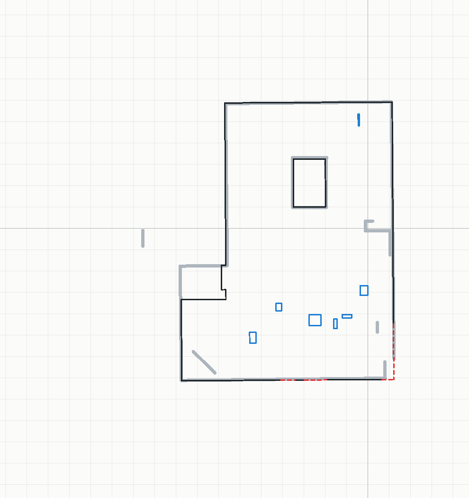

# LD06 SLAM — Cartographie et localisation 2D

Projet du module *Cartographie et localisation appliquée à la robotique mobile* (Yohan Zoungrana,
novembre 2026). Outils pour exploiter les scans du lidar LD06 d'un robot Mecanum à ESP32 :
nuages de points, grid map, carte vectorielle, localisation (scan matching), SLAM et carte de la
salle de classe, exploration autonome en bonus. Énoncé : [docs/enonce.md](docs/enonce.md).

| Le robot | La carte de la salle faite par notre SLAM, sur la carte de référence |
| --- | --- |
|  |  |

Vidéos du robot piloté par câble pendant le SLAM en direct : [vidéo 1](docs/media/robot_video.mp4),
[vidéo 2](docs/media/robot_video_2.mp4).

## Tester en 5 minutes

Node.js 22 ou plus, aucune dépendance. Dans ce dossier :

```bash
node serve.mjs
```

Ouvrir http://localhost:8080/ (Chrome ou Edge), puis, dans la barre latérale :

| Pour voir | Faire |
| --- | --- |
| Nuages de points, une couleur par scan, pose modifiable | **Scans → Scans de la salle** ; cliquer un scan, glisser pour le déplacer, Maj + glisser pour le tourner |
| Grid map et carte vectorielle | **Grid map → Tous les scans visibles**, **Carte vectorielle → Tous les scans visibles** ; « Vue propre » dans **Affichage** |
| Localisation sur les trois références | **Carte de référence → Charger la carte de la salle**, sélectionner un scan, **Localisation → Localiser le scan sélectionné** ou **Comparer les méthodes** |
| Localisation sans pose de départ | **Localisation → Localisation globale (pose inconnue)** |
| SLAM | **Scans → Trajet simulé**, puis **SLAM → SLAM sur les scans visibles** |
| Bonus : robot autonome (simulé) | **Robot → Exploration simulée** |

Tests automatiques (128) : `node --test "test/*.test.js"`. Tous les chiffres des comptes rendus se
régénèrent avec les scripts listés plus bas (section « Ligne de commande »).

## Où trouver chaque demande de l'énoncé

| Énoncé | Où c'est fait | Où c'est expliqué et mesuré |
| --- | --- | --- |
| **Jour 1.1** Extraire ses propres scans réels (polaire) | `firmware/`, `scripts/capture.py`, `scripts/live.py` ; scans dans `data/real/` (carte) et `data/test/` (jeu indépendant) | [jour1.md § 1](docs/jour1.md) |
| **1.2** Afficher plusieurs scans, couleurs distinctes, pose de chaque scan modifiable | Application (`app/`) | [jour1.md § 2](docs/jour1.md) |
| **1.3** Grid map : scan + pose → carte ; carte + scan + pose → mise à jour (cellules traversées et d'impact) ; démarche, hypothèses, difficultés, limites | `src/core/gridmap.js` ; boutons « Scan sélectionné → carte », « Mettre à jour la carte » ; `scripts/build-maps.mjs --grid` | [jour1.md § 3](docs/jour1.md), [algorithmes.md § 2](docs/algorithmes.md) |
| **1.4** Segments : nuage → segments, angle, « proches », fusion, intersection, découpage (cas limites et tolérance) | `src/core/segmentation.js`, `src/core/geometry.js` | [jour1.md § 4](docs/jour1.md) ; cas limites testés dans `test/geometry.test.js` |
| **1.5** Carte vectorielle, étapes du document de cours | `src/core/vectormap.js` | [jour1.md § 5](docs/jour1.md) |
| Propriétés en plus (durée de vie, filtrages, pondérations) | Décroissance des cellules, cellules isolées, poids des segments, cartes propres | [jour1.md § 3, 5, 6](docs/jour1.md) |
| **Jour 2.1** Localisation sur grid map | `src/core/localization.js` (force brute, gradient, multi-résolution, probabiliste, ICP…) | [jour2.md](docs/jour2.md), [banc d'essai](docs/jour2_benchmark.md) |
| **2.2** Localisation sur carte vectorielle | idem, plus calcul direct | idem |
| **2.3** Localisation entre scans | idem | idem |
| Comparaison : mêmes scans, mêmes poses initiales ; erreur (m, °), temps, taux de réussite, seuils explicités ; sensibilité à l'initialisation | `scripts/benchmark-jour2.mjs`, `scripts/benchmark-reel.mjs` | [jour2_benchmark.md](docs/jour2_benchmark.md) (simulation, pose connue), [jour2_reel.md](docs/jour2_reel.md) (réel) |
| Incertitude des références mesurées sur le robot | `scripts/benchmark-reel.mjs` | [jour2_reel.md](docs/jour2_reel.md) (± 2,0 cm, 0,28° en médiane) |
| **Jour 3** SLAM (localisation + cartographie simultanées) | `src/core/slam.js`, `src/core/posegraph.js` | [jour3.md § 1, 2](docs/jour3.md), [banc d'essai](docs/jour3_slam.md) |
| Carte complète de la salle de classe | Séance avec le vrai robot : `data/slam_usb_20261104/` ; carte de référence : `data/reference/` | [jour3.md § 3](docs/jour3.md), [rapport_slam_reel.md](docs/rapport_slam_reel.md) |
| Objectif final : localiser le robot dans cette carte | `src/core/globalloc.js` | [jour3.md § 4](docs/jour3.md), [jour2.md](docs/jour2.md) |
| **Bonus** déplacer le robot automatiquement | `src/core/explore.js`, `firmware/ESP32_RobotWifi` | [jour3.md § 5](docs/jour3.md), [jour3_explore.md](docs/jour3_explore.md) |
| **Livrable** dépôt Git avec historique | https://github.com/yohann869-CMDmaker/ld06-slam | commits réguliers depuis le 2 novembre |
| Outils et instructions pour les tester | ce README | sections ci-dessous |
| Synthèse personnelle (par outil, puis ce que je retiens du module) | — | [docs/synthese.md](docs/synthese.md) |
| **Remarques** tester sur données réelles et sur données MapTool | `data/real/`, `data/test/` ; `data/maptool/` (générées par le code de MapTool) | [jour2_reel.md](docs/jour2_reel.md), [test_maptool.md](docs/test_maptool.md) |
| Piloter le robot sans fil, données en temps réel | `firmware/ESP32_RobotWifi` (routes de RobotControl), `firmware/ESP32_RobotUSB` | [jour3.md § 3.2, 5](docs/jour3.md) |

## Au-delà de l'énoncé, et ce que chaque ajout apporte

| Ajout | Ce qu'il fait | Pourquoi |
| --- | --- | --- |
| Trois méthodes de l'état de l'art : PL-ICP (Censi 2008), NDT (Biber 2003), Gauss-Newton sur la carte (Hector 2011) | Recalent un scan avec d'autres modèles d'erreur (point-droite, gaussiennes, gradient de la carte) | Comparer nos méthodes à celles des articles ; le Gauss-Newton réussit 100 % en 1 à 2 ms et accélère le SLAM 4 à 7 fois ([jour2.md](docs/jour2.md), [état de l'art](docs/etat_de_l_art.md)) |
| Localisation globale avec verdict « fiable » / « ambiguë » | Retrouve le robot dans toute la salle sans pose de départ et dit si la réponse est sûre | La salle est presque symétrique : une réponse fausse doit se signaler ([jour2_global.md](docs/jour2_global.md)) |
| A priori de position | Utilise la pose approximative notée à la main | Lève l'ambiguïté : 17/18 → 18/18 ([jour3_apriori.md](docs/jour3_apriori.md)) |
| Graphe de poses avec précision par direction, et graphe hors ligne (Lu & Milios 1997) | Corrige la dérive le long des couloirs ; recale des clichés épars tous ensemble | Erreur médiane 8,5 → 4,2 cm sur les clichés réels ([jour3.md § 3.1](docs/jour3.md)) |
| SLAM en direct, pilotage continu (câble ou Wi-Fi), calcul dans un fil séparé, suivi robuste aux mouvements rapides | Construit la carte pendant que le robot roule, sans figer la page | Le premier essai par pas de 30 cm se perdait ; la séance réelle de 57 m a réussi ([jour3.md § 6](docs/jour3.md)) |
| Programmes du robot adaptés à notre câblage (`firmware/ESP32_RobotWifi`, `ESP32_RobotUSB`) | Commandent les moteurs directement par l'ESP32 | Notre robot n'a pas la carte I2C du programme fourni : les roues tournaient seules ([README, Wi-Fi](#programme-du-robot-en-wi-fi-firmwareesp32_robotwifi)) |
| Filtrage et reconstruction du plan (`src/core/reconstruct.js`) | Retire chaises et personnes, complète les murs cachés, redessine un plan propre | Carte finale à 2,8 cm (murs vus) et 3,9 cm (murs reconstruits) de la référence ([rapport_slam_reel.md](docs/rapport_slam_reel.md)) |
| Cartes propres « style MapTool », étiquettes (table, armoire, tableau), export ROS (PGM + YAML) | Plan lisible, meubles nommés, carte ouvrable dans ROS / RViz | Rendre les cartes utilisables au-delà de l'application |
| Faux robot Wi-Fi (`scripts/mock-robot.mjs`) | Imite les routes HTTP du robot dans une scène simulée | Tester le pilotage et l'exploration sans le robot |
| Interface « station sol » (thème sombre, barre d'état, sections repliables) | Montre la liaison, la pose, la cadence et l'état du SLAM | Savoir d'un coup d'œil si le robot est suivi pendant une séance |
| Application d'apprentissage *Labo Carto* (dossier voisin `carto-edu`, hors livrable) | Fiches interactives pour apprendre la cartographie et le SLAM, robot virtuel | Prolongement personnel : aider d'autres étudiants qui n'ont pas de robot |

Autres documents : [algorithmes expliqués](docs/algorithmes.md), [journal des erreurs et
corrections](docs/journal.md), [état de l'art](docs/etat_de_l_art.md), notes de suivi du projet
([docs/passation.md](docs/passation.md)).

## Prérequis

- Node.js 22 ou plus (testé avec Node 24). Aucune dépendance à installer.
- Un navigateur récent (Chrome, Edge, Firefox).

## Application web

```bash
node serve.mjs
```

Puis ouvrir http://localhost:8080/ (le serveur est nécessaire : les modules JavaScript ne se
chargent pas depuis `file://`).

1. **Jeu simulé** charge les 6 scans de `data/sim/`, ou **Ouvrir des scans…** charge des CSV
   RobotControl, MapTool ou capturés sur le port série (glisser-déposer possible).
2. Sélectionner un scan pour modifier sa pose : champs x, y, θ ; glisser le scan ;
   Maj + glisser pour le tourner ; flèches et Q/A, E au clavier.
3. **Grid map** : créer depuis le scan sélectionné, mettre à jour la carte avec le scan
   sélectionné, ou construire avec tous les scans visibles. Export CSV/PNG, **export ROS**
   (PGM + YAML, pour `map_server` / Nav2 / RViz), import CSV (y compris les grilles MapTool).
4. **Carte vectorielle** : mêmes actions ; export/import TXT (`x1,y1,x2,y2`), carte de
   référence en pointillés (par ex. `data/sim/scene_A.txt` ou une scène MapTool).

## Piloter le robot par le câble USB (`firmware/ESP32_RobotUSB`)

Le plus simple et le plus fiable : le robot reste branché au PC.

1. Téléverser `firmware/ESP32_RobotUSB/ESP32_RobotUSB.ino` (librairie LD06 seulement), fermer le
   moniteur série.
2. `python scripts/live.py` (relais USB, sert aussi l'application), ouvrir http://localhost:8080/.
3. Section « Robot » : liaison **USB**, « Démarrer le SLAM », vitesse vers 100-120, puis maintenir
   les touches : **I** avancer, **K** reculer, **J** glisser à gauche, **L** glisser à droite,
   **U** tourner à gauche, **O** tourner à droite ; **Échap** : arrêt.

Le programme lit le lidar et commande les moteurs ; liaison à 921600 bauds (un scan passe en 0,1 s,
4 à 5 scans par seconde). Le relais transmet les ordres de l'application (`/live/cmd`) : F, B, G,
D, Q, E (mouvement de 400 ms, renvoyé toutes les 150 ms tant que la touche est maintenue), X (arrêt),
V120 (vitesse). Les mêmes lettres marchent depuis le moniteur série (921600 bauds) pour un essai
rapide. `live.py` et `capture.py` essaient 921600 puis 115200 bauds : l'ancien programme de capture
marche toujours.

## Programme du robot en Wi-Fi (`firmware/ESP32_RobotWifi`)

Sur notre robot, les moteurs ne passent pas par la carte I2C Keyestudio du module : ils sont
commandés **directement par l'ESP32**, deux broches par roue (une par sens, en PWM). Le programme
du module (`ESP32RobotControl.ino`) utilise GPIO19 et GPIO21 comme bus I2C : sur ce robot ce sont
des broches moteur, et les roues tournaient toutes seules. `firmware/ESP32_RobotWifi` reprend les
mêmes routes HTTP et le même format de scan (l'application et RobotControl marchent sans
changement), avec le câblage en tête du fichier :

| Roue | Avance | Recule |
| --- | --- | --- |
| Avant gauche (M2) | D18 | D19 |
| Avant droite (M1) | D5 | D17 |
| Arrière gauche (M3) | D15 | D2 |
| Arrière droite (M4) | D16 | D4 |

Lidar : TX sur GPIO33, PWM sur GPIO32. Librairies : LD06 (ZIP du module), Async TCP et
ESP Async WebServer (auteur ESP32Async). Carte « ESP32 Dev Module ». Une roue qui tourne à
l'envers : `inverse = true` sur sa ligne ; un déplacement latéral dans le mauvais sens : échanger le
contenu de `left()` et `right()` (orientation des galets). Le programme de capture USB met aussi ces
8 broches à 0 au démarrage.

## Acquisition des scans avec le programme de test fourni (Teleplot)

Le programme `ESP32_LD06_Test.ino` du module envoie chaque tour sur le port série sous la
forme `>lidar:x:y;x:y;…|xy` (format Teleplot). L'application lit directement ce texte :

1. Téléverser `ESP32_LD06_Test.ino` et ouvrir le moniteur série de l'IDE Arduino à 115200 bauds.
2. Poser le robot, attendre 2 à 3 secondes sans le toucher.
3. Cliquer dans la zone de sortie du moniteur, **Ctrl+A** puis **Ctrl+C**.
4. Dans l'application, **Ctrl+V** sur la carte (ou bouton **Coller un scan**). Le nouveau scan
   apparaît dans sa couleur.
5. Déplacer le robot (0,5 à 1 m, moins de 45° de rotation) et recommencer à l'étape 2.

L'application garde la dernière ligne complète (celle coupée par la copie est ignorée) et
corrige le miroir des x/y de la librairie. Le programme de test perd des trames, car il envoie
du texte plus lentement que le lidar ne produit ses mesures : chaque tour a des trous (jusqu'à
74° sur un tour réel). Un scan correspond toujours à **un seul tour** : fusionner plusieurs
tours biaiserait le scan dès que le robot a bougé ou tourné, même un peu, entre deux tours.

Ensuite, pour chaque scan : recalage manuel et enregistrement, comme aux étapes 5 et 6 ci-dessous.

## Acquisition des scans par USB (programme de capture)

Variante sans perte de trames : un programme qui n'envoie un scan que sur demande.

1. Dans l'IDE Arduino (librairie `LD06.zip` installée, carte « ESP32 Dev Module »), téléverser
   [`firmware/ESP32_LD06_Capture/ESP32_LD06_Capture.ino`](firmware/ESP32_LD06_Capture/ESP32_LD06_Capture.ino).
   Même câblage que `ESP32_LD06_Test.ino` : TX du lidar sur GPIO33, PWM sur GPIO32.
2. **Fermer le moniteur série de l'IDE** (le port USB ne peut être ouvert que par un programme).
3. Dans l'application ouverte avec **Chrome ou Edge**, cliquer sur **Connecter le robot (USB)**
   et choisir le port de l'ESP32. La ligne d'état affiche la vitesse du lidar et le nombre de
   points par tour.
4. Poser le robot, ne plus le toucher, cliquer sur **Capturer un scan**. Recommencer après
   chaque déplacement (0,5 à 1 m, moins de 45° de rotation entre deux scans).
5. Le premier scan est la référence, en pose (0, 0, 0). Chaque nouveau scan part de la pose
   du scan sélectionné : le recaler à la main (glisser, Maj + glisser, flèches, Q/A et E)
   jusqu'à ce que ses murs se superposent aux précédents. Sa pose x, y, θ est alors lue
   dans l'éditeur de pose.
6. **Enregistrer tous les scans…** écrit chaque scan avec sa pose dans un dossier
   (par exemple `data/real/`) ainsi qu'un récapitulatif `poses.csv`. Les fichiers se
   rechargent avec **Ouvrir des scans…** en gardant leurs poses.

Le programme peut aussi être piloté depuis le moniteur série (115200 bauds) :
`s` envoie un scan, `i` affiche la vitesse, le nombre de points et les erreurs CRC,
`r` compte les octets bruts reçus du lidar en 300 ms (diagnostic de câblage ou d'alimentation).

## Cartes propres et exports du jour 1

- **Vue propre (style MapTool)** (section Affichage) : grid map nettoyée (poussières, faisceaux
  sortis par les fenêtres et petits trous retirés) et carte vectorielle nettoyée (murs redressés
  sur la direction dominante, morceaux fusionnés, coins fermés, segments hors de la pièce retirés).
  Les **objets fixes** (table, armoire, tableau : segments vus par au moins 2 scans) sont gardés,
  en violet, et redessinés dans la grid map ; le fouillis vu par un seul scan est retiré. Un
  meuble sous lequel le lidar passe en partie (tableau sur deux pieds) est **surélevé** :
  pointillés, cellules grises ; un meuble posé au sol (armoire) : trait plein, cellules noires.
  Avec les scans de la salle, seuls les meubles nommés dans `data/reference/etiquettes.json`
  (table, armoire, tableau) restent, avec leur **étiquette** (case « Étiquettes »).
- **Exporter tout le jour 1** : 7 figures PNG avec titre, échelle et légende (nuages de points,
  grid map brute et propre, segments extraits, carte vectorielle brute et propre, plan de la
  salle), les grid maps (CSV) et cartes vectorielles (TXT) brutes et propres, `poses.csv`, et deux
  fichiers pour MapTool (`maptool_carte_vectorielle.txt`, `maptool_grid_map.csv`). Pour les
  ouvrir dans MapTool, régler la largeur et la hauteur indiquées en tête du fichier, puis importer.

## Carte de référence et localisation (jour 2)

- **Scans de la salle** (section Scans) : recharge en un clic les scans réels de `data/real` à
  leurs poses recalées (après un rechargement de la page, l'application repart vide).
- **Charger la carte de la salle** (section Carte de référence) : la salle construite au jour 1
  (`data/reference/carte_reference.json`, régénérée par `node scripts/build-reference.mjs`)
  s'affiche en fond et sert de référence.
- **Figer les cartes actuelles** puis **Enregistrer…** : faire de la carte des scans visibles la
  nouvelle référence.
- **Exporter les résultats** : toutes les localisations de la séance en CSV (pour le compte rendu).
- **Localisation globale (pose inconnue)** : sans placer le scan, la pose est cherchée dans toute
  la salle ; les 3 meilleures candidates sont dessinées, avec un verdict « Fiable » ou « Ambiguë ».
- Ouvrir un scan, le placer à peu près à la main, puis **Localiser le scan sélectionné** (référence
  « Carte de référence : vectorielle » ou « grid map ») ou **Comparer les méthodes**.

## SLAM (jour 3)

- **Trajet simulé** puis **SLAM sur les scans visibles** : la carte, déformée par l'odométrie seule,
  se reconstruit scan par scan (trajectoire en bleu, boucles fermées).
- **SLAM en direct** (robot en USB, `python scripts/live.py`) : cocher la case et déplacer doucement
  le robot ; un scan clé est ajouté tous les 20 cm ou 10° et la carte grandit en temps réel.
- **Pilotage continu (câble USB ou Wi-Fi)** : section Robot, « Démarrer le SLAM » (la liaison qui répond est choisie seule), puis maintenir une touche (I K J L U O,
  comme RobotControl) ou un bouton : le robot roule tant qu'on appuie (commande renvoyée toutes les
  150 ms, arrêt seul 0,4 s après la dernière). Le SLAM tourne en continu (5 à 6 scans par seconde,
  robot en mouvement) avec, comme odométrie, la vitesse estimée × la durée d'appui, étalonnée sur
  des segments de 15 cm ou 25°. Curseur de vitesse des moteurs (route `/speed` du programme
  `firmware/ESP32_RobotWifi`). C'est l'utilisateur qui guide : pas d'arrêt automatique devant un
  obstacle (un avertissement si le SLAM se perd). En USB (robot poussé à la main), l'appli affiche la pose, le
  dernier pas et « trop vite » au-delà de 35 cm ou 15° par scan.
- **Exploration autonome** (bonus) : **Exploration simulée** (salle de classe ou trois pièces) montre le
  robot qui part sans carte et va seul vers les frontières entre le connu et l'inconnu ; **Explorer
  avec le robot (Wi-Fi)** fait de même avec le vrai robot (programme `firmware/ESP32_RobotWifi`, Wi-Fi
  `DON MIGUEL3`, IP `192.168.4.1`). **Échap** ou **Arrêt** coupe les moteurs. Sans robot :
  `node scripts/mock-robot.mjs` puis IP `localhost:8090`.

## Ligne de commande

```bash
node scripts/build-maps.mjs --out out/sim data/sim/scan_01.csv data/sim/scan_02.csv
```

Construit `grid_map.csv`, `grid_map.png`, `grid_map.pgm` + `grid_map.yaml` (format ROS), `vector_map.txt` et `apercu.png` à partir des scans
(pose lue dans chaque fichier). Options : `--res 0.05`, `--grid carte.csv` et
`--vector carte.txt` pour mettre à jour des cartes existantes, `--ref scene.txt`,
`--no-absence`, `--min-intensity N`.

Autres scripts :

| Commande | Rôle |
| --- | --- |
| `node scripts/gen-sim.mjs` | Régénère le jeu simulé (`data/sim/`) |
| `node scripts/figures-jour1.mjs` | Figures du compte rendu (`docs/img/`) et mesures de précision |
| `node scripts/benchmark-jour2.mjs` | Banc d'essai de la localisation (`docs/jour2_benchmark.md`) |
| `node scripts/benchmark-global.mjs` | Banc d'essai de la localisation globale, sans pose de départ (`docs/jour2_global.md`) |
| `node scripts/benchmark-slam.mjs` | Banc d'essai du SLAM sur trajets simulés (`docs/jour3_slam.md`, figures `docs/img/j3_*.png`) |
| `node scripts/benchmark-explore.mjs` | Banc d'essai de l'exploration autonome en simulation (`docs/jour3_explore.md`, figures `docs/img/j3_explo_*.png`) |
| `node scripts/mock-robot.mjs` | Faux robot Wi-Fi (routes de ESP32RobotControl / ESP32_RobotWifi) pour essayer l'exploration sans le robot |
| `node scripts/gen-trajet.mjs` | Trajet simulé pour essayer le SLAM dans l'application (`data/sim_trajet/`) |
| `node scripts/benchmark-reel.mjs` | Banc d'essai sur données réelles : scans de la carte (sans eux) et jeu de test `data/test` (`docs/jour2_reel.md`) |
| `node scripts/build-reference.mjs` | Carte de référence de la salle à partir de `data/real/` (`data/reference/`) |
| `node scripts/import-lidarscope.mjs <export>` | Importe un export LidarScope dans `data/real/` (un seul tour par scan, changement de repère) |
| `node scripts/gen-maptool.mjs` | Scans, grille et carte vectorielle générés par le code de MapTool (`data/maptool/`) |
| `node scripts/test-maptool.mjs` | Nos outils (cartes du jour 1, localisation du jour 2) testés sur les données MapTool (`docs/test_maptool.md`) |
| `node scripts/analyse-slam.mjs <dossier> --nom <nom>` | Séance de SLAM réelle : comparaison à la référence, filtres, reconstruction, figures (`docs/<nom>.md`) |

## Tests

```bash
node --test "test/*.test.js"
```

## Structure

| Dossier | Contenu |
| --- | --- |
| `src/core/` | Librairie d'algorithmes (JS pur, utilisée par l'appli web et par Node) |
| `app/` | Application web interactive |
| `scripts/` | Outils en ligne de commande (données simulées, construction de cartes, figures) |
| `test/` | Tests unitaires (`node --test`) |
| `data/` | Scans : `sim/` simulés avec pose connue, `real/` acquis sur le robot (carte), `test/` jeu de test indépendant, `reference/` carte de référence et étiquettes |
| `docs/` | Compte rendu et figures |

| Module | Rôle |
| --- | --- |
| `pose.js` | Poses, changements de repère, composition, erreur de pose |
| `scan.js` | Lecture des CSV, filtrage, polaire → cartésien → monde |
| `sim.js` | Simulateur de scans LD06 (lancer de rayons, bruit) |
| `gridmap.js` | Grid map probabiliste (log-odds, Bresenham, mise à jour, nettoyage) |
| `geometry.js` | Segments : angle, proximité, fusion, intersection, découpage |
| `segmentation.js` | Nuage de points → segments (clusters, split-and-merge) |
| `vectormap.js` | Carte vectorielle (fusion, gestion des absences) |
| `matching.js` | Champ de distance, ICP, recalage automatique des scans |
| `cleanup.js` | Cartes propres (grid map nettoyée, murs redressés, coins) |
| `localization.js` | Localisation d'un scan sur une référence (9 méthodes) |
| `advancedmatch.js` | Méthodes de l'état de l'art : PL-ICP (Censi 2008), NDT (Biber 2003), Gauss-Newton sur la carte (Hector 2011) |
| `globalloc.js` | Localisation globale : pose retrouvée dans toute la salle, avec indice de confiance |
| `slam.js` | SLAM : suivi sur carte locale, relocalisation, scans clés, fermeture de boucle |
| `explore.js` | Exploration autonome : frontières, chemin, commandes du robot, étalonnage des vitesses |
| `posegraph.js` | Graphe de poses (Graph-SLAM) : optimisation de Gauss-Newton, information par direction |
| `refmap.js` | Carte de référence figée : enregistrement et relecture (JSON) |
