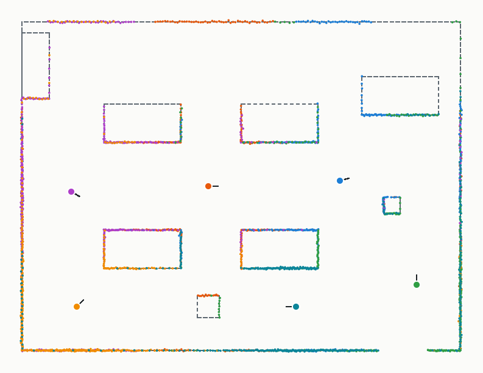
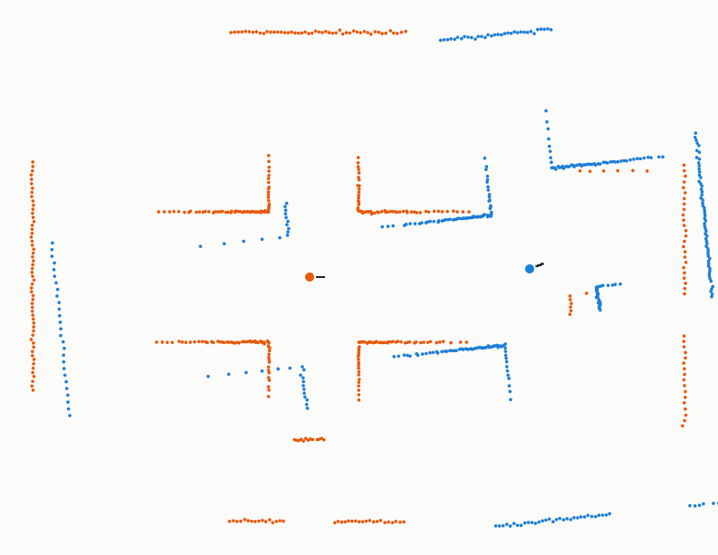
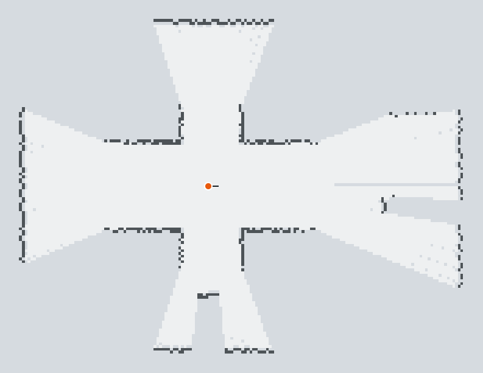
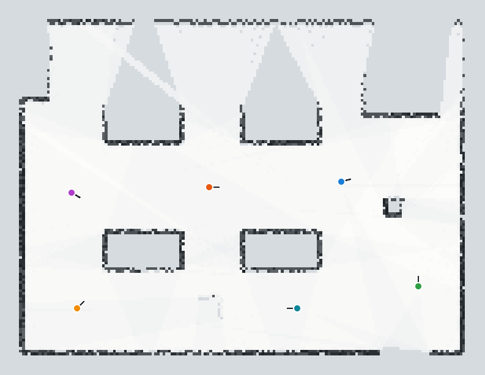
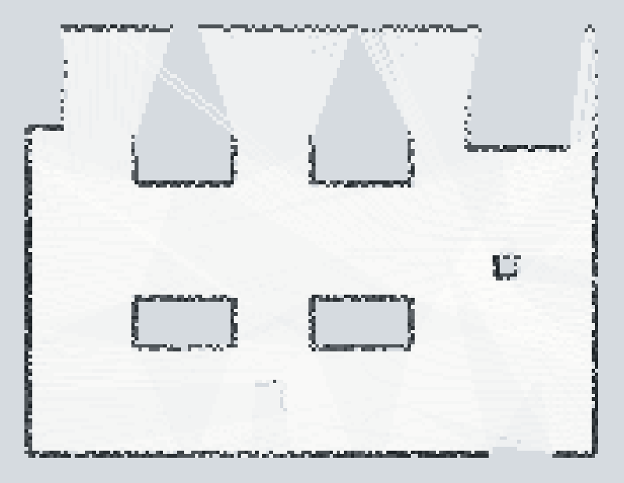
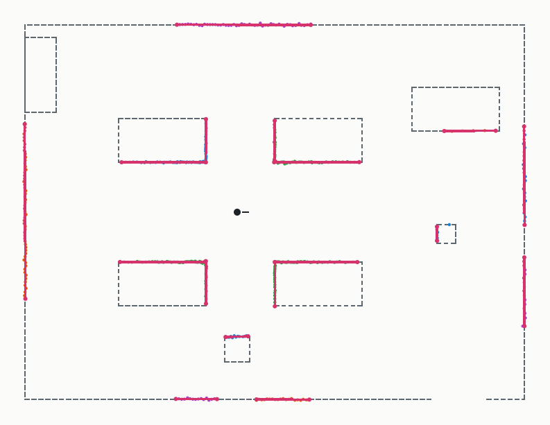
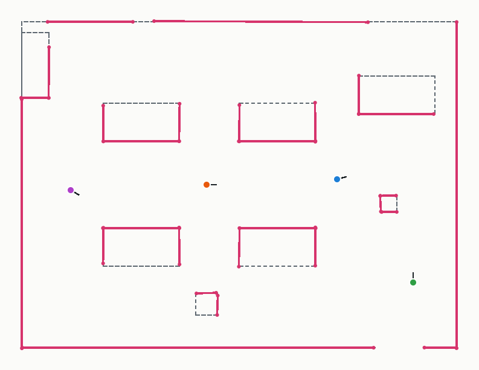
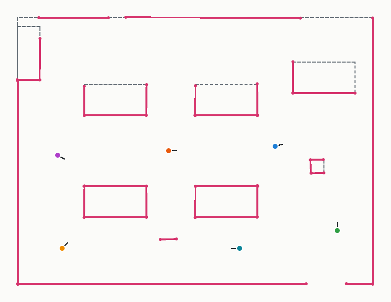
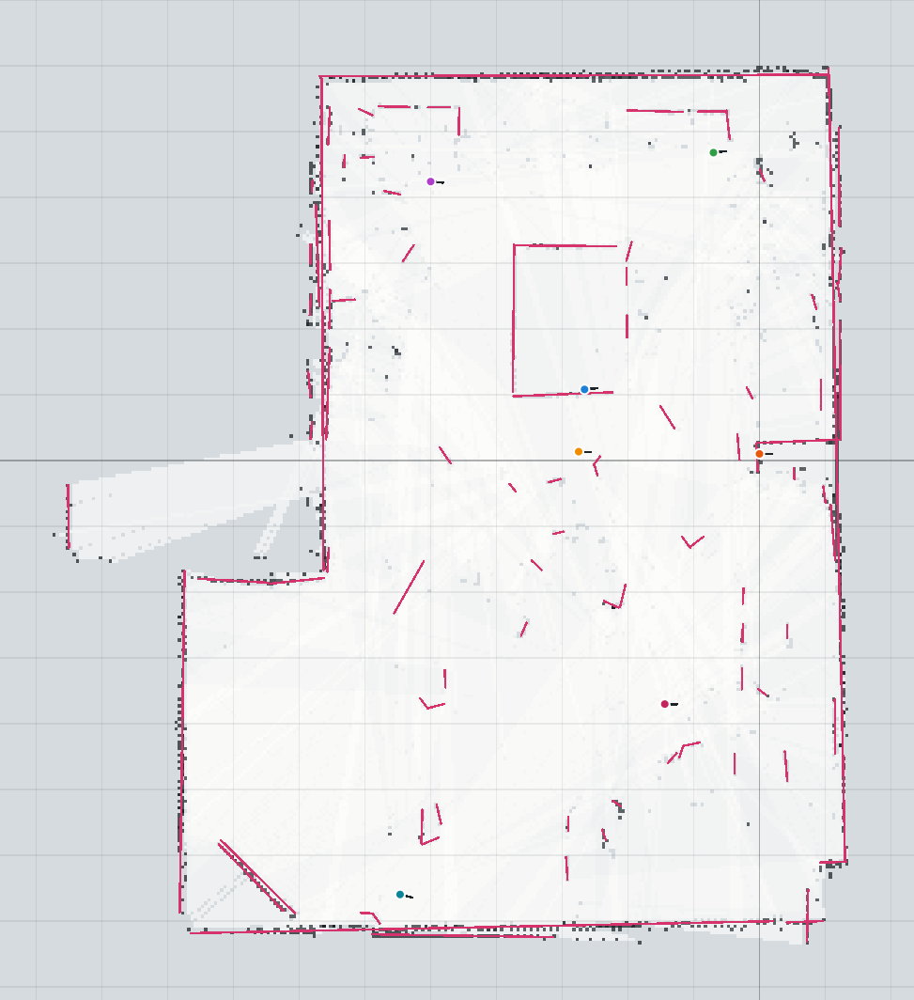
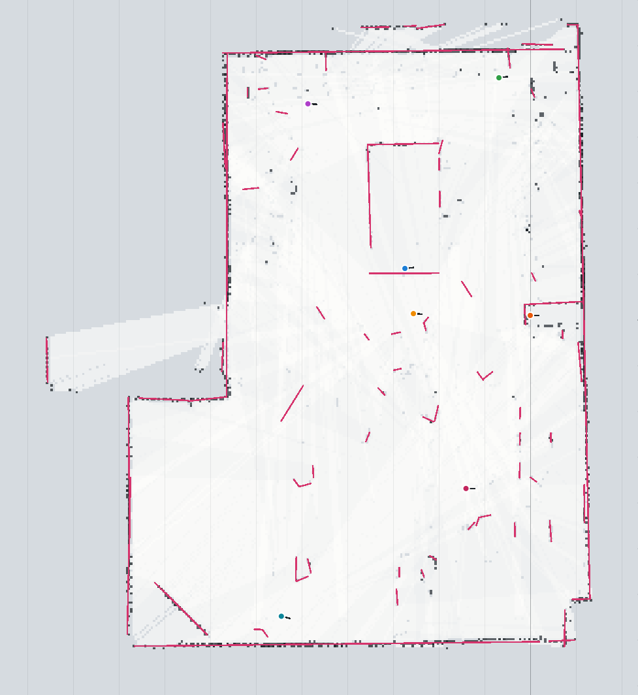

# Jour 1 — Extraction, visualisation et cartographie

Ce document décrit, pour chaque étape du TP, la démarche suivie, les choix techniques,
les hypothèses, les difficultés rencontrées et les limites. Les figures et les mesures
sont reproductibles :

```bash
node scripts/gen-sim.mjs          # jeu de scans simulés (data/sim/)
node scripts/figures-jour1.mjs    # figures (docs/img/) et mesures affichées dans la console
node --test "test/*.test.js"      # 72 tests unitaires
```

> **Données.** Les résultats chiffrés ci-dessous viennent d'un jeu **simulé** dont la vérité
> terrain est connue (salle de 8 m × 6 m, 6 scans, poses exactes). Les scans réels de la salle
> sont à acquérir avec le robot (voir §1) et à déposer dans `data/real/`. Tous les outils les
> lisent sans modification.

## Choix de l'environnement

- **JavaScript (modules ES) sans dépendance**, une seule librairie `src/core/` utilisée :
  - par l'application web interactive (`app/`), pour l'affichage et la manipulation des poses ;
  - par Node.js, pour les tests (`node --test`), les outils en ligne de commande et les figures.
- Même technologie que les outils fournis (MapTool, RobotControl) : l'application pourra
  interroger le robot en Wi-Fi au jour 3 (bonus temps réel) sans passerelle.
- Conventions identiques aux outils du module : pose `(x, y, θ)`, mètres et degrés,
  X vers la droite, Y vers le haut, angles antihoraires.

## 1. Extraction des données lidar

**Chaîne d'acquisition.** LD06 → UART 230 400 bauds → ESP32 (librairie LD06) → Wi-Fi
(`/scan`, binaire `8 + 5N` octets) → RobotControl → export CSV
`angle_deg,distance_m,intensity` avec la pose dans une ligne `#`.

Points relevés en lisant la librairie et le protocole (détails dans les échanges du module) :

- trame de 47 octets : en-tête `0x54 0x2C`, vitesse, angle de début, 12 × (distance, intensité),
  angle de fin, horodatage, CRC-8 (polynôme 0x4D, table vérifiée) ;
- la librairie convertit l'angle horaire du capteur en angle antihoraire (`360 - angle`) :
  **l'angle des CSV RobotControl est déjà en convention mathématique**, il ne faut pas
  l'inverser une seconde fois ;
- interpolation de la librairie `début + (i + 0,5)·plage/12` ≠ constructeur `début + i·plage/11` :
  écart de ±0,43° sur la trame d'exemple du constructeur (≈ 2 cm à 3 m) ;
- les x/y calculés par la librairie (Teleplot) ont le signe de y inversé : ils ne sont pas
  utilisés, les coordonnées sont recalculées à partir de l'angle et de la distance ;
- RobotControl ne publie pas un scan de plus de 460 points (≈ 450 à 10 tours/s) ;
- `r = 0` signifie « pas d'impact » : ces points sont éliminés.

**Lecture des fichiers** (`src/core/scan.js`). Trois formats sont reconnus d'après l'en-tête :
RobotControl, MapTool (`r_m`, angle bruité repris de `x_rel_m, y_rel_m`) et capture série de
la librairie (`printScanCSV`, distances en mm). Un filtre élimine les points sans impact,
hors de [5 cm ; 12 m] et sous un seuil d'intensité réglable.

**Données simulées** (`src/core/sim.js`, `scripts/gen-sim.mjs`). Même principe que MapTool
(lancer de rayons contre des segments), avec les défauts du LD06 : 450 mesures par tour,
premier angle aléatoire, bruit gaussien σ = 1 cm (hypothèse), 1 % de mesures perdues, portée
12 m, arrondi au mm et au 0,01° comme l'échange RobotControl. La salle contient des tables,
un bureau, un poteau, une armoire, une porte, et un carton présent dans les scans 1 à 4 puis
retiré pour les scans 5 et 6 (test de la gestion des objets déplacés).

**Acquisition avec le programme de test** (`ESP32_LD06_Test.ino`). Sa sortie Teleplot
(`>lidar:x:y;…|xy`, x et y en mm) est collée directement dans l'application. Deux corrections
sont nécessaires :

- la librairie calcule `y = −d·sin(angle)` alors que l'angle est déjà antihoraire : le nuage
  est en miroir, et le lecteur rétablit `y = +d·sin(angle)` ;
- des trames sont perdues pendant l'envoi du texte. Sur un tour réel de la salle, 508 points
  ont été reçus avec un pas de 0,45° (environ 800 points attendus par tour), et le plus grand
  trou fait 74°. Un scan reste néanmoins **un seul tour**. Une première version fusionnait
  les derniers tours pris « depuis la même position », jugée sur l'écart médian entre tours.
  Elle a été abandonnée : une rotation de 2 à 3° du robot entre deux tours garde un écart
  médian faible mais dédouble les murs lointains, ce qui biaise le scan.

Le même tour a donné 37 segments, avec un écart quadratique de 6 à 12 mm autour des droites
ajustées. C'est le bruit réel du LD06, contre 1 cm supposé dans la simulation.

**Variante sans perte : capture USB à la demande** (`firmware/ESP32_LD06_Capture`). Le programme de test fourni envoie
chaque tour au format Teleplot en continu. Cela pose deux problèmes :
- les x/y Teleplot sont en miroir ;
- la liaison USB à 115 200 bauds est plus lente que le lidar, donc des octets du lidar sont
  perdus pendant chaque envoi.

Le programme de capture, dérivé du test (même câblage), lit le lidar en continu et n'envoie
un scan que sur demande (caractère `s`). Il attend deux tours complets lus sans interruption,
puis renvoie le dernier au format CSV `angle_deg,distance_m,intensity`, avec la vitesse de
rotation et le compteur d'erreurs CRC en commentaire. Dans l'application, le bouton
**Capturer un scan** dialogue avec l'ESP32 par l'API Web Serial (Chrome, Edge). Le scan
capturé part de la pose du scan sélectionné, puisque le robot a peu bougé.

**Poses sans instrument de mesure.** Le premier scan définit le repère : origine à la
position du robot, axe X dans la direction où il regarde. Chaque scan suivant est recalé à
la main sur les précédents dans l'outil de visualisation, et sa pose est lue une fois les
murs superposés. Pour l'incertitude de ces poses de référence, un même scan est recalé
deux fois en partant de zéro et l'écart obtenu est noté. Avant la campagne, vérifier
l'orientation avec une boîte posée à 50 cm devant le robot (elle doit apparaître vers 0°),
puis à sa gauche (vers 90°).

## 2. Visualisation des nuages de points

`node serve.mjs` puis http://localhost:8080/.

- Chargement de plusieurs scans (bouton, glisser-déposer, ou « Jeu simulé ») ; chaque scan a
  sa couleur (modifiable) et peut être masqué.
- Pose de chaque scan modifiable indépendamment : champs x, y, θ ; glisser le scan pour le
  translater ; Maj + glisser pour le tourner autour du robot ; flèches (±1 cm, ±10 cm avec Maj),
  Q/A et E (±0,5°, ±5° avec Maj).
- Option « angles bruts horaires » par scan, pour des données non converties.
- Export d'un scan avec sa pose corrigée (format RobotControl), capture PNG de la vue.



*Les 6 scans, une couleur par scan, superposés avec leur pose vraie. Pointillés : la salle simulée.*



*Scans 1 et 2 avec la pose du scan 2 faussée de +30 cm et +6° : les murs se dédoublent.
Recaler ce scan à la main dans l'outil revient à faire « à l'œil » le scan matching du jour 2.*

**Choix.** Les points et les segments de chaque scan sont calculés une fois dans le repère du
robot puis seulement transformés par la pose à l'affichage : déplacer un scan reste fluide.

## 3. Grid map

**Représentation** (`src/core/gridmap.js`). Grille probabiliste stockée en **log-odds**
`l = ln(p / (1 − p))` (`Float32Array`), 0 = inconnu. La mise à jour bayésienne d'une cellule
devient une addition :

| Événement | Ajout au log-odds | p après une observation |
| --- | --- | --- |
| Cellule d'impact | +0,85 | 0,70 |
| Cellule traversée | −0,40 | 0,40 |
| Bornes | [−4 ; +4] | [0,018 ; 0,982] |

Les bornes laissent la carte « changer d'avis » (objet déplacé). Classement : occupé si
p ≥ 0,6, libre si p ≤ 0,45, sinon inconnu ; une seule observation suffit donc à classer une
cellule. Résolution par défaut 5 cm (compromis : le bruit du LD06 est d'environ 1 cm, et une
salle de 8 × 6 m tient en 200 × 160 cellules). Propriétés supplémentaires par cellule :
nombre d'impacts et numéro du dernier scan qui l'a observée. Export sur un octet
(0 = libre, 128 = inconnu, 255 = occupé), import des grilles MapTool.

**Algorithme** (étapes du document de cours) :

1. points filtrés → repère monde `P = R(θ)·p + T` → cellule `i = ⌊x / rés⌋` ;
2. cellules traversées : tracé de **Bresenham** du robot vers l'impact → `−0,40` ;
3. cellule d'impact → `+0,85`.

Outils : `gridFromScan(scan, pose)` crée une carte, `updateGrid(carte, scan, pose)` renvoie la
carte mise à jour. La grille s'agrandit automatiquement si un scan sort de ses limites.

**Difficultés rencontrées et solutions :**

- *Une cellule traversée par des dizaines de faisceaux près du robot* recevait des dizaines de
  mises à jour par scan. → Une seule mise à jour par cellule et par scan (tampons de numéro
  de scan), et **l'occupation l'emporte** : une cellule où un faisceau s'arrête n'est pas
  libérée par un faisceau voisin qui la traverse en incidence rasante.
- *Murs pointillés.* Un impact bruité situé juste derrière un mur libérait la cellule du mur
  qu'un autre faisceau venait de marquer occupée (cas extrême : mur exactement sur une frontière
  de cellule). → Les faisceaux ne libèrent rien dans les **5 derniers centimètres** avant
  l'impact (≈ 5σ du bruit). Gain : +3,6 % de cellules de mur (1 205 contre 1 163).
- *Hachures loin du robot.* Deux faisceaux voisins sont espacés de `r·dθ` (5,6 cm à 4 m pour
  0,8°) : des cellules libres ne sont jamais traversées. → **Faisceaux intermédiaires** (libres
  seulement) entre deux impacts consécutifs d'une même surface : +4,6 % de cellules libres sur
  un scan seul.
- *Affichage.* Un rendu linéaire de p rendait gris moyen une cellule libre vue une fois.
  → Rendu par classe (blanc libre, gris-bleu inconnu, noir occupé) nuancé par la confiance.

**Nettoyage** (boutons de l'application) : décroissance temporelle des cellules non observées
au dernier scan (retour vers l'inconnu) et suppression des cellules occupées isolées.



*Grid map créée depuis le scan 1 seul : les zones d'ombre derrière les tables restent inconnues.*



*Mise à jour avec les 5 autres scans. Le carton, vu par les scans 1 à 4 puis retiré, a été
effacé par les faisceaux des scans 5 et 6.*



*Même carte sans marge avant l'impact ni faisceaux intermédiaires : murs pointillés.*

**Mesures** (vérité terrain = salle sans carton) :

| | Valeur |
| --- | --- |
| Cellules occupées à moins de 4,5 cm d'un mur réel | 1 204 / 1 205 (99,9 %) |
| Murs vus couverts par une cellule occupée | 98,8 % |
| Temps : 1 scan / 6 scans | 1,0 ms / 3,4 ms |

**Limites.** Résolution fixe ; tout ce qui n'est pas un impact reste « inconnu » (les
mesures perdues ne libèrent rien) ; la qualité dépend entièrement de la justesse des poses
(une erreur de pose épaissit ou dédouble les murs).

## 4. Extraction et manipulation de segments

### Nuage de points → segments (`src/core/segmentation.js`)

1. **Clusters.** Points parcourus dans l'ordre angulaire ; coupure quand la distance entre
   deux points successifs dépasse le seuil adaptatif de Borges & Aldon
   `D = r·sin(dθ) / sin(λ − dθ) + 3σ` (λ = 10°, σ = 1 cm). Le seuil grandit avec la distance :
   deux points voisins d'un même mur sont plus espacés loin du robot. Coupure systématique
   au-delà de 5° sans mesure.
2. **Split** (Douglas-Peucker) : coupe récursive au point le plus éloigné de la corde tant que
   l'écart dépasse 3 cm (coins, objets accolés).
3. **Ajustement** par moindres carrés **totaux** (ACP) : minimise la distance perpendiculaire,
   valable pour un mur vertical (contrairement à `y = ax + b`).
4. **Merge** des morceaux consécutifs qui tiennent sur une même droite. Segments gardés :
   au moins 5 points et 15 cm.

Difficultés : le mur qui contient l'angle 0° était coupé en deux (début et fin du tour) → le
dernier cluster est raccordé au premier s'ils sont continus ; quand la pièce entière forme
une seule boucle fermée, elle est redémarrée sur un coin avant le split.



*Scan 1 : clusters (couleurs alternées) et segments extraits (rose). Le mur de droite est
interrompu par l'ombre du poteau, le mur du bas par celle du carton.*

### Opérations sur les segments (`src/core/geometry.js`)

| Fonction | Définition retenue |
| --- | --- |
| `angleBetweenDeg` | Angle entre droites supports, dans [0° ; 90°] : un mur n'a pas de sens de parcours |
| `areClose` | Proches si angle ≤ 10°, **et** écart perpendiculaire des extrémités du plus court à la droite du plus long ≤ 8 cm, **et** trou longitudinal ≤ 20 cm |
| `mergeSegments` | Direction = moyenne pondérée sur l'**angle double** (0° et 180° donnent 0°, pas 90°) ; droite passant par le barycentre pondéré des milieux ; étendue = projections extrêmes des 4 extrémités. Poids = nombre de points |
| `intersect` | Résolution paramétrique `P1 + t·r = Q1 + u·s` ; distingue point, sécantes hors segments, parallèles, colinéaires (avec ou sans recouvrement), dégénéré |
| `cutSegment` | Découpe et garde le plus long côté (règles ci-dessous) |

**Découpage — règles et tolérance.** Tolérance numérique **EPS = 1 µm** : très inférieure au
bruit du lidar (1 cm), très supérieure aux erreurs d'arrondi sur des coordonnées de quelques
mètres (~10⁻¹⁵ m). Un point à moins de EPS d'un segment est sur le segment ; deux longueurs
qui diffèrent de moins de EPS sont égales.

- l'intersection doit être sur les deux segments (à EPS près) ;
- elle doit être strictement à l'intérieur du segment coupé : à plus de EPS de chaque extrémité,
  sinon rien ne change ;
- segments colinéaires ou parallèles : pas de découpe ;
- longueurs égales à EPS près : on garde le côté contenant le premier point P1 ;
- le côté conservé garde le sens du segment d'origine.

Cas limites testés (`test/geometry.test.js`) : croisement franc des deux côtés ; intersection
exactement à une extrémité, à EPS/2 et à 3·EPS d'une extrémité ; segment coupant qui s'arrête
sur le segment (en T), juste avant (1 mm) et à EPS/2 ; intersection hors du segment ;
colinéaires qui se recouvrent, se touchent ou non ; parallèles ; moitiés égales dans les deux
sens de parcours ; longueurs différant de EPS/2 (côté P1) et de 2·EPS (côté le plus long) ;
segments de longueur nulle ; croisement oblique en coordonnées réalistes.

## 5. Carte vectorielle

Étapes du document de cours (`src/core/vectormap.js`), pour chaque scan + pose :

1. points filtrés → repère monde ;
2. **gestion des absences** : chaque faisceau, raccourci de 15 cm avant son impact pour ne pas
   couper l'objet touché, est un segment ; tout segment de la carte qu'il traverse est découpé
   avec `cutSegment` (on garde le plus long côté). Un faisceau trop rasant (< 20° avec le
   segment) ne découpe pas, car il est trop sensible aux erreurs de pose ;
3. extraction des segments du scan (§4) ;
4. chaque nouveau segment est **fusionné** avec les segments proches de la carte, en cascade
   (le segment fusionné peut devenir proche d'un troisième), sinon **ajouté** ;
5. suppression des segments de moins de 15 cm.

Chaque segment garde son poids (nombre de points) et la liste des scans qui l'ont vu (nombre
d'observations exact, même quand un mur sort en deux morceaux d'un même scan).
Export au format des outils du module (`x1,y1,x2,y2` par ligne). La construction est
intégrée à l'outil du point 3 (même application, même ligne de commande).

| Scan | Extraits | Fusionnés | Ajoutés | Découpes | Total |
| --- | --- | --- | --- | --- | --- |
| 1 | 17 | 0 | 17 | 0 | 17 |
| 2 | 18 | 11 | 7 | 0 | 24 |
| 3 | 12 | 14 | 2 | 0 | 22 |
| 4 | 16 | 11 | 5 | 1 | 27 |
| 5 (carton retiré) | 11 | 9 | 2 | 10 | 28 |
| 6 (carton retiré) | 9 | 9 | 0 | 2 | 28 |



*Après les scans 1 à 4 : deux faces du carton (dessus et côté droit, en bas de la salle) sont
dans la carte. Les faces jamais vues des tables restent en pointillés.*



*Après les 6 scans, le carton ayant été retiré : sa face droite, traversée par les faisceaux
des scans 5 et 6, a été découpée jusqu'à disparaître ; sa face supérieure, que ces faisceaux
ne croisent qu'en rasant, reste. Pointillés : la salle sans carton.*

**Mesures** : 28 segments, 41,9 m de murs. Écart à la vérité terrain échantillonné tous les
2 cm : moyen **1,4 mm**, médian 0,8 mm, 95 % sous 5,6 mm, max 14,2 mm. Un seul segment sans
correspondance : la face supérieure du carton (36 cm), voir les limites. Temps : 12 ms pour
les 6 scans.

**Limites.**

- La face du carton parallèle aux faisceaux n'est jamais traversée sous plus de 20° depuis les
  poses 5 et 6 : elle reste dans la carte. Baisser le seuil la supprimerait, au prix de
  découpes parasites dès que la pose est imprécise. Une suppression par vieillissement (segment
  non revu depuis N scans alors qu'il était dans le champ) serait plus robuste.
- La gestion des absences suppose des poses justes. Dans l'application, décaler un scan de
  30 cm et reconstruire produit 320 découpes : avec des données réelles, elle ne doit être
  activée qu'une fois les scans recalés (jour 2).
- Seuls des segments sont représentés : pieds de chaise, poteaux ronds ou personnes donnent
  des clusters trop courts, ignorés.
- Les seuils (8 cm, 10°, 20 cm, 3 cm) sont réglés pour le bruit simulé ; ils seront à
  revalider sur les scans réels.

## 6. Données réelles, reconstruction propre et exports

**Recalage des scans réels.** Les poses des scans de la salle ont été posées à la main dans
l'outil de visualisation, puis affinées par le bouton « Recaler automatiquement » : recherche
exhaustive multi-résolution sur un champ de distance, puis ICP, chaque scan étant aligné sur
tous les autres (deux passes). Sur 7 scans réels, la part des points à moins de 10 cm d'un
autre scan passe de 45 % (poses manuelles) à 60 % ; un scan décalé de 60 cm à la main a été corrigé.




**Reconstruction propre** (`src/core/cleanup.js`), pour un rendu lisible comme un plan (style MapTool) :

- grid map : suppression des poussières (groupes de moins de 3 cellules occupées), ouverture
  morphologique de l'espace libre (retire les faisceaux sortis par les fenêtres : le lidar ne voit
  pas les vitres), seules les zones libres reliées à une position du robot sont gardées, petits
  trous bouchés, murs fermés le long du sol ;
- carte vectorielle : direction dominante des murs (histogramme des orientations pondéré par la
  longueur), segments à moins de 7° redressés sur cette direction ou sa perpendiculaire, fusion
  des morceaux d'un même mur, coins fermés, segments hors de la pièce retirés, **oubli des
  segments rarement vus** (option « vus par au moins N scans », comme la carte SLAM de la
  présentation RoboCup qui oublie les segments rarement observés) ;
- **coins** (points d'intérêt orientés du document « carte vectorielle ») : intersection de deux
  murs presque perpendiculaires qui se rejoignent, avec la direction de la bissectrice.

**Exports** (bouton « Exporter tout le jour 1 ») : 7 figures avec titre, échelle et légende
(nuages de points, grid map brute et propre, segments extraits, carte vectorielle brute et
propre, plan de la salle), grid maps (CSV) et cartes vectorielles (TXT) brutes et propres,
coins, poses, et deux fichiers directement importables dans MapTool (coordonnées décalées en
positif, dimensions de la scène indiquées en tête du fichier).
