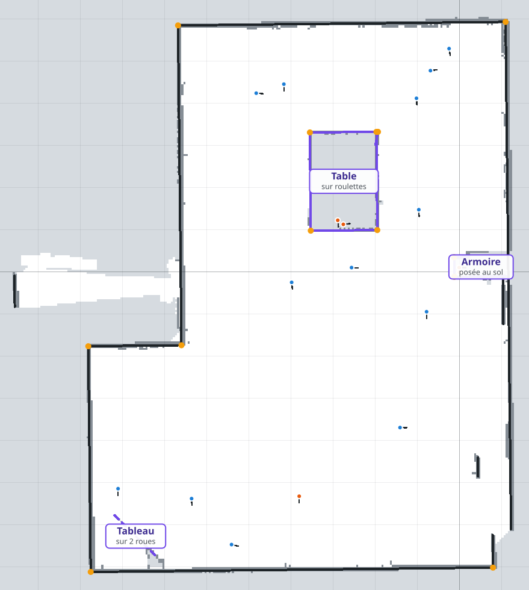

# Jour 2 — Localisation (scan matching)

Objectif (énoncé et présentation du module) : aligner un scan lidar sur une référence, d'abord
à la main puis automatiquement, sur trois types de référence, avec une évaluation chiffrée.
Code : `src/core/localization.js` (méthodes), `src/core/matching.js` (champ de distance, ICP),
application : panneau **Localisation (jour 2)**, banc d'essai : `scripts/benchmark-jour2.mjs`.

## Carte de référence figée

Pour localiser un scan, il faut une carte qui ne bouge plus. Les cartes « des scans visibles »
de l'application sont reconstruites à chaque changement de pose ; la **carte de référence** est
au contraire figée une fois pour toutes et enregistrée dans un fichier. Les nouveaux scans
(pris au hasard dans la salle) sont ensuite localisés sur elle, sans la modifier.

Contenu du fichier `data/reference/carte_reference.json` (module `src/core/refmap.js`) :

| Partie | Contenu |
| --- | --- |
| Grid map | Valeurs 0..255 par cellule (0 libre, 128 inconnu, 255 occupé), compressées par plages de valeurs identiques : 85 000 cellules tiennent en 12 ko |
| Carte vectorielle | Segments `[x1, y1, x2, y2]` en mètres, et coins `[x, y, θ]` |
| Traçabilité | Nom, date, version propre ou brute, scans ayant servi et leurs poses recalées |

Construction de la carte de la salle :

```bash
node scripts/build-reference.mjs
```

Le script relit tous les scans réels de `data/real/` avec leur pose de départ (posée à la main),
les recale automatiquement (multi-résolution + ICP, chaque scan face à tous les autres, en
2 secondes), construit la grid map et la carte vectorielle, garde leur version propre et écrit
la carte, les poses recalées (`data/reference/poses_recalees.csv`) et un aperçu.

### Scans ajoutés pour améliorer la carte (3 novembre)

Aux 7 scans du 2 novembre s'ajoutent 11 scans pris le 3 novembre et exportés depuis
LidarScope (export brut gardé dans `data/real/lidarscope_20261103/`). Import :

```bash
node scripts/import-lidarscope.mjs data/real/lidarscope_20261103 --prefix scan_1103_ls
```

1. **Un seul tour par scan.** 6 des 11 fichiers enchaînent 2 à 3 rotations (693 à 870 points
   pour environ 300 par tour). `singleTour` (`src/core/scan.js`) garde la plus longue suite de
   points, dans l'ordre d'acquisition, qui tient dans 360° : un tour complet sans doublon
   d'angle, et le plus complet si des trames ont été perdues.
2. **Changement de repère.** LidarScope a son propre repère (origine et axes choisis dans
   l'outil). L'export contient aussi notre scan `scan_1102_175527`, réimporté : il sert d'ancre.
   T = (pose dans notre repère) ∘ (pose LidarScope)⁻¹ = (−0,610 m ; −4,672 m ; −89,0°), appliqué
   aux 11 autres scans.
3. **Recalage commun** des 18 scans (`build-reference.mjs`).

Trois départs ont été comparés pour le recalage commun (même algorithme, seules les poses de
départ changent) :

| Départ | Points cohérents (10 cm) | Cohérence à 5 cm | Cellules occupées |
| --- | --- | --- | --- |
| Nos 7 scans à leurs poses recalées d'hier + poses LidarScope | 80 % | 68 % | 1413 |
| Nos 7 scans à leurs poses recalées d'hier + nouveaux scans localisés sur l'ancienne carte | 82 % | 70 % | 1402 |
| **Nos 7 scans à leurs poses manuelles + poses LidarScope** (retenu) | **82 %** | **71 %** | **1376** |

Moins de cellules occupées signifie des murs plus fins, donc mieux superposés. Le départ retenu
donne aussi la carte la plus propre à l'œil : mur du haut en un seul trait, rectangle central
fermé.

**Erreur corrigée dans l'ancienne carte.** Le recalage automatique du 2 novembre avait fait
glisser deux scans du haut de la salle (`180026` et `180105`) d'environ 50 cm le long des murs :
dans cette zone, des murs longs et parallèles laissent la translation mal contrainte. Les
nouveaux scans lèvent l'ambiguïté : en y, ces deux scans reviennent à 9 cm et 0 cm de leurs
poses manuelles (ils en étaient à 62 et 49 cm). Le recalage automatique n'est donc fiable
qu'avec assez de recouvrement entre scans.

### Scans pris en hauteur

Deux scans ont été pris le robot **posé sur un meuble** : le premier (`175527`, origine de la
carte) **sur l'armoire**, le deuxième (`175930`) **sur la table du milieu**, sur trois boîtes. Tous
les autres ont été pris au sol. Un scan pris en hauteur coupe la salle à une autre hauteur : il
passe **au-dessus** des meubles et ne voit presque que des murs. Trois scans LidarScope ont la
même signature :

| Scan | Points sur les murs | Points à moins de 1 m | Portée médiane | Pris |
| --- | --- | --- | --- | --- |
| `175527` | 96 % | 0 | 6,0 m | sur l'armoire (indiqué) |
| `175930` | 77 % | 0 | 4,9 m | sur la table (indiqué) |
| `ls09` | 100 % | 0 | 6,1 m | sur l'armoire (même vue que `175527` à 97 %) |
| `ls08` | 67 % | 1 | 4,7 m | sur la table (même vue que `175930` à 67 %) |
| `ls12` | 94 % | 0 | 5,3 m | en hauteur, support à confirmer |
| 13 autres | 10 à 62 % | 9 à 220 | 0,7 à 2,8 m | au sol |

Ces scans sont marqués dans leur fichier par une ligne `# pris en hauteur : ...` (case « Scan
pris en hauteur » dans l'application ; `looksElevated` signale un scan qui en a l'air : rien à
moins de 1 m et portée médiane d'au moins 4 m). Ils servent au **recalage** (ils voient les murs
de loin) et à la **frontière de la salle** (les grands murs qu'ils voient par-dessus les
meubles), mais pas aux cartes : grid map, carte vectorielle et meubles sont construits avec les
13 scans au sol, à la hauteur du robot qui se localisera.

Conséquence : les mesures précédentes sur la table étaient faussées. Ses cellules étaient
effacées en partie par les faisceaux des scans pris en hauteur, qui passaient **au-dessus**, et
ces faisceaux comptaient comme « passés dessous ».

| Mesure | 7 scans (2 nov.) | 18 scans (3 nov.), cartes avec les 13 scans au sol |
| --- | --- | --- |
| Points cohérents entre scans | 45 % → 60 % | 75 % → 82 % |
| Grid map | 279 × 304 cellules de 5 cm | 277 × 302 cellules de 5 cm |
| Carte vectorielle | 31 segments, 9 coins | 19 segments : 10 murs et 3 meubles nommés (table, armoire, tableau), 13 coins |
| Emprise | 12,6 m × 13,9 m | 12,6 m × 14,0 m |



*Carte à 18 scans avec ses étiquettes. Sol blanc, inconnu gris (dont l'intérieur de la table et
le dessous des bureaux, invisibles depuis le sol), murs en noir, meubles en violet : table du
milieu, armoire contre le mur de droite, tableau en diagonale dans le coin en bas à gauche (trait
plein : posé au sol pour le lidar ; pointillés : le lidar passe dessous) ; coins orange ; robots
au sol en bleu, robots posés en hauteur en orange. Sans étiquettes :
[j2_carte_reference.png](img/j2_carte_reference.png) ; ancienne carte à 7 scans :
[j2_carte_reference_7scans.png](img/j2_carte_reference_7scans.png).*

**Carte sémantique.** Seuls trois meubles de la salle sont réels et fixes : la **table** du
milieu, l'**armoire** et le **tableau**. Ils sont nommés à la main dans
`data/reference/etiquettes.json` (nom, détail, zone dans le repère de la carte) :

| Étiquette | Détail | Zone (m) |
| --- | --- | --- |
| Table | sur roulettes | x de −3,7 à −1,8, y de 0,85 à 3,45 |
| Armoire | posée au sol | x de −0,3 à 1,25, y de −0,3 à 0,5 |
| Tableau | sur 2 roues | x de −8,3 à −6,95, y de −7,0 à −5,65 |

Un objet fixe détecté dans une zone prend le nom du meuble ; les autres objets détectés (bureaux,
meubles le long des murs) ne correspondaient pas à la réalité : ils sont retirés de la carte
vectorielle, et la grid map garde ce qu'elle voit à leur place. Les étiquettes sont enregistrées
dans la carte de référence et affichées dans l'application (case « Étiquettes ») et sur les
figures 06 et 07. Le détail « sur roulettes » de la table vient de l'observation : le lidar,
lui, voit la table comme un bloc (voir plus bas).

**Deux couches de grid map.** La carte de référence enregistre :

- le **plan**, pour l'humain (`semanticPlan`) : dans la salle, seuls les murs et les trois
  meubles restent ; le reste de l'intérieur devient du sol, y compris le dessous des bureaux que
  le lidar au sol ne voit pas. L'extérieur ne change pas (il n'entre pas par une ouverture de
  moins de 60 cm). C'est ce que montrent la vue propre, les figures et l'aperçu ;
- la **grid map de localisation**, pour le robot : tout ce que le lidar voit depuis le sol, y
  compris les pieds de bureaux et les rangées de chaises. Ce « fouillis » n'a rien à faire sur un
  plan, mais il sert de repère : localisés sur le plan seul, les scans du haut de la salle
  glissent de 47 cm le long des murs parallèles (14/18 réussites au lieu de 18/18).

**Objets fixes.** Les meubles (table, armoire, tableau) sont gardés dans la carte propre
(méthode : [algorithmes.md](algorithmes.md), § 6). Ils disparaissaient auparavant : dans la grid
map, des faisceaux effaçaient leurs cellules (17 cellules occupées pour 8 m de contour de table),
et la découpe par les absences effaçait leurs segments (8,3 m → 0,2 m pour la table). Ils sont
maintenant reconnus parce que plusieurs scans les voient (2 à 5 scans par côté), alors que le
fouillis (chaises, sacs) n'est vu que par un scan. Depuis le sol, le mur derrière l'armoire
n'est pas vu : ce sont les grands murs vus d'en haut qui ferment la salle à cet endroit.

**Meubles surélevés.** Pour chaque meuble, on compte, avec les scans au sol, les faisceaux qui
s'arrêtent dessus et ceux qui passent dessous pour toucher quelque chose derrière :

| Meuble | Faisceaux passés dessous | Classement |
| --- | --- | --- |
| Armoire (contre le mur de droite) | 1 % | posée au sol |
| Table du milieu | 4 % | posée au sol (pour le lidar) |
| Tableau (coin en bas à gauche) | 61 % | surélevé |

Seuil : 15 %. Un meuble surélevé est dessiné en **pointillés** (convention des plans d'architecte
pour ce qui est au-dessus du sol) et ses cellules sont « occupées en partie » (gris clair,
p = 0,75 : il reste un obstacle pour le robot) ; un meuble posé au sol est en trait plein.

**La table est sur roulettes, mais le lidar ne passe pas dessous** : 4 % seulement des faisceaux
des scans au sol la traversent, comme l'armoire. L'espace entre le sol et la table est plus bas
que le plan du lidar : pour un lidar 2D à cette hauteur, la table est un bloc. Le tableau, sur
deux pieds, laisse passer 61 % des faisceaux. Le 23 % mesuré d'abord pour la table venait des
scans pris en hauteur. Montrer que la table est sur roulettes demande donc une information que
le capteur ne mesure pas (étiquette ajoutée à la main, carte sémantique).

Dans l'application, section **Carte de référence (jour 2)** :

- **Charger la carte de la salle** : relit `data/reference/carte_reference.json` ;
- **Charger…** : une autre carte de référence enregistrée ;
- **Figer les cartes actuelles** : les cartes des scans visibles (version propre ou brute)
  deviennent la référence ; **Enregistrer…** la télécharge ;
- la carte s'affiche en fond (sol blanc, murs gris) et le panneau Localisation propose les
  références « Carte de référence : vectorielle » et « Carte de référence : grid map ».

Vérification sur les 18 scans : chacun est placé à 25 cm, 15 cm et 8° de sa pose recalée
(29 cm d'écart), puis localisé sur la carte de référence. Réussite = moins de 5 cm et de 2°.
Les scans ont servi à construire la carte : c'est un contrôle de cohérence, pas encore
l'évaluation sur des scans de test indépendants.

| Référence | Méthode | 7 scans | 18 scans, murs + fouillis | 18 scans, carte finale (au sol / en hauteur) | Erreur médiane | Temps |
| --- | --- | --- | --- | --- | --- | --- |
| Grid map de localisation | Multi-résolution | 13/18 | 13/18 | **18/18** (13/13, 5/5) | 2,2 cm / 0,25° | 103 ms |
| Grid map de localisation | Descente de gradient | 11/18 | 13/18 | **18/18** (13/13, 5/5) | 2,4 cm / 0,13° | 6 ms |
| Plan (murs et 3 meubles) | Multi-résolution | – | – | 14/18 (10/13, 4/5) | 3,2 cm / 0,25° | 106 ms |
| Plan (murs et 3 meubles) | Descente de gradient | – | – | 16/18 (11/13, 5/5) | 3,5 cm / 0,28° | 3 ms |
| Carte vectorielle | Multi-résolution | 13/18 | 17/18 | 15/18 (10/13, 5/5) | 1,4 cm / 0,50° | 95 ms |
| Carte vectorielle | Calcul direct | 13/18 | 10/18 | 14/18 (9/13, 5/5) | 1,3 cm / 0,45° | 3 ms |

- La **grid map** de référence relocalise les 18 scans : c'est la référence proposée par défaut
  avec la carte de la salle (multi-résolution).
- La carte vectorielle finale ne garde que les murs et les trois meubles nommés : plus juste,
  mais avec moins de repères pour les scans pris près des murs encombrés (bureaux du haut).
  Ses échecs sont pour la plupart juste au-dessus du seuil de 5 cm.
- Sur la grid map, l'erreur médiane de 2 à 3 cm vient de l'épaisseur des murs (cellules de 5 cm).
- Peu de points d'un scan tombent sur la carte (40 à 60 %) même quand la pose est juste : la
  carte propre ne garde ni les chaises ni les pieds des tables mobiles.

## Localisation globale (pose de départ inconnue)

Les méthodes précédentes partent d'une pose approximative (fenêtre ±50 cm, ±20°). Un robot qui
démarre n'importe où dans la salle n'en a pas : la **localisation globale**
(`src/core/globalloc.js`, bouton « Localisation globale (pose inconnue) ») cherche dans toute la
salle.

1. **Positions candidates** : les cellules de sol de la grid map de localisation, tous les 20 cm,
   à au moins 10 cm d'un obstacle : 2 141 positions dans la salle.
2. **Orientations candidates, d'après les murs** : les murs d'une salle sont presque tous
   parallèles ou perpendiculaires. La direction dominante des segments du scan comparée à celle
   des murs de la carte (0,6°) donne l'orientation du robot **à 90° près** : 4 orientations
   (± 4°, pas de 1°), soit 36 au lieu de 180. Si le scan n'a pas de direction nette (moins de
   25 % de ses segments alignés), on teste tous les angles.
3. **Tri** : score de chaque pose (2 141 × 36 = 77 000) sur le champ de distance lissé
   (σ = 15 cm, 150 points du scan).
4. **Affinage** des 6 meilleures poses distinctes (multi-résolution locale ±30 cm, puis ICP),
   classées par la part des points du scan à moins de 5 cm de la carte.
5. **Confiance** : la meilleure candidate est comparée à la deuxième (distante d'au moins 50 cm
   ou 10°) sur les **points qui les départagent** : sur la carte pour l'une et pas pour
   l'autre. Les murs d'une salle presque symétrique s'expliquent des deux façons ; ce sont les
   meubles et les détails qui tranchent. Réponse **ambiguë** si la deuxième a au moins moitié
   autant de « points à elle » que la première, ou si moins de 8 points départagent.

Dans l'application, les trois meilleures candidates sont dessinées (1 en vert = pose retenue, 2 et
3 en orange) et le verdict s'affiche : « Fiable » ou « Ambiguë, à vérifier ».

**Évaluation** (`node scripts/benchmark-global.mjs`, détail dans
[jour2_global.md](jour2_global.md)) : chaque scan est localisé sans pose de départ sur une carte
construite **sans lui**. Réussite = moins de 5 cm et de 2°.

| Jeu | Variante | Réussite | Erreur médiane | Temps moyen | Réponses « fiables » justes | Échecs signalés ambigus |
| --- | --- | --- | --- | --- | --- | --- |
| Simulé (6 scans) | orientations des murs | 6/6 | 0,7 cm / 0,17° | 0,6 s | 6/6 | – |
| Simulé (6 scans) | tous les angles | 6/6 | 1,6 cm / 0,25° | 0,9 s | 6/6 | – |
| Salle, scans au sol (13) | orientations des murs | 10/13 | 1,3 cm / 0,32° | 0,9 s | **11/11** (avec les 5 en hauteur) | **3/3** |
| Salle, scans au sol (13) | tous les angles | 9/13 | 1,4 cm / 0,19° | 1,7 s | 11/13 | 2/4 |
| Salle, scans en hauteur (5) | orientations des murs | 5/5 | 1,6 cm / 0,12° | 0,8 s | | |

- L'**astuce des murs** divise par 5 le nombre de poses testées et par 2 le temps, et rend la
  méthode plus sûre : en testant tous les angles, deux réponses dites fiables sont fausses.
- **Quand la localisation globale se dit fiable, elle a raison** (11 fois sur 11). Les 3 échecs
  sont tous signalés ambigus : `ls02` (scan collé aux bureaux, vue très courte : erreur de 14 m),
  `ls03` (glissement de 53 cm le long des murs parallèles du haut, la même ambiguïté qu'au
  recalage du 2 novembre) et `180026` (6,8 cm, juste au-dessus du seuil). L'indicateur est
  prudent : 4 bonnes réponses sont aussi signalées, leur deuxième candidate étant presque aussi
  plausible (souvent la même pose glissée le long d'un mur).
- Pour un robot, une réponse ambiguë se lève en bougeant un peu et en refaisant un scan, ou en
  suivant plusieurs hypothèses (filtre particulaire), ce qui mène au SLAM du jour 3.

## Références

| Référence | Représentation utilisée | Construction dans l'application |
| --- | --- | --- |
| Grid map | Centres des cellules occupées | Avec les scans visibles autres que le scan à localiser |
| Carte vectorielle | Segments (échantillonnés tous les 2 cm pour les méthodes à base de points) | Idem, ou carte importée (`Référence…`, par ex. une scène MapTool) |
| Scan de référence | Points du scan précédent dans la liste | Scan pris près de la position du scan à localiser |
| Carte de référence | Grid map ou segments de la carte figée | Chargée depuis un fichier, ne change plus |

Pour chaque référence, un **champ de distance** (distance de chaque cellule au point de
référence le plus proche, transformée de chanfrein en deux passes) donne le score d'une pose :
moyenne de exp(−d²/2σ²) sur les points du scan transformés. C'est le « score basé sur la
distance aux cellules occupées » du cours, lissé par σ.

## Méthodes (document « Scan matching », §8)

| Méthode | Principe | Références |
| --- | --- | --- |
| Force brute | Toutes les poses d'une grille 2 cm × 0,5° dans la fenêtre ±50 cm, ±20° | toutes |
| Multi-résolution | Grille grossière (10 cm, 2°, champ lissé σ = 15 cm), puis fine (1 cm, 0,25°) autour des 3 meilleurs candidats | toutes |
| Descente de gradient | Montée sur le score, gradient numérique sur le champ interpolé, pas adaptatif, σ décroissant 15 → 8 → 4 cm | toutes |
| Filtre particulaire (probabiliste) | 400 hypothèses autour de la pose initiale, pondérées par la vraisemblance, rééchantillonnage systématique, bruit décroissant (recuit) | toutes |
| ICP | Plus proche voisin + transformation rigide en forme close, distance d'association décroissante | toutes |
| Calcul direct | Moindres carrés point-droite : chaque point proche d'un segment donne une équation linéaire en (dx, dy, dθ), système 3 × 3 résolu directement ; passes à marge décroissante 25 → 10 → 4 cm | carte vectorielle |

Le **calcul direct** généralise l'algorithme de localisation absolue de l'article « Enhancing
Robot Navigation with a Low-Cost LIDAR and Absolute Localization Algorithm » (équipe Mars
Attacks!, Coupe de Robotique 2024) : l'article sélectionne les points proches des bords d'une
table rectangulaire connue (boîtes AABB), fait une régression linéaire par paire de bords
parallèles et en déduit (x, y, θ) ; il propose comme amélioration plusieurs passes à marge
décroissante (0,100 → 0,025 → 0,010 m). Ici les segments de la carte sont quelconques et la
régression devient un système point-droite à trois inconnues.

## Évaluation chiffrée

Protocole et résultats complets : [jour2_benchmark.md](jour2_benchmark.md) (données brutes en CSV).
Jeu simulé à pose vraie connue ; mêmes scans et **mêmes poses initiales** pour toutes les méthodes ;
4 niveaux de perturbation de 5 cm / 2° à 45 cm / 18° ; réussite = moins de 5 cm et moins de 2°.

Ce qu'il en ressort, conforme au cours :

- **Force brute et multi-résolution** : 100 % de réussite à tous les niveaux, mais 0,2 à 0,4 s
  par scan ; la précision est limitée par le pas de la grille de recherche.
- **ICP et calcul direct** : les plus précis (≈ 1 mm, 0,02 à 0,1°) et rapides (≈ 10 ms), mais
  locaux : la réussite tombe à 50–75 % quand la pose initiale est à 45 cm / 18°.
- **Descente de gradient** : 5 ms, 98 à 100 % de réussite dans la fenêtre grâce au σ décroissant.
- **Grid map** : erreur médiane ≈ 1 cm, liée à la résolution de 5 cm des cellules.
- **Filtre particulaire** : robuste aux grands écarts mais peu précis seul (≈ 3 cm) : il sert
  d'initialisation à une méthode locale.

Combinaison retenue dans l'application (« Recaler automatiquement ») : recherche
multi-résolution sur une large fenêtre, puis ICP, comme la stratégie « Full Search ICP » puis
« Limited search ICP » de la présentation RoboCup MSL 2022.

## Données réelles

`node scripts/benchmark-reel.mjs` applique aux scans réels le protocole de la simulation (4 niveaux
de perturbation, 2 tirages, réussite < 5 cm et < 2°). Tableaux complets :
[jour2_reel.md](jour2_reel.md) (données brutes en CSV).

**A. Scans de la carte, chacun localisé sur des cartes construites sans lui** (13 scans pris au
sol ; pose de référence = pose recalée) :

| Référence | Méthode | Réussite | 5 cm / 2° | 15 cm / 5° | 30 cm / 10° | 45 cm / 18° | Erreur médiane | Temps |
| --- | --- | --- | --- | --- | --- | --- | --- | --- |
| Grid map de localisation | Multi-résolution | **85 %** | 85 % | 85 % | 85 % | 85 % | 2,6 cm / 0,25° | 122 ms |
| Grid map de localisation | Force brute | 77 % | 69 % | 77 % | 77 % | 85 % | 3,2 cm / 0,50° | 339 ms |
| Grid map de localisation | Descente de gradient | 76 % | 92 % | 85 % | 77 % | 50 % | 2,8 cm / 0,45° | 5 ms |
| Grid map de localisation | ICP | 56 % | 92 % | 85 % | 46 % | 0 % | 4,4 cm / 0,77° | 10 ms |
| Grid map de localisation | Filtre particulaire | 22 % | 27 % | 19 % | 19 % | 23 % | 7,1 cm / 1,22° | 38 ms |
| Carte vectorielle | Multi-résolution | 78 % | 77 % | 77 % | 77 % | 81 % | 1,7 cm / 0,25° | 127 ms |
| Carte vectorielle | Calcul direct | 57 % | 85 % | 85 % | 54 % | 4 % | 3,1 cm / 0,61° | 5 ms |
| Scan de référence | Multi-résolution | **86 %** | 85 % | 85 % | 85 % | 88 % | 1,6 cm / 0,50° | 121 ms |
| Scan de référence | Force brute | **88 %** | 88 % | 88 % | 88 % | 88 % | 2,1 cm / 0,50° | 347 ms |

- Le classement est **le même qu'en simulation** : les recherches systématiques (force brute,
  multi-résolution) réussissent quel que soit l'écart de départ ; ICP et calcul direct sont
  excellents de près (85 à 92 % jusqu'à 15 cm / 5°) mais locaux (0 à 8 % à 45 cm / 18°) ; la
  descente de gradient est le meilleur compromis rapide (5 ms) jusqu'à 30 cm ; le filtre
  particulaire seul reste imprécis (≈ 7 cm), il sert d'initialisation.
- Les taux plafonnent vers 85 % parce que la **pose de référence elle-même** est douteuse pour
  2 scans sur 13 (`ls03` et `180026`, voir l'incertitude ci-dessous) : toutes les méthodes s'y
  accordent entre elles mais pas avec la pose recalée.
- L'erreur médiane réelle (1,6 à 3 cm) est 10 fois celle de la simulation (≈ 1 à 3 mm) : bruit du
  lidar réel, meubles déplacés, et incertitude de la référence.

**Incertitude des poses de référence réelles.** Chaque scan est relocalisé, depuis sa pose
recalée, sur une grid map construite sans lui : le déplacement mesure le désaccord entre cette
carte indépendante et le recalage commun.

| | Désaccord (carte sans le scan / recalage commun) | Pose manuelle / pose recalée |
| --- | --- | --- |
| Médiane | **2,0 cm / 0,28°** | 8,4 cm / 1,0° |
| Maximum | 49,5 cm / 1,25° (`ls03`) | 24,4 cm / 2,0° |

Les poses de référence sont donc connues à **± 2 cm et ± 0,3°** en général ; `ls03` fait exception
(près des murs parallèles du haut, deux positions à 50 cm l'une de l'autre expliquent presque aussi
bien le scan : la même ambiguïté que la localisation globale signale). Les poses posées à la main
étaient à 8 cm et 1° en médiane, 24 cm au pire.

**B. Jeu de test indépendant** (`data/test/`, 16 scans du 2 novembre jamais utilisés pour la
carte, voir [data/test/README.md](../data/test/README.md)) : localisation globale, sans pose de
départ, sur la carte de référence.

| | Nombre | Écart aux poses posées à la main dans LidarScope |
| --- | --- | --- |
| Réponses fiables | 12/16 | toutes à moins de 41 cm et 2,4° (médiane 21 cm) |
| Réponses ambiguës | 4/16 | 3 à plus de 1 m (fausses), 1 à 14 cm (juste) |

Le placement à la main dans LidarScope est approximatif (≈ 20 à 30 cm) : l'écart montre que la
localisation globale trouve **la bonne place** pour toutes ses réponses fiables, et que ses
erreurs sont signalées. Depuis la pose trouvée, perturbée de 5 cm / 2° à 45 cm / 18°, la
multi-résolution et la force brute sur la grid map reviennent à moins de 5 cm et 2° **dans 100 %
des cas** (écart médian 0,7 à 1,1 cm), la descente de gradient dans 92 %.

Les 6 scans de test sans aucun obstacle à moins de 1 m sont détectés « pris en hauteur » (table,
armoire) ; ils sont aussi bien localisés (85 à 87 % de leurs points sur la carte) : les murs, vus
par-dessus les meubles, sont les mêmes à toutes les hauteurs.

**Dans l'application**, « Exporter les résultats » enregistre en CSV toutes les localisations de la
séance (scan, référence, méthode, pose de départ, pose trouvée, correction, écart à la pose du
fichier, part des points sur la carte, temps, confiance de la localisation globale).

## Conclusion du jour 2

- **Référence** : la carte de la salle (18 scans, recalage commun à ± 2 cm) est figée avec deux
  couches, un plan étiqueté (murs, table, armoire, tableau) pour l'humain et une grid map de
  localisation (tout ce que le lidar voit au sol) pour le robot.
- **Méthodes** : six méthodes sur trois références, évaluées sur simulation et sur données réelles
  avec le même protocole. Pour un robot, la combinaison retenue est une recherche (multi-résolution,
  100 ms) suivie d'un affinage rapide (ICP, descente de gradient ou calcul direct, 5 à 10 ms).
- **Localisation globale** : sans pose de départ, la bonne place est trouvée en 0,5 à 1 s grâce à
  l'astuce des murs ; quand elle se dit fiable elle a eu raison à chaque fois (11/11 sur les scans
  de la carte, 12/12 sur le jeu de test), et ses erreurs sont signalées.
- **Limites** : zones de murs longs et parallèles (glissement de 50 cm possible), scans collés aux
  meubles qui voient peu, meubles déplacés entre deux séances, et les informations que le lidar ne
  mesure pas (table sur roulettes : étiquette ajoutée à la main).
- **Suite (jour 3)** : lever les ambiguïtés en suivant le robot dans le temps (odométrie + filtre),
  construire la carte en même temps qu'on se localise (SLAM) et fermer les boucles.
