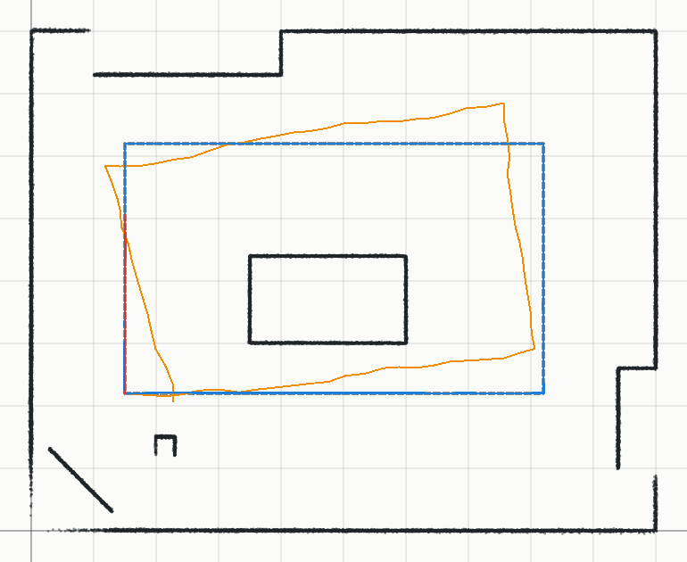
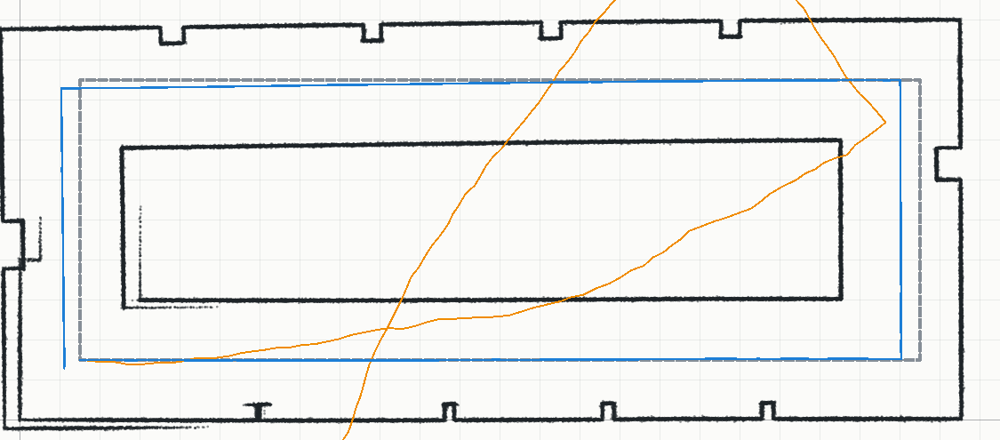
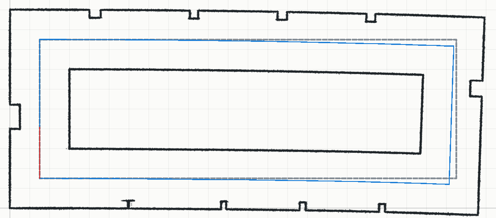

# Jour 3 — SLAM et carte de la salle

Énoncé : combiner les outils des jours 1 et 2 en un système de **localisation et cartographie
simultanées** (début de SLAM), produire une **carte complète de la salle**, et en bonus déplacer le
robot automatiquement pour construire la carte en temps réel.

Code : `src/core/slam.js` (SLAM), `src/core/posegraph.js` (graphe de poses), application :
section **SLAM (jour 3)**, banc d'essai : `scripts/benchmark-slam.mjs`
([jour3_slam.md](jour3_slam.md)).

## Principe

Le SLAM enchaîne, pour chaque nouveau scan, la localisation du jour 2 et la cartographie du jour 1 :

1. **Prédiction** : pose du scan précédent, composée avec le mouvement commandé s'il est connu. Le
   robot Mecanum n'a pas de codeurs : l'« odométrie » n'est que la durée des commandes, et les
   roues glissent (simulée avec 10 % d'erreur sur la distance et 1,5° de dérive de cap par mètre).
2. **Suivi sur la carte locale** (les 15 derniers scans clés) : multi-résolution dans une fenêtre
   ±50 cm / ±20° autour de la prédiction, puis ICP. Une carte locale plutôt que toute la carte : au
   retour dans une zone déjà vue, le suivi ne « saute » pas vers l'ancienne carte (ce saut
   fausserait la chaîne des déplacements) ; c'est la fermeture de boucle qui s'en charge.
3. **Relocalisation** si le scan ne colle pas (moins de 50 % de ses points sur la carte) :
   localisation globale du jour 2 dans toute la carte, acceptée seulement si elle est fiable,
   colle à la carte et ne contredit pas l'espace libre déjà vu (moins de 5 % des points du scan
   sur du sol vu vide).
4. **Cartographie** : le scan devient un **scan clé** (ajouté à la grid map et à la carte
   vectorielle) s'il a bougé d'au moins 20 cm ou 10° depuis le précédent et si sa pose est sûre.
5. **Graphe de poses et fermeture de boucle** (Graph-SLAM du document « Localisation ») : chaque scan
   clé est relié au précédent par le déplacement suivi. Un nouveau scan clé est aussi recalé sur
   les anciens scans clés proches (hors carte locale) ; s'il colle (60 % de ses points), un lien
   « boucle » est ajouté et le graphe est optimisé (Gauss-Newton) : toute la trajectoire est
   corrigée et la carte reconstruite.

**Précision par direction.** Chaque lien porte une matrice d'information calculée à partir des
normales des points du scan (information de l'ICP point-droite) : dans un couloir, toutes les
normales sont en travers, le lien est précis en travers et imprécis le long. L'optimisation sait
alors que c'est le long des couloirs que la dérive s'est accumulée.

## Résultats sur trajets simulés (pose vraie connue)

| Scène | Méthode | Erreur moyenne (ATE) | Erreur max | Arrivée |
| --- | --- | --- | --- | --- |
| Salle de classe, boucle de 21 m (75 scans) | Odométrie seule | 56,4 cm | 90,8 cm | 78,3 cm / 16,1° |
| | SLAM sans odométrie | **0,6 cm** | 1,3 cm | 1,0 cm / 0,3° |
| | SLAM avec odométrie | **0,7 cm** | 1,8 cm | 1,8 cm / 0,3° |
| Couloir en boucle de 54 m, lidar limité à 4 m (189 scans) | Odométrie seule | 727 cm | 1 465 cm | 1 446 cm / 87,6° |
| | SLAM sans fermeture de boucle | 44,0 cm | 54,6 cm | 44,6 cm / 0,4° |
| | SLAM + boucle (précisions fixes) | 29,9 cm | 53,0 cm | 1,5 cm / 0,0° |
| | SLAM + boucle (précision par direction) | **27,1 cm** | 47,1 cm | **1,4 cm** / 0,2° |

*Salle de classe simulée : points des scans clés à leur pose estimée, trajectoire vraie (gris
pointillé), odométrie seule (orange), SLAM (bleu).*

| Couloir sans fermeture de boucle | Couloir avec fermeture de boucle |
| --- | --- |
|  |  |

- Dans une salle comme la nôtre, le SLAM suit le robot **au centimètre**, même sans odométrie :
  le premier scan voit déjà presque toute la salle et chaque nouveau scan s'y recale.
- Dans un long couloir avec un lidar à courte portée, la dérive s'accumule (44 cm) et la carte
  se dédouble au retour (murs doublés en bas à gauche). La **fermeture de boucle** ramène
  l'arrivée à 1,4 cm et redonne une carte cohérente (un seul trait par mur) ; la précision par
  direction réduit encore l'erreur moyenne (27 cm au lieu de 30).
- Avec une seule boucle, le SLAM ne connaît que l'écart total départ / arrivée : une dérive qui
  part dans un sens puis revient dans l'autre ne se voit pas (erreur max 47 cm au milieu du
  trajet). D'autres passages par des lieux déjà vus la corrigeraient.

## Sur les scans réels de la salle : pourquoi un trajet continu

Les 18 scans de la carte sont des **clichés épars** : pris à plusieurs mètres les uns des autres,
sur deux jours, les deux premiers en hauteur (sur l'armoire et sur la table). En partant de zéro,
sans aucune pose manuelle :

- **SLAM dans l'ordre** : le premier scan (sur l'armoire) voit la salle par-dessus les meubles ; un
  scan pris ensuite au sol voit surtout des pieds de meubles proches, que cette carte ne contient
  pas (7 à 16 % de ses points sur la carte) : il est « perdu ». Quelques relocalisations
  tombaient sur le symétrique de la salle (12 m, 180°) avant l'ajout des garde-fous.
- **Placement dans le désordre** (à chaque tour, placer les scans qui se localisent de façon
  fiable sur la carte déjà construite) : 15 scans sur 18 placés, mais 3 au symétrique de la
  salle. Quand la vraie zone n'est pas encore cartographiée, son symétrique est la seule zone qui
  ressemble : l'ambiguïté ne se voit pas. Le test de l'espace libre ne marche pas non plus ici :
  les scans pris en hauteur ont vu « vide » au-dessus des meubles que les scans au sol rencontrent.

Conclusion : **un SLAM a besoin d'un trajet continu**, un scan tous les 20 à 30 cm, à la même
hauteur (le robot au sol). C'est ce que fait le **SLAM en direct** de l'application. Les clichés
épars restent excellents pour une carte de référence avec un placement grossier à la main, puis
un recalage commun (jour 2).

## Dans l'application

- **Trajet simulé** (section Scans) : les 75 scans de la boucle de la salle de classe simulée,
  placés selon l'odométrie seule (la carte est déformée, 78 cm d'écart à l'arrivée).
- **SLAM sur les scans visibles** : dans l'ordre de la liste, le premier scan fixe le repère, les
  poses des autres sont ignorées ; la carte se construit scan par scan, la trajectoire s'affiche
  en bleu. Sur le trajet simulé : 75 scans en 15 s, 3 boucles fermées, erreur moyenne 0,5 cm.
- **SLAM en direct** (robot en USB, `python scripts/live.py`) : cocher la case puis pousser ou
  piloter doucement le robot ; chaque scan reçu est localisé, un scan clé est ajouté à la liste
  tous les 20 cm ou 10°, la carte grandit et la pose du robot est suivie en temps réel.
