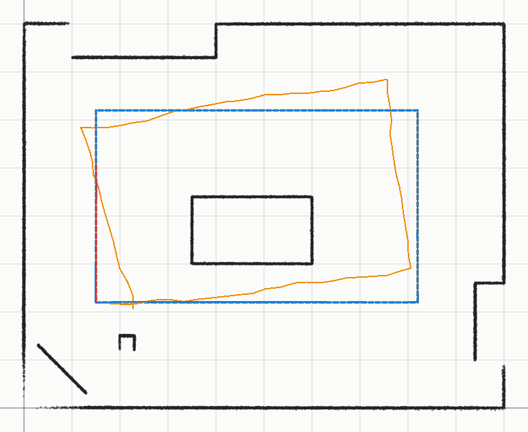
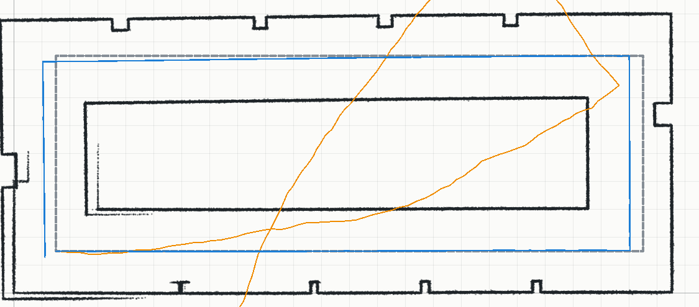
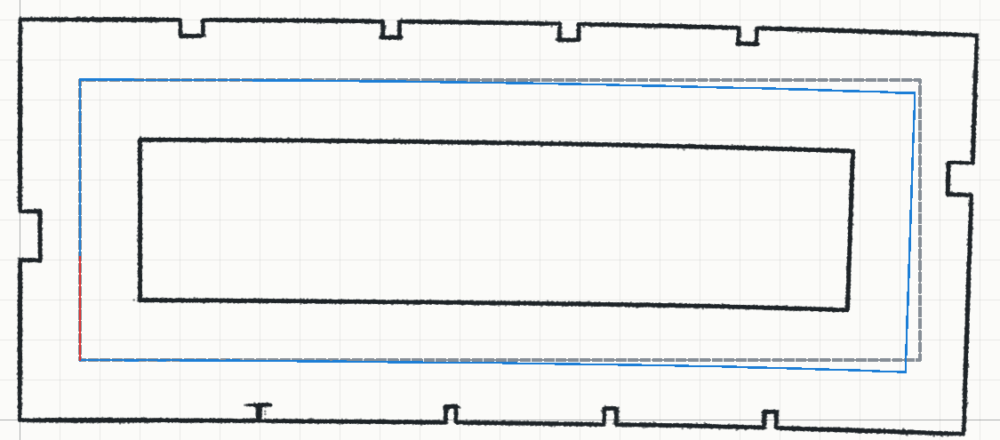
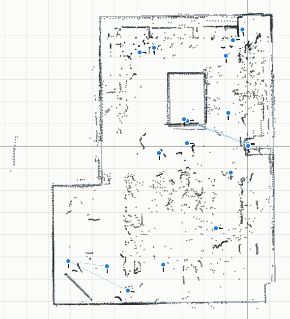
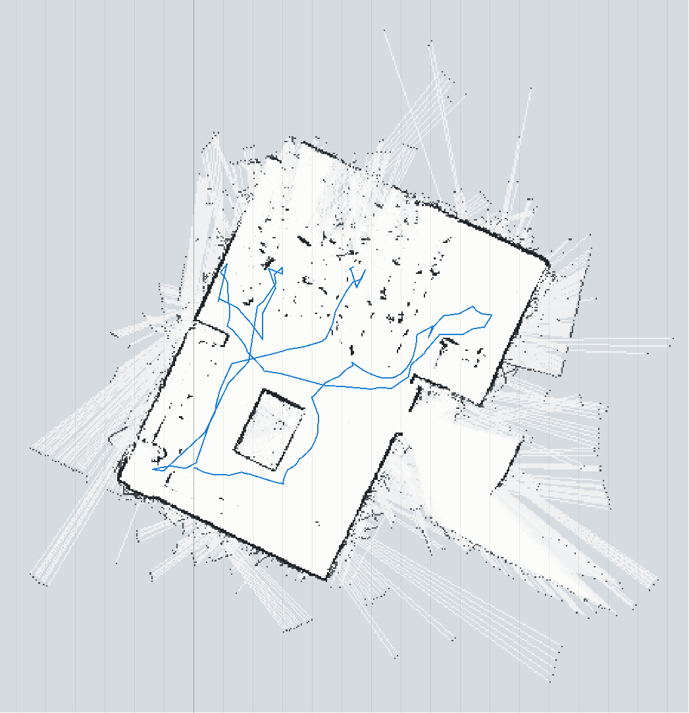
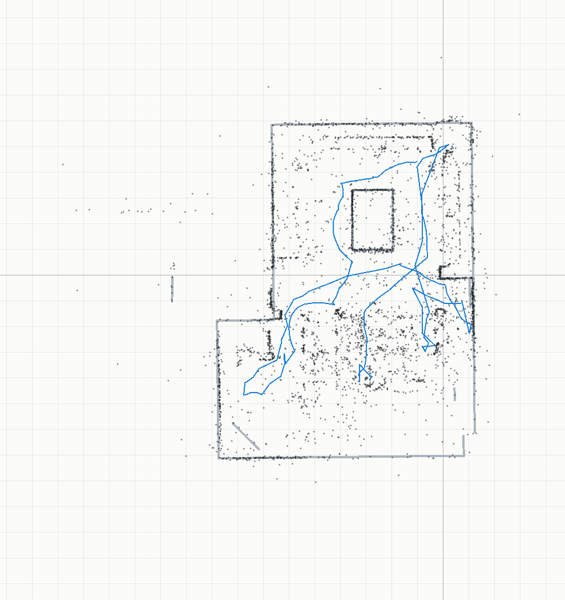
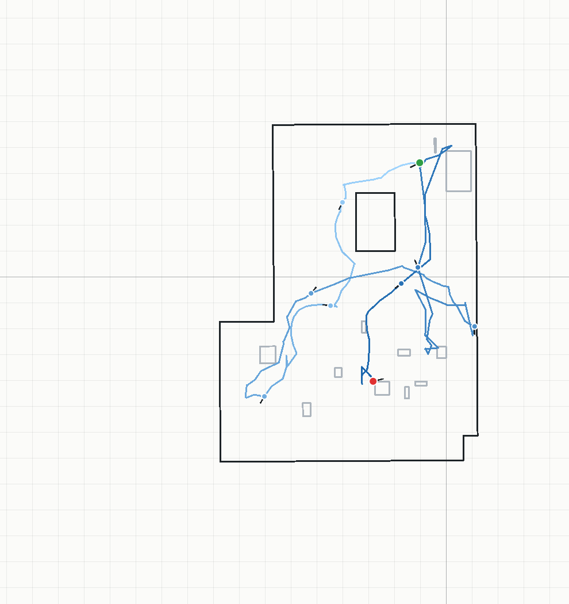
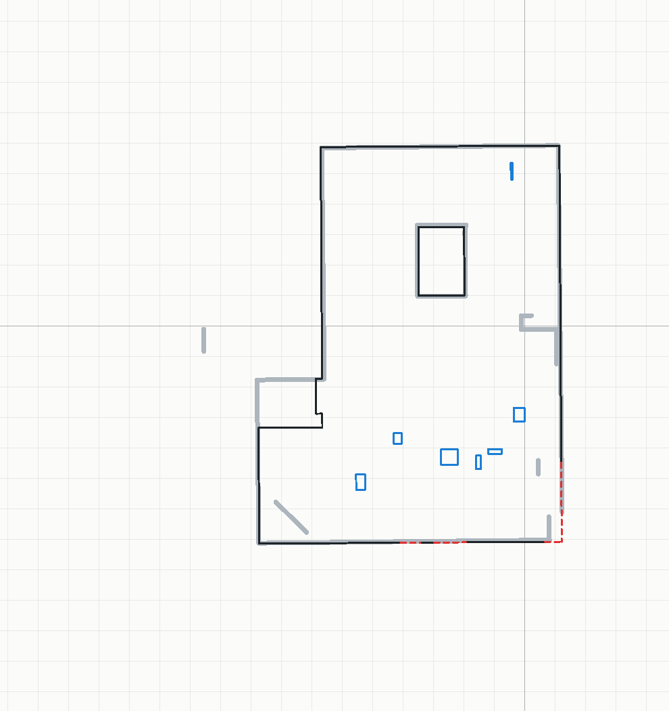
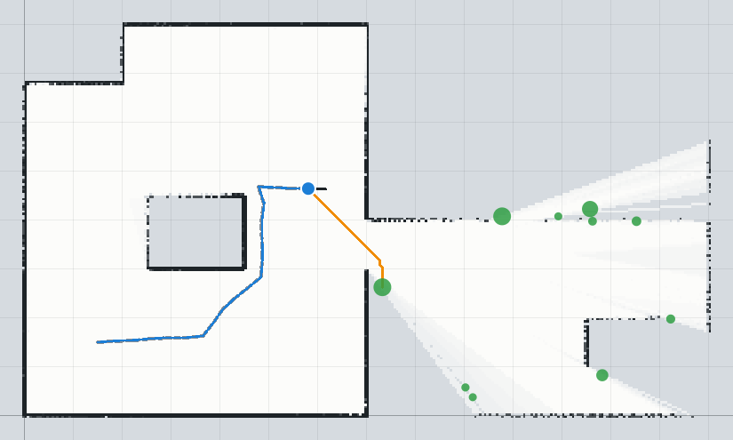
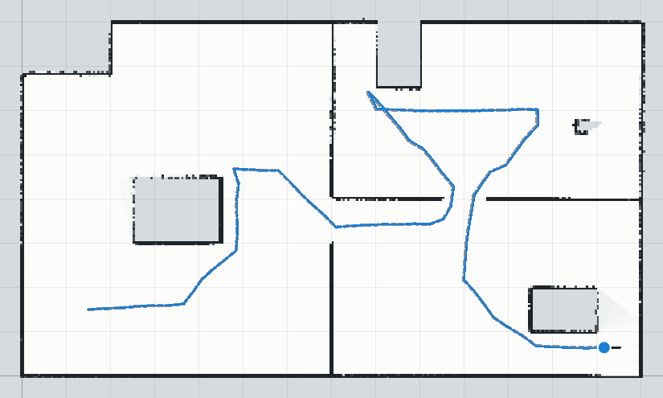

# Jour 3 — SLAM et carte de la salle

**Énoncé** : combiner les outils des jours 1 et 2 en un système de **localisation et cartographie
simultanées** (début de SLAM), produire une **carte complète de la salle de classe**, et, en bonus,
déplacer le robot automatiquement pour construire la carte en temps réel.

**Résultat en bref**

| Demande | Résultat | Détail |
| --- | --- | --- |
| SLAM | Suivi sur carte locale, scans clés, graphe de poses, fermeture de boucle ; 0,5 cm d'erreur dans la salle simulée | §1, §2 |
| Carte complète de la salle | Faite avec le **vrai robot** (séance du 4 novembre) : murs à **4,3 cm** de la carte de référence, puis filtrée et reconstruite (murs reconstruits à 3,9 cm) | §3, [rapport_slam_reel.md](rapport_slam_reel.md) |
| Localiser le robot dans la carte | Scans réels retrouvés dans toute la salle : 17 sur 18 sans aucune pose de départ, **18 sur 18** avec la pose approximative | §4 |
| Bonus : robot autonome | Exploration par frontières : 12 départs sur 12 réussis en simulation, 98,5 à 100 % de couverture, 0 collision ; essayé avec succès sur le vrai robot | §5 |

Code : `src/core/slam.js` (SLAM), `src/core/posegraph.js` (graphe de poses), `src/core/explore.js`
(exploration), `src/core/reconstruct.js` (filtres et reconstruction du plan). Application : sections
**SLAM (jour 3)** et **Robot : pilotage et exploration**. Bancs d'essai : `scripts/benchmark-slam.mjs`
([jour3_slam.md](jour3_slam.md)), `scripts/benchmark-explore.mjs` ([jour3_explore.md](jour3_explore.md)),
`scripts/analyse-slam.mjs` (séance réelle).

## 1. Principe du SLAM

Pour chaque nouveau scan, le SLAM enchaîne la localisation du jour 2 et la cartographie du jour 1 :

1. **Prédiction.** La pose du scan précédent, composée avec le mouvement connu. Le robot Mecanum n'a
   pas de codeurs : l'« odométrie » est la durée des commandes multipliée par une vitesse estimée,
   et les roues glissent. Sans odométrie, une prédiction à **vitesse constante** est faite d'après
   l'heure des scans.
2. **Suivi sur la carte locale** (les 15 derniers scans clés). Deux départs, la prédiction et la pose
   précédente. Gauss-Newton sur la carte d'abord (1 à 2 ms, à la manière de Hector SLAM) ; si moins
   de 70 % des points collent, recherche multi-résolution (±50 cm, ±20°) puis ICP ; en dernier
   recours, fenêtre élargie (±60 cm, ±60°). Une carte locale plutôt que toute la carte : au retour
   dans une zone déjà vue, le suivi ne « saute » pas vers l'ancienne carte, ce qui fausserait la
   chaîne des déplacements ; c'est la fermeture de boucle qui s'en charge.
3. **Relocalisation** si le scan ne colle pas (moins de 50 % de ses points sur la carte) :
   localisation globale du jour 2, avec la pose prédite comme a priori, acceptée seulement si elle
   est fiable et ne contredit pas l'espace libre déjà vu.
4. **Cartographie.** Le scan devient un **scan clé** (ajouté à la grid map et à la carte vectorielle)
   s'il a bougé d'au moins 20 cm ou 10° depuis le précédent et si sa pose est sûre.
5. **Graphe de poses et fermeture de boucle** (Graph-SLAM du document « Localisation »). Chaque scan
   clé est relié au précédent par le déplacement suivi. Un nouveau scan clé est aussi recalé sur les
   anciens scans clés proches, hors carte locale ; s'il colle (60 % de ses points), un lien « boucle »
   est ajouté et le graphe est optimisé par Gauss-Newton. Toute la trajectoire est corrigée et la
   carte reconstruite.

**Précision par direction.** Chaque lien porte une matrice d'information calculée à partir des
normales des points du scan (information de l'ICP point-droite). Dans un couloir, toutes les normales
sont en travers : le lien est précis en travers et imprécis le long. L'optimisation sait alors que
c'est le long des couloirs que la dérive s'est accumulée.

Les algorithmes sont détaillés dans [algorithmes.md](algorithmes.md) (§ 12 à 17).

## 2. Validation en simulation (pose vraie connue)

Odométrie simulée du robot : 10 % d'erreur sur la distance, 2° par pas, 1,5° de dérive de cap par
mètre. **ATE** : moyenne quadratique des erreurs de position sur toute la trajectoire. Chiffres de
[jour3_slam.md](jour3_slam.md).

| Scène | Méthode | ATE | Erreur max | Arrivée | Temps / scan |
| --- | --- | --- | --- | --- | --- |
| Salle de classe, boucle de 21 m (75 scans) | Odométrie seule | 56,4 cm | 90,8 cm | 78,3 cm / 16,1° | – |
| | SLAM sans odométrie | **0,5 cm** | 1,3 cm | 1,2 cm / 0,3° | 183 ms |
| | SLAM avec odométrie | **0,5 cm** | 1,3 cm | 1,1 cm / 0,3° | 124 ms |
| Couloir en boucle de 54 m, lidar limité à 4 m (189 scans) | Odométrie seule | 727 cm | 1 465 cm | 1 446 cm / 87,6° | – |
| | SLAM sans fermeture de boucle | 46,1 cm | 63,5 cm | 42,5 cm / 1,5° | 87 ms |
| | SLAM + boucle (précisions fixes) | 31,7 cm | 56,7 cm | 3,0 cm / 0,0° | 119 ms |
| | SLAM + boucle (précision par direction) | **30,1 cm** | 51,9 cm | **2,2 cm** / 0,1° | 118 ms |

*Salle de classe simulée : points des scans clés à leur pose estimée, trajectoire vraie (gris
pointillé), odométrie seule (orange), SLAM (bleu).*

| Couloir sans fermeture de boucle | Couloir avec fermeture de boucle |
| --- | --- |
|  |  |

- Dans une salle comme la nôtre, le SLAM suit le robot **au centimètre**, même sans odométrie : le
  premier scan voit déjà presque toute la salle et chaque nouveau scan s'y recale.
- Dans un long couloir avec un lidar à courte portée, la dérive s'accumule (46 cm) et la carte se
  dédouble au retour. La **fermeture de boucle** ramène l'arrivée à 2 cm et redonne un seul trait par
  mur ; la précision par direction réduit encore l'erreur moyenne.
- Avec une seule boucle, le SLAM ne connaît que l'écart total entre départ et arrivée : une dérive qui
  part dans un sens puis revient dans l'autre ne se voit pas (erreur max 52 cm au milieu du trajet).
  D'autres passages par des lieux déjà vus la corrigeraient.

## 3. Carte complète de la salle

### 3.1 Les clichés épars ne suffisent pas : il faut un trajet continu

Les 18 scans de la carte de référence (jour 2) sont des **clichés** pris à plusieurs mètres les uns
des autres, sur deux jours, dont 5 en hauteur (sur l'armoire et sur la table). Un SLAM parti de zéro
sur ces clichés échoue :

- un cliché pris au sol ne retrouve que 6 à 45 % de ses points sur la carte déjà construite (vue d'un
  autre endroit, ou d'en haut) : il est « perdu » ;
- la salle est presque symétrique : sans a priori, certaines relocalisations tombent sur le
  symétrique (12 m, 180°).

Avec la pose approximative notée pour chaque cliché comme a priori, plus aucune erreur n'est grosse
(médiane 9,7 cm), mais la carte ne grandit pas (13 clichés perdus). Pour ces clichés, la bonne
méthode est **hors ligne** : le graphe de poses de Lu & Milios (1997), tous les scans à la fois, un
lien par paire qui se recouvre, plus un lien « pose approximative » par scan. Erreur médiane
**8,5 → 4,2 cm** ([jour3_apriori.md](jour3_apriori.md)).

*Carte de la salle par le graphe de poses hors ligne : points des scans au sol à leur pose optimisée
(noir), carte de référence (gris), liens entre scans (bleu).*

Conclusion : **un SLAM en ligne a besoin d'un trajet continu**, un scan tous les 20 à 30 cm, à la
même hauteur. D'où la séance suivante, avec le robot piloté en continu.

### 3.2 La séance avec le vrai robot (4 novembre)

Le robot roule au sol, piloté au clavier par le câble USB (`firmware/ESP32_RobotUSB`,
`scripts/live.py`), et le SLAM tourne **en direct** dans l'application, 5 à 6 scans par seconde.

| Mesure | Valeur |
| --- | --- |
| Durée, trajet | 26 min (17 h 50 – 18 h 16), **57,1 m** |
| Scans clés | 159 |
| Écart médian entre les murs du SLAM et ceux de la référence | **4,3 cm** |
| Murs de la référence retrouvés (point à moins de 10 cm) | **79 %** |

La carte de référence et la carte du SLAM ont été faites séparément, de deux façons différentes ;
elles s'accordent à 4 cm près, ce qui valide l'une par l'autre. Les cellules du SLAM hors de la
référence sont surtout des chaises et des personnes.

| Carte brute du SLAM et trajet | Recalée sur la carte de référence |
| --- | --- |
|  |  |

*Trajet estimé par le SLAM sur la carte finale, du bleu clair (début) au bleu foncé (fin) ; départ
en vert, arrivée en rouge.*

Le premier essai, par pas de 30 cm, s'était perdu dès les premiers pas. Trois changements l'ont
rendu possible (§ 6) : pilotage continu, SLAM dans un fil de calcul séparé, suivi robuste aux
mouvements rapides.

### 3.3 Filtrage et reconstruction du plan

La carte brute contient des chaises, des personnes, un coin inaccessible et des murs mal vus.
`src/core/reconstruct.js`, d'après les travaux de reconstruction de plans en intérieur encombré
(Okorn et al. 2010, Mura et al. 2014, Ochmann et al. 2016 et 2019) :

1. **Filtrage 1** : les objets de moins de 40 cm (pieds de chaises, sacs, jambes) et les cellules vues
   par un seul scan sont retirés : 200 objets, 1 476 cellules.
2. **Filtrage 2 et reconstruction** : droites des murs par histogrammes, découpage de la salle en
   rectangles, intérieur atteignable depuis le trajet sans traverser de mur ; complétion des coins
   cachés ; un meuble isolé (le bureau du prof) n'est pas pris pour un mur ; un petit décroché du mur
   est retrouvé à partir d'un morceau de 40 cm.

| Mesure | Valeur |
| --- | --- |
| Surface de la salle | 109,5 m² |
| Murs observés | 49,1 m, à **2,8 cm** de la référence (médiane), 99 % à moins de 15 cm |
| Murs reconstruits (jamais vus) | 4,3 m, à **3,9 cm** de la référence (médiane), 97 % à moins de 15 cm |

*Carte finale dans le repère de la référence : référence en gris épais, murs observés en noir, murs
reconstruits en rouge pointillé, meubles en bleu.*

Démarche complète, figures intermédiaires et versions successives de l'algorithme :
[rapport_slam_reel.md](rapport_slam_reel.md). Chiffres bruts : [slam_usb_20261104.md](slam_usb_20261104.md).
Refaire l'analyse : `node scripts/analyse-slam.mjs data/slam_usb_20261104 --nom slam_usb_20261104`.

## 4. Localiser le robot dans la carte de la salle

Objectif final de l'énoncé. Sur les 18 scans réels, chacun localisé sur une carte construite **sans
lui** ([jour3_apriori.md](jour3_apriori.md), [jour2.md](jour2.md) § Localisation globale) :

| | Sans a priori | Avec la pose approximative comme a priori |
| --- | --- | --- |
| Localisation globale (pose de départ inconnue) | 17 / 18 (un scan au symétrique de la salle) | **18 / 18** |

Dans l'application : **Charger la carte de la salle**, ouvrir un scan, puis **Localisation globale
(pose inconnue)** ; ou le placer à peu près et **Localiser le scan sélectionné**.

## 5. Bonus : déplacer le robot automatiquement

Le robot construit la carte **seul** : à chaque pas, scan, SLAM, puis choix de la commande par la
**méthode des frontières** (Yamauchi 1997) sur la grid map du SLAM ([algorithmes.md](algorithmes.md) § 15).

1. Les obstacles de la grid map sont gonflés du rayon du robot (17 cm) plus 8 cm de marge.
2. Un parcours en largeur depuis le robot sur les cellules libres donne le chemin le plus court vers
   chaque cellule atteignable.
3. Les **frontières** (cellules libres voisines de l'inconnu) sont regroupées en zones ; le robot va
   vers la plus proche.
4. Commande : tourner sur place vers le point visé (au plus 60°), puis avancer de 40 cm au plus, sans
   dépasser l'obstacle le plus proche vu droit devant.
5. Plus de frontière atteignable : la carte est finie.

### En simulation (pose vraie connue)

Mouvement vrai entaché d'erreurs (10 % sur la distance et l'angle, glissement latéral, 1,5° de
dérive de cap par mètre) ; le SLAM ne reçoit que la commande. **Réussite** : couverture ≥ 95 % sans
collision ([jour3_explore.md](jour3_explore.md)).

| Scène | Départs réussis | Couverture | Collisions | Erreur de pose (ATE) | Trajet |
| --- | --- | --- | --- | --- | --- |
| Salle de classe 10 m × 8 m | 6 / 6 | 100 % | 0 | 0,7 à 2,7 cm | 22 à 39 pas, 6 à 10 m |
| Trois pièces reliées par des portes de 1 m | 6 / 6 | 98,5 à 100 % | 0 | 1,0 à 1,7 cm | 104 à 149 pas, 27 à 35 m |

(6 départs par scène : 3 points de départ × 2 façons de choisir la frontière.)

| Trois pièces : exploration en cours (frontières en vert, chemin prévu en orange) | Carte finale |
| --- | --- |
|  |  |

- Choisir la frontière la plus **utile** (longueur / (distance + 1 m), Holz et al. 2010) plutôt que la
  plus proche ne raccourcit pas le trajet en moyenne : gain sur certains départs, perte sur d'autres.
  Gardé en option.
- Le robot passe par les portes de 1 m sans les toucher : 1 m − 2 × 25 cm laisse 50 cm au centre.

### Avec le vrai robot (Wi-Fi)

Programme `firmware/ESP32_RobotWifi` (moteurs commandés directement par l'ESP32 : notre robot n'a pas
la carte I2C du module), PC connecté au Wi-Fi `DON MIGUEL3`, robot en `192.168.4.1`. Bouton
**Explorer avec le robot (Wi-Fi)**. Chaque pas : `/scan`, SLAM avec le mouvement commandé comme
prédiction, commande `/forward?time=…` ou `/rotateleft?time=…`, attente de la fin du mouvement. Le
robot n'a pas de codeurs : la durée est calculée avec une vitesse estimée, **corrigée à chaque pas**
d'après le déplacement mesuré par le SLAM. Sécurité : arrêt si le SLAM perd le robot, bouton
**Arrêt** et touche **Échap**.

- **Avec le faux robot** (`node scripts/mock-robot.mjs`, mêmes routes HTTP dans une scène simulée) :
  la salle simulée est cartographiée en 28 pas ; les vitesses, parties de 0,25 m/s et 90 °/s,
  convergent vers 0,31 m/s et 72 °/s pour des vitesses vraies de 0,32 m/s et 75 °/s.
- **Avec le vrai robot** : l'exploration autonome et le pilotage continu en Wi-Fi ont été essayés
  dans la salle et ont fonctionné. Cette séance n'a pas été enregistrée (ni scans ni carte
  exportés), et le robot n'était plus disponible ensuite pour la refaire : elle n'est donc pas
  chiffrée ici. La carte réelle chiffrée est celle du § 3.2 (pilotage manuel en USB).

## 6. Améliorations successives

| Problème rencontré | Changement | Effet mesuré |
| --- | --- | --- |
| Suivi lent (250 ms par scan) | Gauss-Newton sur la carte d'abord, multi-résolution en secours | 4 à 7 fois plus rapide, même précision dans la salle |
| Clichés épars ambigus (salle symétrique) | Pose approximative comme a priori (localisation globale et SLAM) | Localisation globale 17/18 → **18/18** |
| Robot perdu dès les premiers pas de 30 cm | Pilotage continu (touche maintenue), 5 à 6 scans par seconde | Séance complète de 57 m |
| Page figée pendant le SLAM en direct | SLAM dans un fil de calcul séparé (Web Worker, `app/slam-worker.js`) | Aucune tâche longue dans la page |
| Robot perdu quand il bouge vite | Prédiction à vitesse constante, deux départs, fenêtre élargie | Erreur max 145 → 3 cm à 38° par scan ; pas de 50 cm acceptés |
| Wi-Fi : liaison restée sur USB, touches inactives | Détection automatique de la liaison, touches actives partout | Pilotage Wi-Fi sans réglage |

Les erreurs rencontrées et leurs corrections sont détaillées dans [journal.md](journal.md).

## 7. Limites et suite

- **Échelle absolue.** La carte du SLAM et la carte de référence viennent du même lidar : leur accord
  ne prouve pas l'échelle. Une mesure au mètre ruban d'un mur ou de la table la vérifierait.
- **Une seule boucle par endroit.** Une dérive qui part puis revient ne se corrige qu'avec plusieurs
  passages par des lieux déjà vus.
- **Objets mobiles.** Chaises et personnes sont retirées après coup (filtrage 1) ; un SLAM qui les
  écarterait pendant le trajet serait plus propre.
- **Bonus sur le vrai robot** : à enregistrer (scans, carte, vidéo) lors d'une prochaine séance.
