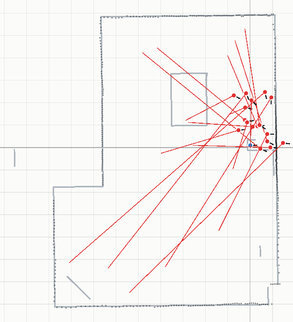
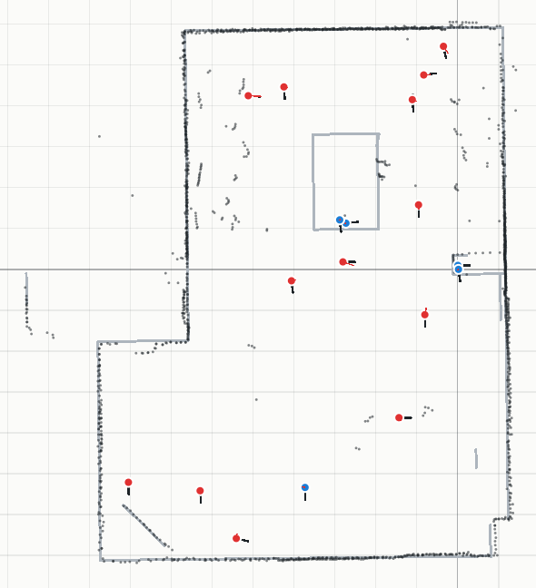
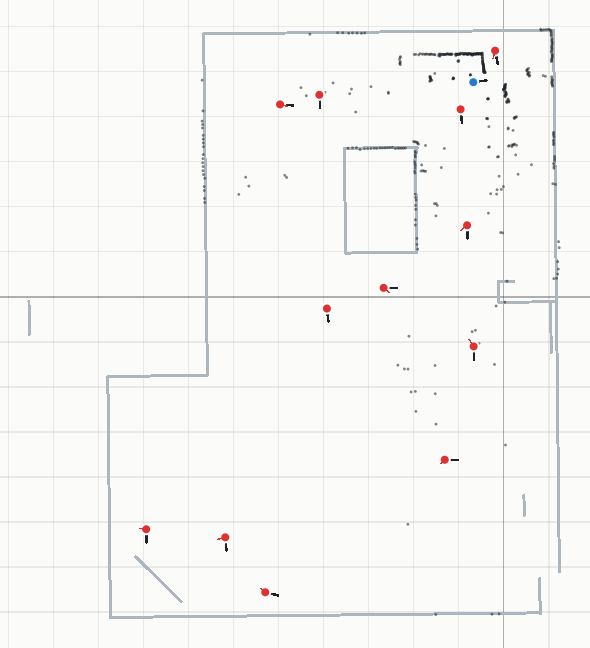
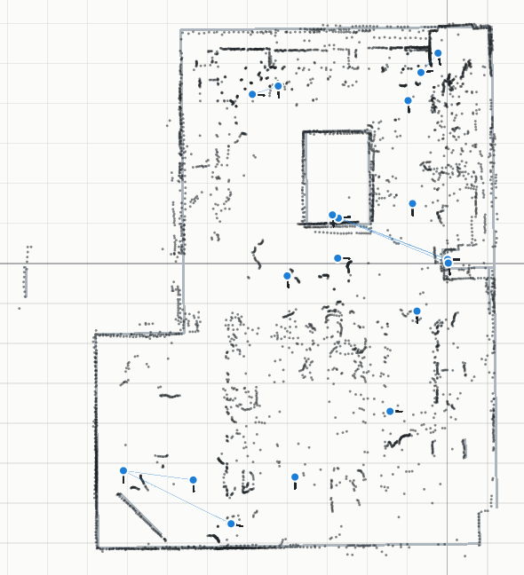

# Connaître (à peu près) la position du robot : ce que ça change

Généré par `node scripts/benchmark-prior.mjs`. Données réelles : les 18 scans de la salle. Chaque
fichier porte une **pose approximative** (notée à la main ou venue de LidarScope) ; la référence
est la pose recalée (± 2 cm). Écart des poses approximatives à la référence :
médiane 8.5 cm / 0.9°, maximum 24.4 cm / 2.2°.

## A. Localisation globale, sans et avec a priori

Chaque scan est cherché dans toute la salle sur une grid map construite **sans lui** (scans au sol à
leur pose recalée). A priori : la pose approximative du fichier, σ = 50 cm et 15°. **Réussite** :
erreur < 10 cm et < 2° par rapport à la pose recalée.

| Scan | Sans a priori : erreur | Verdict | Avec a priori : erreur | Verdict |
| --- | --- | --- | --- | --- |
| scan_1102_175527.csv (en hauteur) | 2.8 cm / 0.3° | fiable | 2.8 cm / 0.3° | fiable |
| scan_1102_175930.csv (en hauteur) | 1.8 cm / 0.0° | fiable | 1.8 cm / 0.0° | fiable |
| scan_1102_180026.csv | 4.8 cm / 0.6° | ambiguë | 4.8 cm / 0.6° | ambiguë |
| scan_1102_180105.csv | 2.9 cm / 0.0° | fiable | 2.9 cm / 0.0° | fiable |
| scan_1102_180212.csv | 2.1 cm / 0.1° | ambiguë | 2.1 cm / 0.1° | fiable |
| scan_1102_180308.csv | 1.6 cm / 0.3° | ambiguë | 1.6 cm / 0.3° | fiable |
| scan_1102_180357.csv | 4.2 cm / 0.1° | ambiguë | 4.2 cm / 0.1° | ambiguë |
| scan_1103_ls01.csv | 3.0 cm / 0.5° | fiable | 3.0 cm / 0.5° | fiable |
| scan_1103_ls02.csv | 1.7 cm / 0.1° | ambiguë | 1.7 cm / 0.1° | ambiguë |
| scan_1103_ls03.csv | 1.9 cm / 0.4° | ambiguë | 1.9 cm / 0.4° | ambiguë |
| scan_1103_ls05.csv | 0.8 cm / 0.5° | fiable | 0.8 cm / 0.5° | fiable |
| scan_1103_ls06.csv | 1.2 cm / 0.3° | fiable | 1.2 cm / 0.3° | fiable |
| scan_1103_ls07.csv | **309.0 cm / 88.5°** | ambiguë | 1.1 cm / 0.5° | fiable |
| scan_1103_ls08.csv (en hauteur) | 2.5 cm / 0.4° | ambiguë | 2.2 cm / 0.5° | fiable |
| scan_1103_ls09.csv (en hauteur) | 3.1 cm / 0.1° | fiable | 3.1 cm / 0.1° | fiable |
| scan_1103_ls10.csv | 1.6 cm / 0.2° | fiable | 1.6 cm / 0.2° | fiable |
| scan_1103_ls11.csv | 3.3 cm / 0.0° | fiable | 3.3 cm / 0.0° | fiable |
| scan_1103_ls12.csv (en hauteur) | 2.0 cm / 0.2° | fiable | 2.0 cm / 0.2° | fiable |

**Sans a priori** : 17 / 18 réussis, 0 faux annoncés fiables, 872 ms par scan.
**Avec a priori** : 18 / 18 réussis, 0 faux annoncés fiables, 651 ms par scan.

## B. SLAM sur les scans réels

Les scans dans l'ordre de prise ; le premier est placé à sa pose recalée (pour comparer dans le même
repère), les autres poses viennent du SLAM. Odométrie (variantes 2 et 3) : déplacement entre les
poses approximatives de deux scans successifs, comme le donnerait la durée des commandes du robot.
**Placé loin** : à plus de 1 m de la pose recalée (symétrique de la salle, par exemple). **Accord avec
la référence** : part des cellules occupées de la carte du SLAM à moins de 10 cm d'un mur ou meuble
de la carte de référence.

| Variante | Scans | Perdus | Placés loin | Erreur médiane / max (scans placés) | Erreur médiane / max (tous, perdus à la pose prédite) | Accord avec la référence | Temps |
| --- | --- | --- | --- | --- | --- | --- | --- |
| Sans a priori (jour 3) | 18 | 17 | 0 | – | 433.9 cm / 1161.3 cm | 98 % | 968 ms |
| Avec odométrie (poses approximatives) | 18 | 13 | 0 | 1.6 cm / 6.1 cm | 9.7 cm / 31.0 cm | 91 % | 655 ms |
| Avec odométrie, scans au sol seulement | 13 | 12 | 0 | – | 15.3 cm / 18.3 cm | 43 % | 660 ms |

Figures : murs et meubles de la carte de référence (gris), points des scans gardés à leur pose
SLAM (noir), robots : bleu = bien placé, orange = placé loin, rouge = perdu (traits rouges : écart
à la pose recalée).

| Sans a priori | Avec odométrie | Avec odométrie, au sol |
| --- | --- | --- |
|  |  |  |

## C. SLAM hors ligne : graphe de poses à partir des poses approximatives (Lu & Milios 1997)

Tous les scans d'un coup au lieu d'un par un. Pour chaque paire de scans à moins de 6 m l'un de
l'autre (d'après les poses approximatives), le second est recalé sur le premier (multi-résolution
±50 cm / ±15° autour du déplacement approximatif, puis ICP) ; si au moins 35 % de ses points collent,
la paire devient un lien du graphe (déplacement mesuré, précision d'après les normales des points).
Chaque scan est aussi relié au premier par sa **pose approximative** (lien peu précis : 15 cm, 2°) :
c'est l'a priori de position, qui tient les scans sans voisin assez proche. Le graphe est optimisé
(Gauss-Newton), le premier scan fixé à sa pose recalée. Le recalage de la carte de référence
(`autoAlign`) suit la même idée, scan par scan face à tous les autres.

| Liens | Paires testées | Erreur médiane / max (avant optimisation : poses approximatives) | Erreur médiane / max (après) | Temps |
| --- | --- | --- | --- | --- |
| 9 recalages + 17 a priori | 93 | 8.5 cm / 24.4 cm | **4.2 cm / 24.4 cm** | 14.2 s |

*Points des scans au sol à leur pose optimisée (noir), carte de référence (gris), liens du graphe (bleu).*
