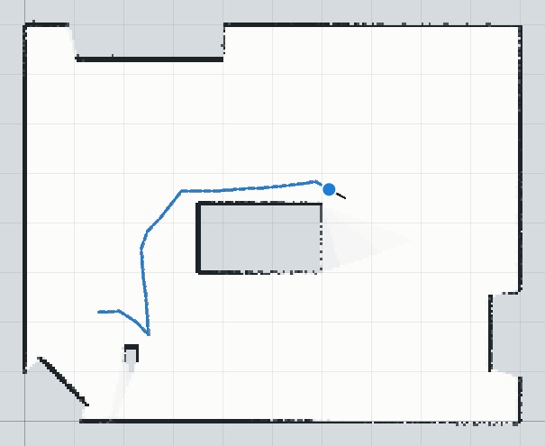
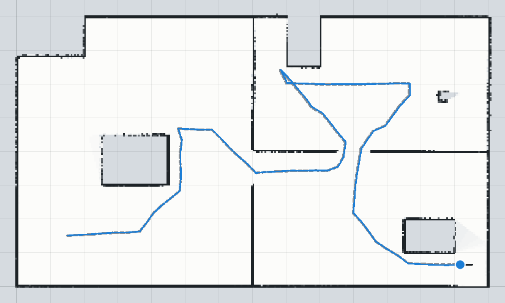
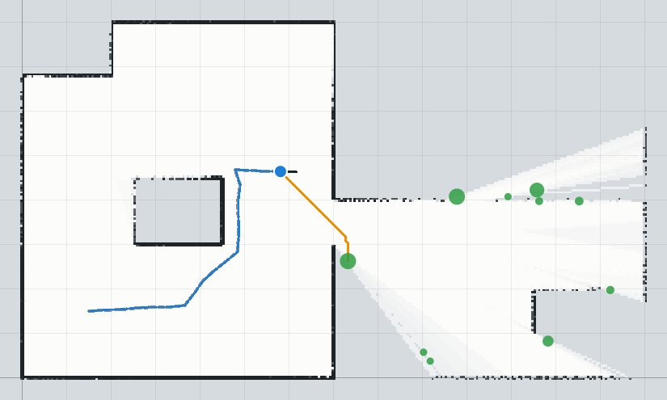

# Jour 3 — Banc d'essai de l'exploration autonome (simulation)

Généré par `node scripts/benchmark-explore.mjs`. Le robot part sans carte et choisit seul ses
commandes (méthode des frontières sur la grid map du SLAM). Mouvement vrai : 10 % d'erreur sur
la distance et l'angle, 5 cm de glissement latéral et 1,5° de dérive de cap par mètre ; le SLAM
ne reçoit que la commande. **Couverture** : part du sol libre de la scène (grille de 10 cm, hors
meubles et murs) que la carte a vue libre. **Réussite** : couverture ≥ 95 % sans collision.

## A. Salle de classe simulée (10 m × 8 m)

| Départ | Pas | Distance | Couverture | Collisions | ATE | Erreur finale | Boucles | Temps / pas | Réussite |
| --- | --- | --- | --- | --- | --- | --- | --- | --- | --- |
| (1.5 ; 2.2 ; 0°) | 30 | 7.4 m | **100.0 %** | 0 | 0.9 cm | 0.9 cm | 1 | 274 ms | oui |
| (8 ; 6 ; 180°) | 38 | 8.9 m | **100.0 %** | 0 | 0.7 cm | 1.0 cm | 1 | 244 ms | oui |
| (5 ; 1 ; 90°) | 34 | 8.6 m | **100.0 %** | 0 | 1.2 cm | 1.0 cm | 0 | 237 ms | oui |

## B. Trois pièces reliées par des portes de 1 m (14 m × 8 m)

| Départ | Pas | Distance | Couverture | Collisions | ATE | Erreur finale | Boucles | Temps / pas | Réussite |
| --- | --- | --- | --- | --- | --- | --- | --- | --- | --- |
| (1.5 ; 1.5 ; 0°) | 102 | 27.0 m | **100.0 %** | 0 | 1.9 cm | 2.0 cm | 8 | 347 ms | oui |
| (5.5 ; 6.5 ; -90°) | 128 | 33.1 m | **99.9 %** | 0 | 1.9 cm | 1.0 cm | 14 | 348 ms | oui |
| (12 ; 6.5 ; 180°) | 134 | 30.0 m | **98.3 %** | 0 | 1.5 cm | 0.9 cm | 15 | 352 ms | oui |

Figures (premier départ de chaque scène) : grid map construite par le SLAM, trajectoire vraie
(gris pointillé) et estimée (bleu) ; sur la vue en cours : zones frontières (vert, taille selon
leur longueur) et chemin prévu vers la plus proche (orange).

| Salle de classe : carte finale | Trois pièces : carte finale |
| --- | --- |
|  |  |

