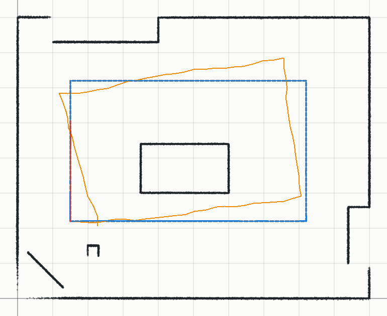
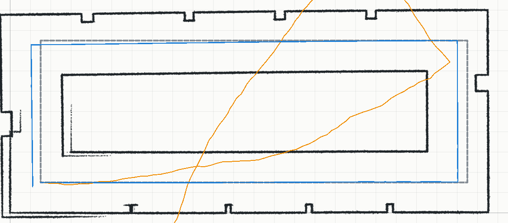
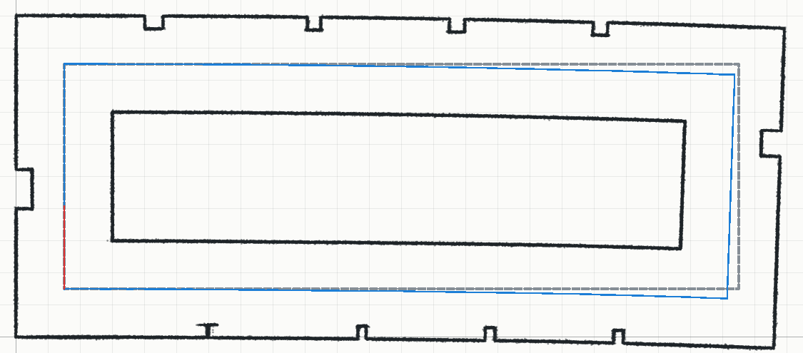

# Jour 3 — Banc d'essai du SLAM (trajets simulés)

Généré par `node scripts/benchmark-slam.mjs`. Pose vraie connue à chaque scan. Odométrie simulée
du robot Mecanum, qui n'a pas de codeurs (durée des commandes) : 10 % d'erreur sur la distance,
2° par pas, dérive de cap de 1,5° par mètre. **ATE** : moyenne quadratique des erreurs de position
sur toute la trajectoire.

## A. Salle de classe simulée (boucle de 21 m autour de la table)

75 scans sur 21 m.

| Méthode | ATE | Erreur max | Arrivée | Scans clés | Relocalisations | Boucles | Temps / scan |
| --- | --- | --- | --- | --- | --- | --- | --- |
| Odométrie seule | 56.4 cm | 90.8 cm | 78.3 cm / 16.1° | – | – | – | – |
| SLAM sans odométrie | **0.6 cm** | 1.3 cm | 1.0 cm / 0.3° | 75 | 3 | 3 (correction 1 cm, 0 cm, 1 cm) | 263 ms |
| SLAM avec odométrie | **0.7 cm** | 1.8 cm | 1.8 cm / 0.3° | 75 | 0 | 3 (correction 1 cm, 0 cm, 2 cm) | 253 ms |

## B. Couloir en boucle de 54 m (lidar limité à 4 m)

189 scans sur 56 m.

| Méthode | ATE | Erreur max | Arrivée | Scans clés | Relocalisations | Boucles | Temps / scan |
| --- | --- | --- | --- | --- | --- | --- | --- |
| Odométrie seule | 726.8 cm | 1465.3 cm | 1445.6 cm / 87.6° | – | – | – | – |
| SLAM sans fermeture de boucle | **44.0 cm** | 54.6 cm | 44.6 cm / 0.4° | 188 | 0 | 0 | 184 ms |
| SLAM + fermeture de boucle (précisions fixes) | **29.9 cm** | 53.0 cm | 1.5 cm / 0.0° | 188 | 0 | 2 (correction 47 cm, 5 cm) | 118 ms |
| SLAM + fermeture de boucle (précision par direction) | **27.1 cm** | 47.1 cm | 1.4 cm / 0.2° | 188 | 0 | 2 (correction 47 cm, 4 cm) | 116 ms |

Figures : points des scans clés à leur pose estimée (noir), trajectoire vraie (gris pointillé),
odométrie seule (orange), SLAM (bleu), liens de fermeture de boucle (rouge).

| Couloir sans fermeture de boucle | Couloir avec fermeture de boucle |
| --- | --- |
|  |  |
