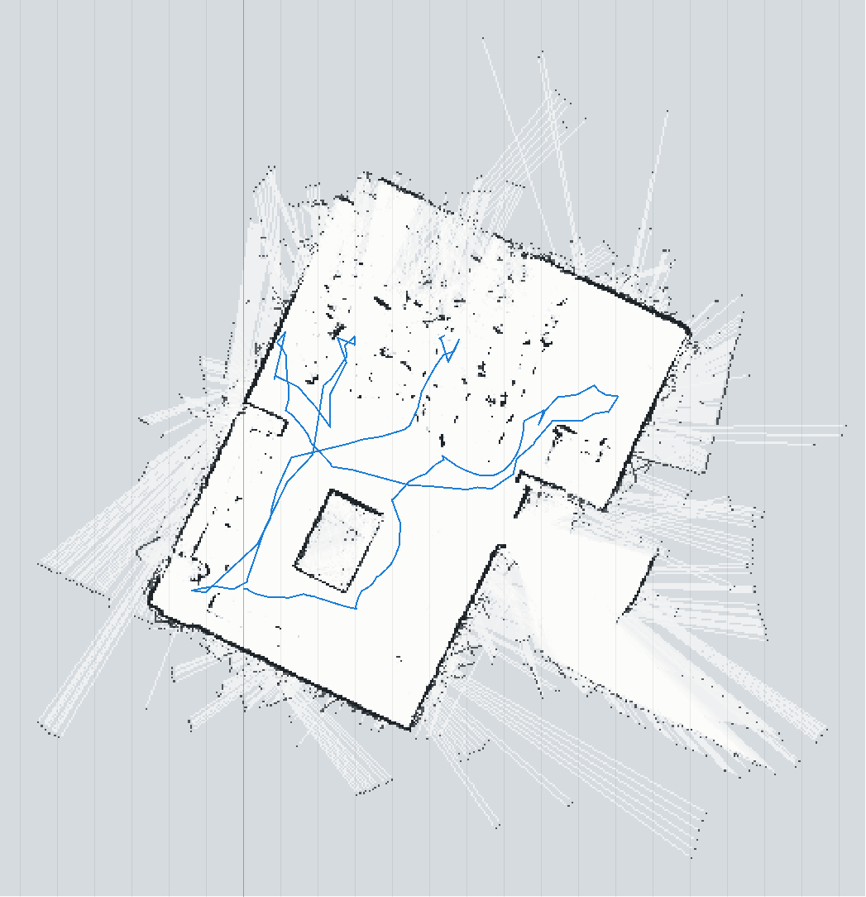
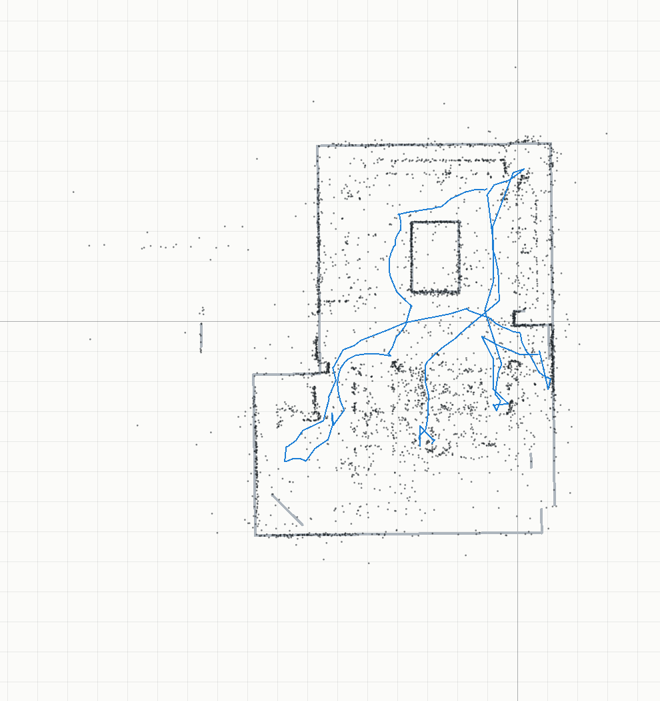
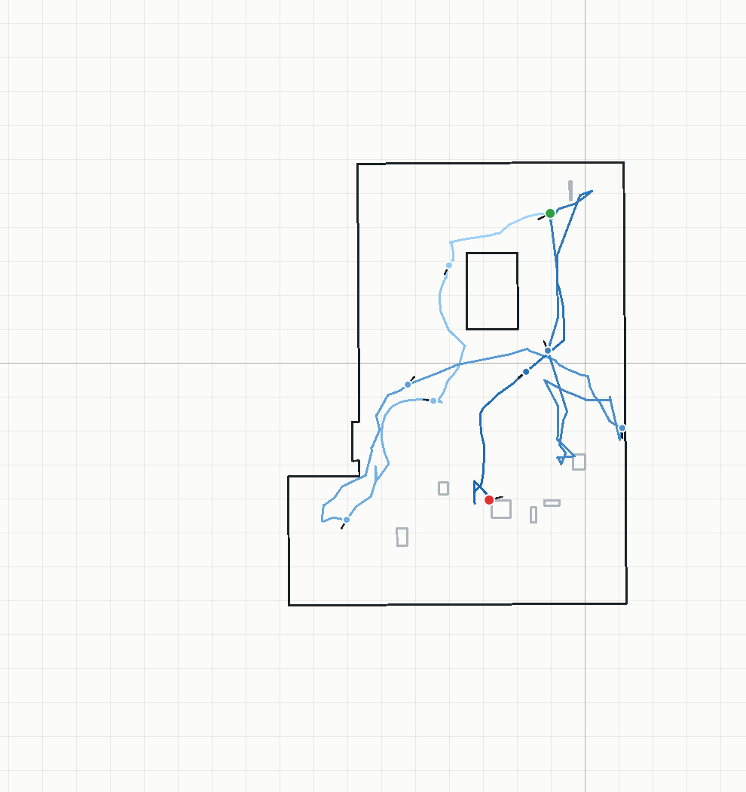
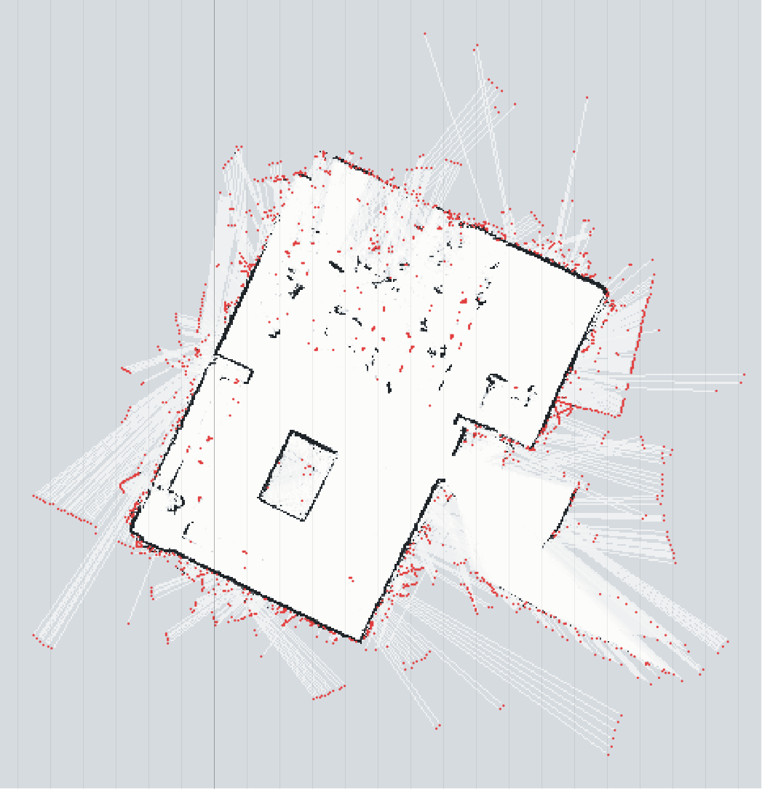
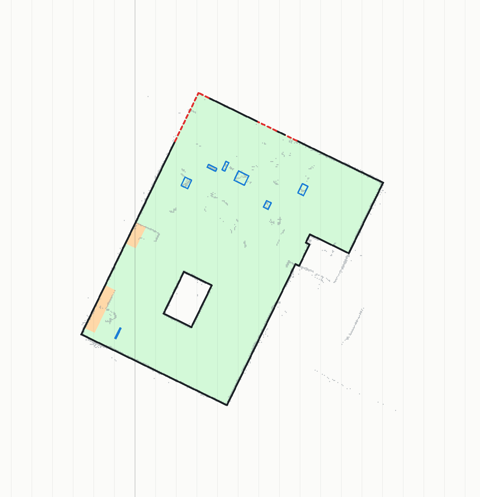
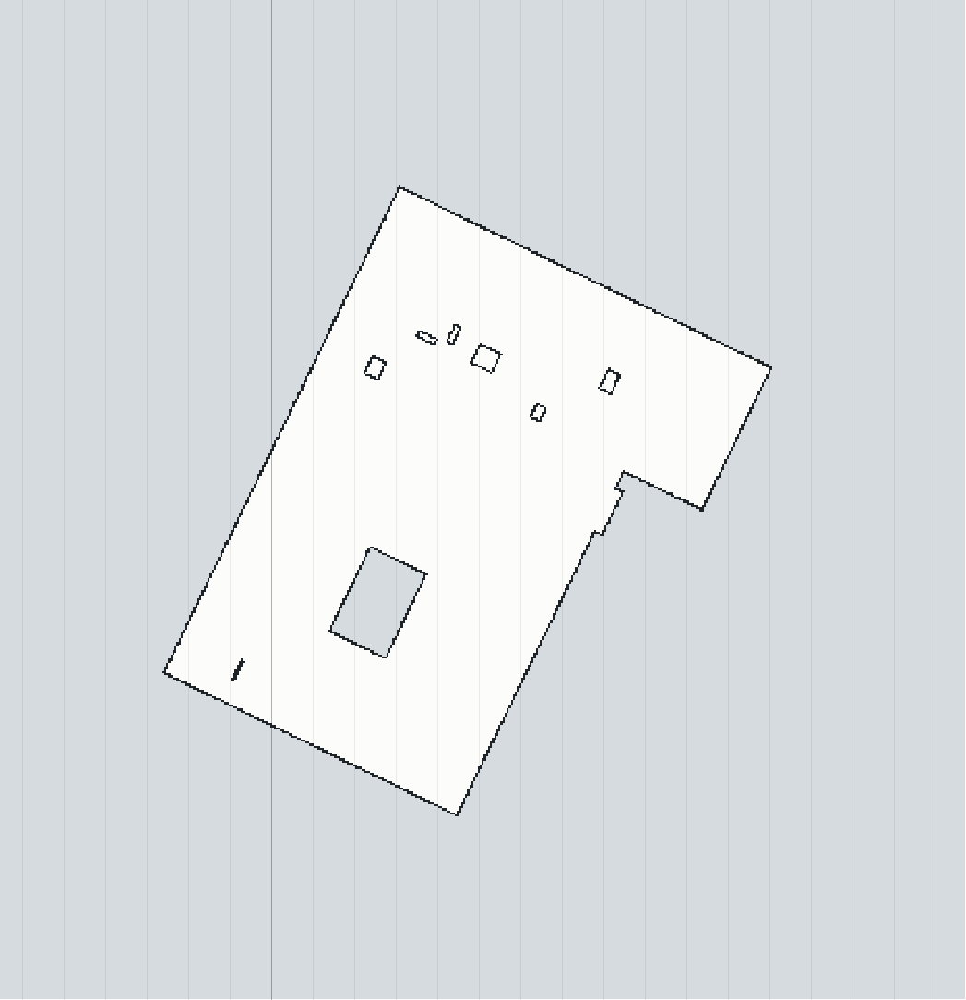
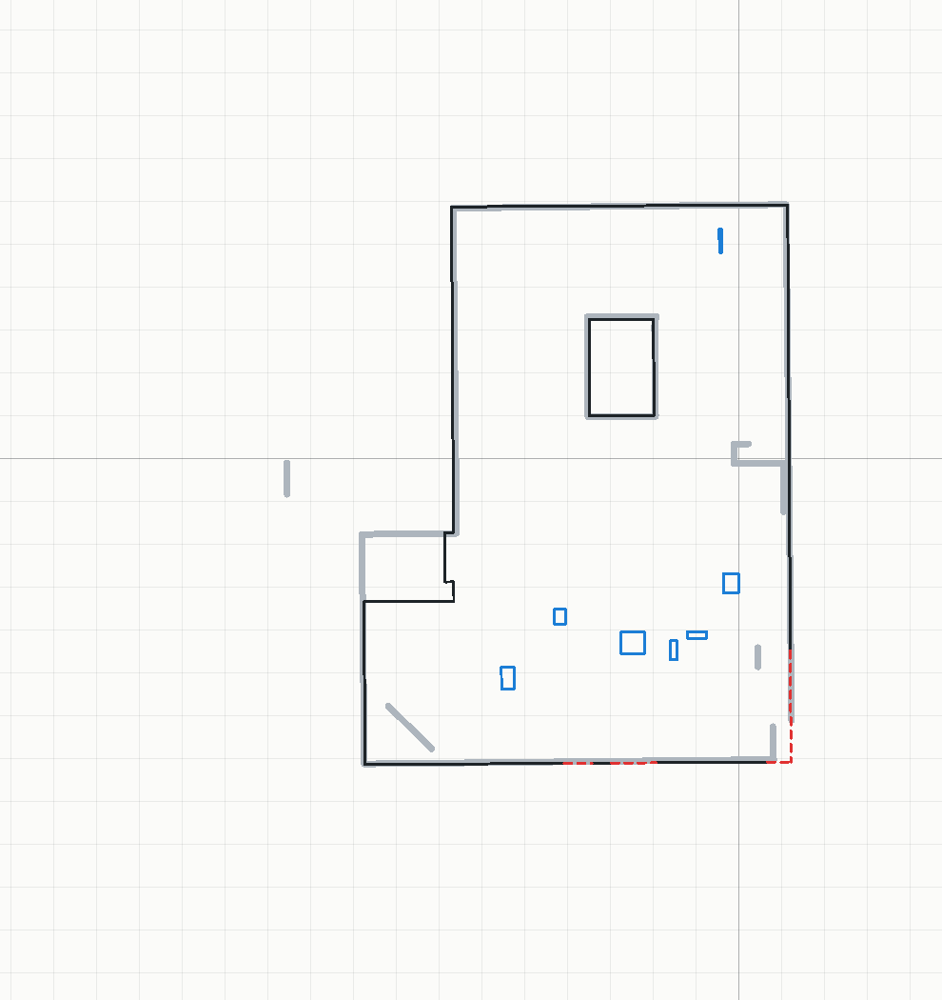

# SLAM de la salle avec le vrai robot (4 novembre 2026)

Partie du rapport sur le jour 3 : la salle cartographiée par notre SLAM, en direct, avec le robot
piloté au clavier. Chiffres et figures produits par
`node scripts/analyse-slam.mjs data/slam_usb_20261104 --nom slam_usb_20261104` (détail complet
dans [slam_usb_20261104.md](slam_usb_20261104.md)).

## 1. Premier résultat : la carte du SLAM comparée à la carte de référence

**Deux cartes faites indépendamment.**

- **Carte de référence** (jour 2, `data/reference/`) : 18 clichés immobiles recalés entre eux.
  13 ont été pris au sol. 5 ont été pris **en hauteur**, le robot posé sur l'armoire ou sur la table
  du milieu. Ces scans en hauteur passent au-dessus des meubles et des chaises. Ils ne voient
  presque que les murs : ils ont servi à obtenir **la forme de la salle**, pas à remplir la grid map.
- **Carte du SLAM** (4 novembre, 17 h 50 à 18 h 16) : le robot roule au sol et le SLAM tourne en
  direct. 159 scans clés, 57,1 m de trajet, aucune mesure extérieure (ni ruban, ni odomètre).

**Méthode de comparaison.** Le SLAM part de (0, 0, 0) : sa carte n'est pas dans le repère de la
référence. Elle y est recalée en deux étapes :

1. localisation globale d'un de ses scans sur la référence ;
2. ICP de tous ses points.

| Mesure | Valeur |
| --- | --- |
| Écart médian entre les murs du SLAM et ceux de la référence | **4,3 cm** |
| Murs de la référence retrouvés par le SLAM (point à moins de 10 cm) | **79 %** |
| Cellules occupées du SLAM à moins de 10 cm de la référence | 50 % |

Les deux cartes se valident l'une l'autre : faites séparément, de deux façons différentes, elles
s'accordent à 4 cm près. Les 50 % de cellules du SLAM hors de la référence sont surtout des chaises,
des sacs et des personnes, que le robot voit à 20 cm du sol. La référence en contient moins, car
ses scans en hauteur passent au-dessus. Les 21 % de murs non retrouvés se trouvent là où le robot
n'est pas allé.

| Carte brute du SLAM (son repère, trajet en bleu) | Recalée sur la référence (gris) |
| --- | --- |
|  |  |

**Limite.** L'accord entre les deux cartes ne prouve pas que l'**échelle absolue** est juste : les
deux viennent du même lidar. Une mesure au mètre ruban d'un mur ou de la table la vérifierait.

## 2. Démarche : suivre le robot tout le long du trajet

**Matériel et liaison.**

- Le robot est à roues Mecanum. Son ESP32 commande directement les moteurs, par 2 broches PWM par
  roue (`firmware/ESP32_RobotUSB`).
- Le LD06 est relié en UART à l'ESP32. L'ESP32 envoie les scans au PC par le câble USB, à
  921 600 bauds.
- Le relais `scripts/live.py` transmet les scans à l'application web (flux SSE) et lui renvoie les
  commandes de mouvement.

**Pilotage.**

- Le robot avance tant que la touche est maintenue : I/K pour avancer et reculer, J/L pour le
  déplacement latéral, U/O pour tourner.
- L'application répète la commande toutes les 150 ms. Le robot s'arrête seul s'il ne reçoit plus
  rien pendant 400 ms : câble arraché, page figée.
- C'est nous qui guidons le robot ; il n'y a pas de sécurité anti-obstacle.

**Un premier essai a échoué.** Le robot avançait par pas fixes de 30 cm, au milieu des chaises, et
le SLAM s'est perdu dès les premiers pas. Nous avons fait trois changements :

1. **Pilotage continu**, le SLAM tournant à 5 ou 6 scans par seconde. D'un scan au suivant, le
   robot ne bouge que de quelques centimètres.
2. **SLAM dans un fil de calcul séparé** (Web Worker, `app/slam-worker.js`). Le calcul figeait la
   page, donc les touches et le dessin. Aujourd'hui, aucune tâche longue ne bloque la page.
3. **Suivi robuste aux mouvements rapides** (`src/core/slam.js`). Avec ces trois ajouts, l'erreur
   maximale passe de 145 cm à 3 cm sur un essai à 38° par scan, et des pas de 50 cm passent :
   - **prédiction à vitesse constante**, d'après les horodatages des scans : le robot garde à peu
     près la vitesse qu'il avait au scan précédent ;
   - **deux départs** pour le recalage, depuis la prédiction et depuis la pose précédente ;
   - recherche **élargie** (± 60 cm, ± 60°) avant de déclarer le robot perdu.

**À chaque scan, le SLAM fait trois choses.**

1. **Localisation sur la carte en cours**, avec quatre méthodes :
   - Gauss-Newton sur le champ de distance (méthode de Hector SLAM) ;
   - en secours, recherche multi-résolution ;
   - puis ICP ;
   - puis la fenêtre large.
2. **Scan clé** tous les 20 cm ou tous les 10° : le scan est ajouté à la grid map (log-odds) et à
   la carte vectorielle.
3. **Fermeture de boucle**. Quand le robot repasse dans une zone déjà vue, une contrainte est
   ajoutée au **graphe de poses**. Le graphe est ré-optimisé par Gauss-Newton, ce qui corrige la
   dérive accumulée.

Si le robot est perdu, une relocalisation globale est tentée tous les 5 scans, autour de la
dernière pose connue.

**Le trajet.** La figure suivante montre le trajet sur la carte finale. Le robot part du haut de la
salle, tourne autour de la table du milieu, puis descend vers la partie basse, encombrée de chaises
et de tables. Entre deux scans clés, il y a en médiane 27 cm et 18°.

*Trajet estimé par le SLAM, du bleu clair (début) au bleu foncé (fin). Départ en vert, arrivée en
rouge. Le robot est dessiné tous les 20 scans clés ; le trait indique son cap.*

## 3. Filtrage 1 : enlever les chaises et les objets parasites

La carte brute contient les pieds de chaises et de tables, des sacs et des jambes. Le filtrage
(`filterClutter`, `src/core/reconstruct.js`) procède ainsi :

1. Les cellules occupées sont regroupées en **objets** : ce sont des composantes connexes, après une
   dilatation d'une cellule qui recolle les morceaux d'un même mur.
2. Un objet plus petit que 40 cm (diagonale de sa boîte englobante) est retiré.
3. Une cellule vue occupée par un seul scan est retirée aussi : c'est du bruit, ou une personne qui
   passait.

**Résultat :** 200 objets retirés (1 476 cellules, en rouge sur la figure) et 92 objets gardés
(murs, grands meubles).

## 4. Filtrage 2 et reconstruction du plan de la salle

**Ce qui reste à corriger.** Après le filtrage 1, la carte est propre mais incomplète :

- un **coin de la salle était inaccessible**, à cause du monde présent ;
- **un mur n'a pas été détecté** ;
- des meubles collés aux murs cachent la paroi.

**Méthode.** La reconstruction (`reconstructRoom`) s'inspire des travaux de reconstruction de
plans en intérieur encombré :

- **Okorn, Xiong, Akinci, Huber (CMU, 3DPVT 2010)** : les murs sont trouvés comme les pics
  d'histogrammes des points, dans la direction dominante de la salle ;
- **Mura, Mattausch, Villanueva, Gobbetti, Pajarola (Computers & Graphics, 2014)** : l'espace est
  découpé en cellules par les droites des murs. Le fouillis et les occlusions sont traités en
  raisonnant sur ce que les rayons ont vu libre, et non sur chaque point ;
- **Ochmann, Vock, Wessel, Klein (Computers & Graphics, 2016 ; ISPRS Journal, 2019)** : chaque
  cellule du découpage est étiquetée intérieur ou extérieur ; les murs sont les frontières entre
  les deux ;
- **monde « Manhattan »** : les murs sont parallèles ou perpendiculaires entre eux.

**Étapes.**

1. **Direction des murs.** C'est la moyenne des segments de la carte vectorielle. La carte est
   ensuite redressée.
2. **Droites candidates.** Deux sources :
   - les pics des histogrammes des cellules occupées, quand ils cumulent au moins 1,5 m ;
   - les limites de l'espace vu libre. Elles donnent la place d'un mur que le lidar n'a pas
     détecté : au-delà de la limite, aucun rayon n'est passé.
3. **Rectangles.** Les droites découpent la carte en rectangles. Un rectangle est **intérieur** à
   trois conditions :
   - il a été vu libre, sur au moins 30 % de ses cellules ;
   - il est dans le cadre des murs extérieurs ;
   - il est **atteignable depuis le trajet du robot sans traverser de mur observé**.

   Cette dernière condition est une diffusion depuis le trajet. L'espace vu à travers une porte,
   derrière un mur, est vu libre, mais n'appartient pas à la salle.
4. **Complétion** : on ajoute à la salle ce que le robot n'a pas pu voir.
   - Un rectangle jamais vu, collé à l'intérieur sans mur entre eux, devient intérieur : c'est le
     cas d'un coin inaccessible.
   - Une petite niche de 4 m² au plus, au bord de la salle, est rattachée à la salle quand elle
     est coupée du trajet par un obstacle qui n'est pas un mur (meuble, personnes).
5. **Contour.** Les frontières entre intérieur et extérieur deviennent les murs :
   - **observés** quand des points occupés les longent (en noir) ;
   - **reconstruits** sinon (en rouge pointillé).

   Les grands objets restés à l'intérieur sont les **meubles** (en bleu). Une grid map propre est
   redessinée : intérieur libre, murs et meubles occupés.

**Résultat.**

| Mesure | Valeur |
| --- | --- |
| Surface de la salle | 106,9 m² |
| Murs observés | 48,9 m, à **3,0 cm** de la référence en médiane, 92 % à moins de 15 cm |
| Murs reconstruits (jamais vus par le lidar) | 4,9 m, à **4,1 cm** de la référence en médiane, 78 % à moins de 15 cm |
| Meubles | 7, dont la table du milieu |

| Reconstruction (repère du SLAM) | Carte finale propre |
| --- | --- |
|  |  |

*Carte finale dans le repère de la référence. Référence en gris épais, murs observés en noir, murs
reconstruits en rouge pointillé, meubles en bleu.*

**Ce que montre la figure.**

- Le contour suit celui de la référence, y compris la forme en L de la salle.
- Les murs que le robot n'a pas vus sont reconstruits à 4 cm près : le coin en bas à droite et des
  morceaux du mur du bas.
- La table du milieu forme un rectangle fermé.

**Trois étapes ont été nécessaires pour y arriver.** Nous les avons ajoutées l'une après l'autre,
en regardant le résultat à chaque fois.

| Version | Surface | Murs reconstruits | Problème |
| --- | --- | --- | --- |
| Rectangles vus libres, dans le cadre | 129 m² | à 100 cm de la référence | l'espace vu par les portes, hors de la forme en L, compté dans la salle |
| + diffusion depuis le trajet | 105 m² | à 4 cm | meubles collés au mur de droite pris pour le mur |
| + niches au bord de la salle | **107 m²** | à 4 cm | (version retenue) |

**Limites.**

- **Niche à gauche.** Une niche d'environ 1,9 × 1,5 m, juste sous le décroché de la forme en L,
  reste hors de la salle. À la hauteur du robot, le SLAM y voit des surfaces. La référence, elle,
  a vu le mur du fond grâce aux scans en hauteur. Aucune droite, à hauteur du robot, ne donne la
  place de ce mur.
- **Hypothèse Manhattan.** Le tableau posé en diagonale, dans le coin en bas à gauche, n'apparaît
  pas dans la carte finale. Une salle à murs obliques demanderait de chercher plusieurs directions.
- **Seuils réglés sur cette salle.** Les seuils (40 cm pour un objet, 30 % de libre, 4 m² pour une
  niche) ont été réglés sur cette salle et n'ont pas été essayés ailleurs.
