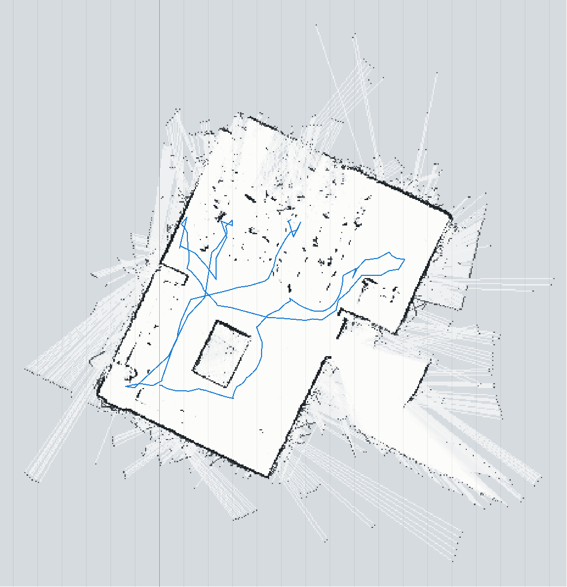
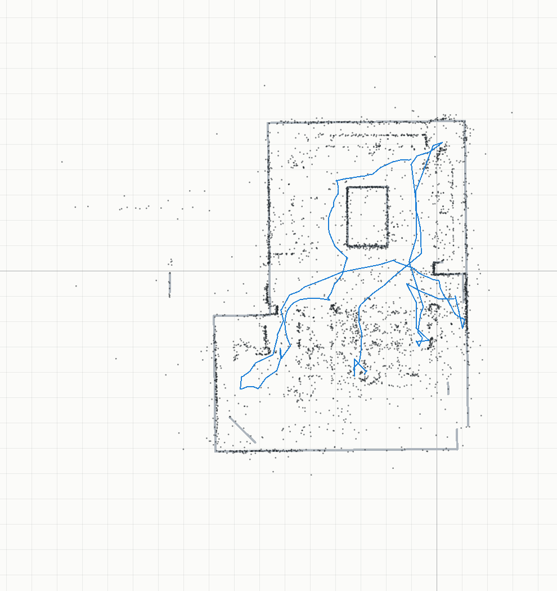
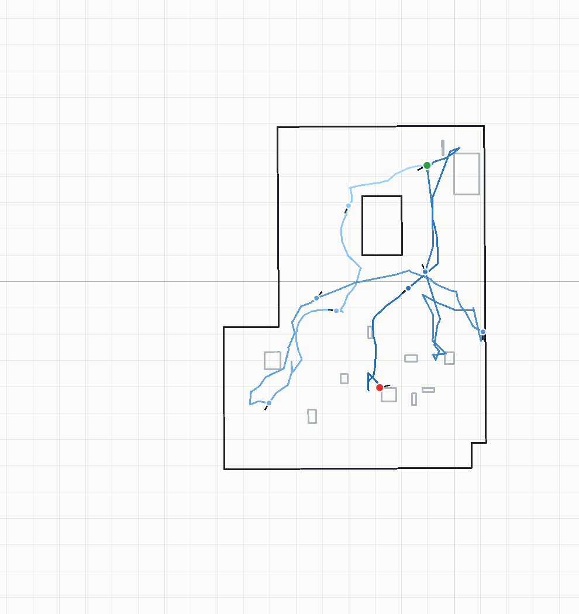
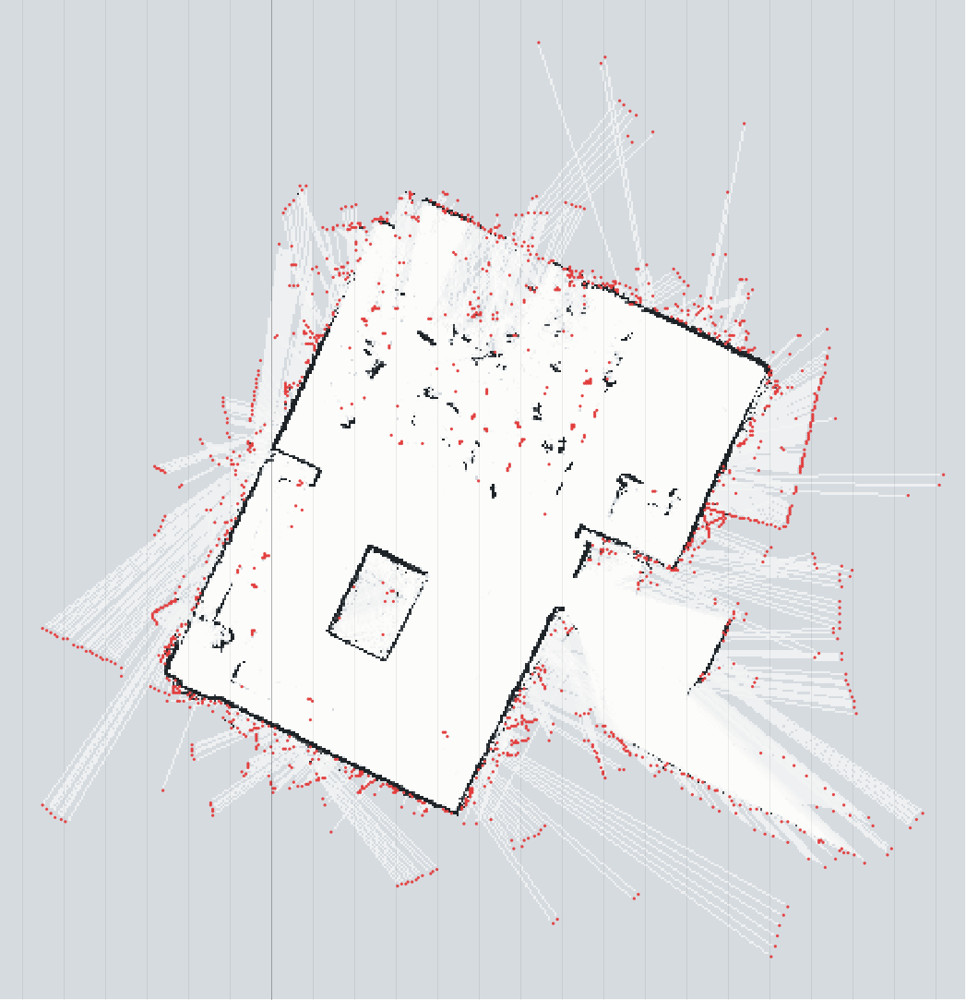
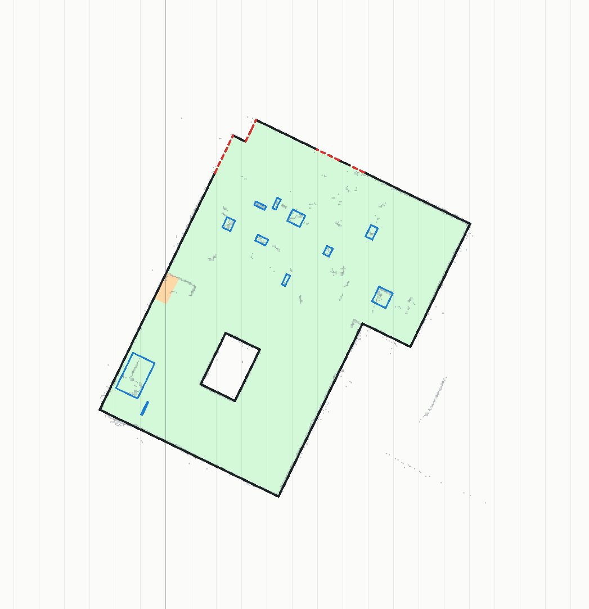
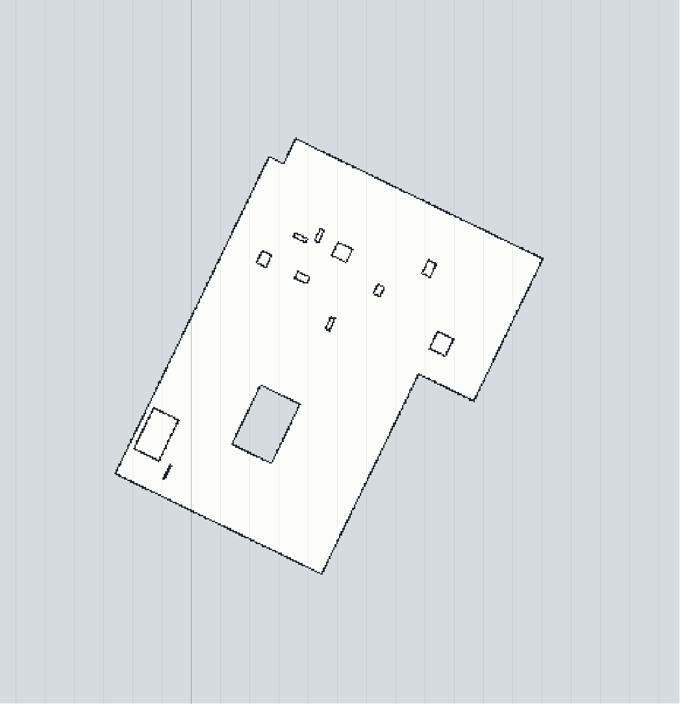
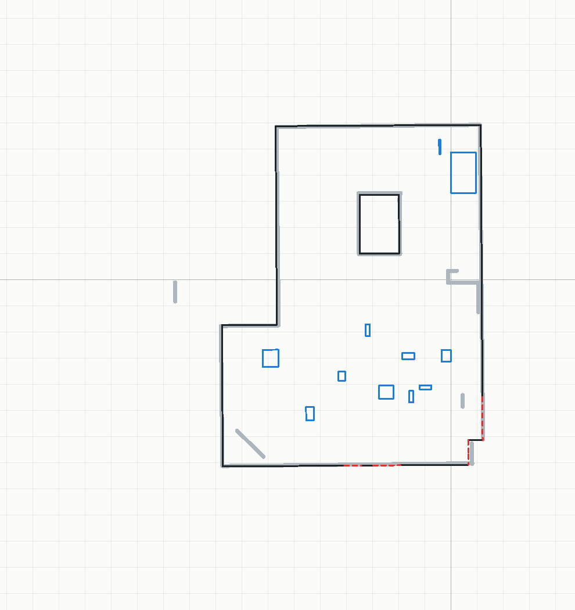

# Session de SLAM réelle : slam_usb_20261104

Généré par `node scripts/analyse-slam.mjs data/slam_usb_20261104`. 159 scans clés enregistrés par le SLAM en direct,
trajet de 57.1 m (somme des déplacements entre scans clés).

## Comparaison avec la carte de référence

Le SLAM part de (0, 0, 0) : sa carte est d'abord recalée sur la carte de référence (localisation
globale du scan `scan_1104_175201.csv`, fiable, 62 % de ses points sur la carte, puis ICP de tous les points).
Changement de repère : (-1.03 m ; 4.42 m ; -153.7°).

| Mesure | Valeur |
| --- | --- |
| Cellules occupées du SLAM à moins de 10 cm d'un mur ou meuble de la référence | **50 %** |
| Écart médian des cellules occupées proches (< 30 cm) à la référence | 4.3 cm |
| Murs de la référence vus par le SLAM (point à moins de 10 cm) | **79 %** |

Les cellules hors référence (50 %) sont des objets absents de la carte de référence (chaises,
sacs, personnes, meubles déplacés) ou des erreurs du SLAM ; les murs non vus sont les zones où le robot
n'est pas allé.

| Carte du SLAM (repère du SLAM, trajet en bleu) | Superposée à la référence (gris) |
| --- | --- |
|  |  |

## Suivi du robot

Trajet du robot estimé par le SLAM, sur la carte finale : 159 scans clés, 57.1 m,
du bleu clair (début) au bleu foncé (fin) ; départ en vert, arrivée en rouge, robot dessiné tous
les 20 scans clés (trait = cap).

## Filtrage 1 : chaises et objets parasites

Les cellules occupées sont regroupées en objets (composantes connexes, après une dilatation d'une
cellule qui relie les morceaux d'un même mur). Un objet de moins de 40 cm (pieds de chaises et de
tables, sacs, jambes) est retiré, ainsi que toute cellule vue occupée par un seul scan.

**200 objets retirés** (1476 cellules, en rouge), 92 gardés (murs, grands meubles).

## Filtrage 2 et reconstruction du plan

Inspiré des travaux de reconstruction de plans en milieu encombré : droites des murs par
histogrammes (Okorn et al., CMU, 2010), décomposition de l'espace en cellules par ces droites et
étiquetage intérieur / extérieur (Mura et al., 2014 ; Ochmann et al., 2016 et 2019), murs parallèles
ou perpendiculaires (« monde Manhattan »). Détail : `src/core/reconstruct.js`.

1. Direction des murs : 64.1° (moyenne des segments de la carte vectorielle) ; carte redressée.
2. Droites : 37 (pics des histogrammes des cellules occupées, au moins 1,5 m cumulé ; plus les
   limites de l'espace vu libre, qui donnent la place d'un mur que le lidar n'a pas détecté ; plus les
   décrochés : un court morceau de mur accroché à un mur extérieur, dont le coin est hors de la salle).
3. Rectangles de l'arrangement : intérieur s'ils ont été vus libres (30 % de leurs cellules au moins),
   dans le cadre des murs extérieurs, et atteignables depuis le trajet du robot sans traverser de mur
   observé (diffusion depuis le trajet) : l'espace vu par une porte, derrière un mur, est exclu. Un
   meuble isolé (objet compact et épais, loin des murs, comme le bureau du prof) n'arrête pas la diffusion.
4. Complétion (orange) : un rectangle non vu, collé à l'intérieur sans mur entre eux (coin
   inaccessible, personnes), ou entouré d'intérieur, devient intérieur ; une petite niche (4 m² au plus)
   au bord de la salle, coupée du trajet par un obstacle (meuble, personnes), est rattachée à la salle.
5. Contour : murs **observés** (points occupés le long, noir) ou **reconstruits** (rouge pointillé) ;
   grands objets restants à l'intérieur : meubles (bleu).

| Mesure | Valeur |
| --- | --- |
| Surface de la salle reconstruite | 109.5 m² |
| Murs observés | 49.1 m, à 2.8 cm (médiane) de la référence, 99 % à moins de 15 cm |
| Murs reconstruits | 4.3 m, à 3.9 cm (médiane) de la référence, 97 % à moins de 15 cm |
| Meubles | 11 |

| Reconstruction (repère du SLAM) | Carte finale propre |
| --- | --- |
|  |  |

*Carte finale dans le repère de la référence : référence en gris épais, murs observés en noir,
reconstruits en rouge pointillé, meubles en bleu.*
