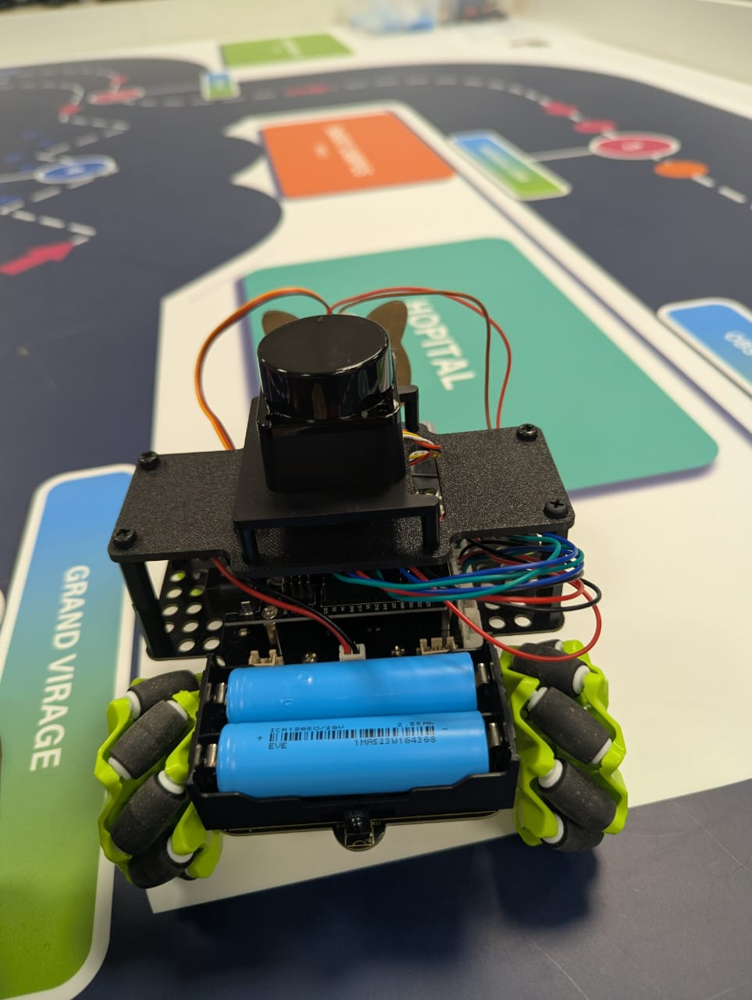
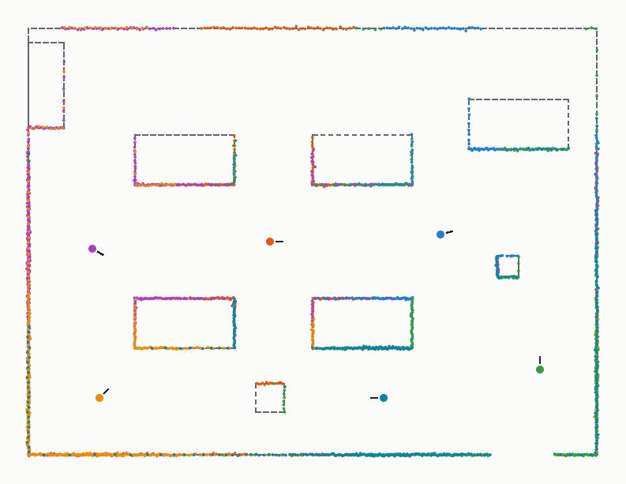
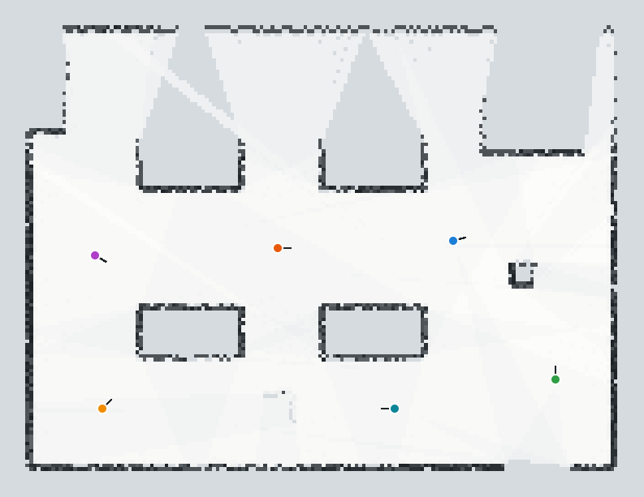
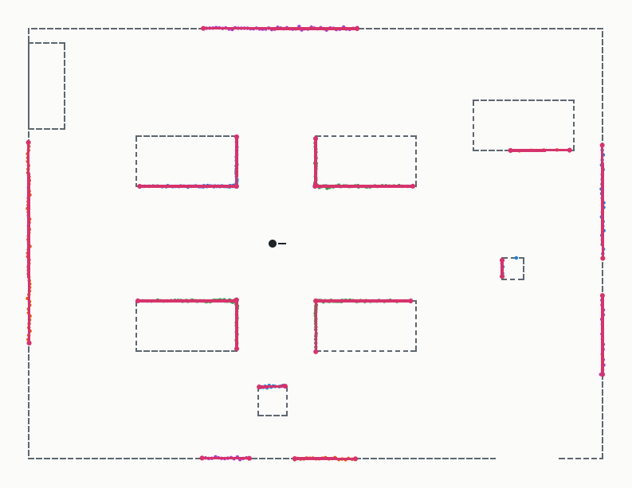
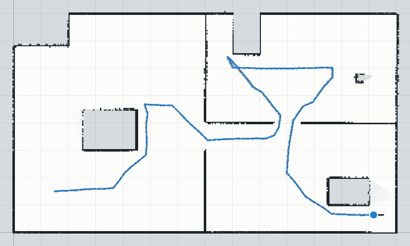

# Synthèse personnelle — Cartographie et localisation

Module *Cartographie et localisation appliquée à la robotique mobile*, novembre 2026. Synthèse
demandée par le livrable : pour chaque outil, les résultats visuels obtenus, les choix effectués,
les fonctionnalités intégrées et les méthodes implémentées ; puis ce que je retiens du module.
Les chiffres viennent des comptes rendus ([jour 1](jour1.md), [jour 2](jour2.md), [jour 3](jour3.md)) ;
chaque tableau y est régénérable par un script.

**Environnement choisi.** JavaScript (modules ES) sans aucune dépendance : une seule librairie
d'algorithmes (`src/core/`) sert à la fois à l'application web (affichage, manipulation, robot en
direct) et à Node.js (tests, bancs d'essai, figures). Même technologie que les outils du module
(MapTool, RobotControl), conventions identiques (pose x, y, θ ; mètres et degrés ; angles
antihoraires).

## 1. Acquisition des scans et programmes du robot

- **Résultats.** 18 scans réels pour la carte de la salle (`data/real/`), 16 scans d'un jeu de test
  indépendant (`data/test/`), 159 scans clés d'une séance de SLAM avec le robot en mouvement
  (`data/slam_usb_20261104/`).
- **Choix.** Un scan = **un seul tour** de lidar : fusionner plusieurs tours biaiserait le scan dès que
  le robot bouge un peu. Le programme de test fourni perdait des trames (trous jusqu'à 74°) : j'ai
  écrit un programme de capture qui n'envoie un scan que sur demande, puis un programme USB à 921 600
  bauds pour suivre le lidar en continu.
- **Fonctionnalités.** Lecture de tous les formats du module (RobotControl, MapTool, sortie Teleplot
  collée depuis le moniteur série, échange binaire Wi-Fi) ; capture USB et Wi-Fi.
- **Difficulté et solution.** Notre robot n'a pas la carte moteurs I2C du programme fourni : ses
  broches I2C sont des broches moteur, et les roues tournaient seules. J'ai relevé le câblage et écrit
  `ESP32_RobotWifi` et `ESP32_RobotUSB`, qui commandent les moteurs directement par l'ESP32 en gardant
  les routes et le format de RobotControl.

## 2. Outil de visualisation des nuages de points (jour 1)

- **Résultats.** Plusieurs scans affichés ensemble, une couleur par scan, à leur pose.
- **Fonctionnalités.** Pose de chaque scan modifiable (champs x, y, θ ; glisser ; Maj + glisser pour
  tourner ; clavier) ; recalage automatique de tous les scans ; enregistrement des scans avec leurs
  poses (`poses.csv`) ; scan en temps réel du robot affiché en direct.
- **Méthode.** Polaire → repère du robot → repère monde, `P = R(θ)·p + T`.

## 3. Outil grid map (jour 1)

| Un scan | Six scans |
| --- | --- |
|  |  |

- **Résultats.** Carte d'occupation de la salle ; chaque nouveau scan met la carte à jour.
- **Choix.** Grille probabiliste en **log-odds** : la mise à jour bayésienne devient une addition
  (impact +0,85, cellule traversée −0,40, bornes ±4 pour que la carte puisse « changer d'avis ») ;
  cellules de 5 cm (le bruit du LD06 est d'environ 1 cm).
- **Fonctionnalités.** Créer une carte depuis un scan, la mettre à jour avec un autre scan, carte de
  tous les scans ; **durée de vie** des cellules (décroissance vers l'inconnu), filtre des cellules
  isolées, carte propre ; exports CSV, PNG, ROS (PGM + YAML) ; import des grilles MapTool.
- **Méthode.** Bresenham du robot vers chaque impact (cellules traversées), puis la cellule d'impact.

## 4. Outil segments (jour 1)

- **Résultats.** Un segment par mur ; toutes les opérations demandées, testées sur leurs cas limites.
- **Choix.** Découpage en groupes de points par un seuil qui grandit avec la distance (Borges & Aldon) ;
  split-and-merge (Douglas-Peucker, 3 cm) ; ajustement par moindres carrés **totaux**, valable pour
  un mur vertical ; tolérance numérique EPS pour les intersections et les découpages.
- **Fonctionnalités.** Angle entre segments, segments « proches » en angle et en position, fusion
  pondérée, intersection, découpage d'un segment par un autre (intersection strictement intérieure,
  extrémités et colinéaires sans effet, longueurs égales à EPS près : côté du premier point).
- **Vérification.** Tests automatiques de chaque cas limite de l'énoncé (`test/geometry.test.js`).

## 5. Outil carte vectorielle (jour 1)

- **Résultats.** Carte de segments de la salle, mise à jour scan par scan.
- **Méthode** (étapes du document de cours). Gestion des absences : chaque faisceau découpe les
  segments qu'il traverse ; extraction des segments du scan ; fusion en cascade avec les segments
  proches de la carte ; suppression des segments trop courts. Chaque segment garde son poids et les
  scans qui l'ont vu.
- **Fonctionnalités.** Carte propre (murs redressés, coins fermés, meubles fixes gardés et nommés :
  table, armoire, tableau), import et export TXT, scènes MapTool en référence.

## 6. Outil de localisation (jour 2)

- **Résultats.** Sur les trois types de référence (grid map, carte vectorielle, scan de référence),
  avec les mêmes scans et les mêmes poses de départ ; réussite = moins de 5 cm **et** moins de 2° :

  | Référence | Méthode retenue (Gauss-Newton sur la carte) | La plus précise |
  | --- | --- | --- |
  | Grid map | 100 % de réussite, 11 mm et 0,12°, 2 ms | Descente de gradient : 10 mm, 97 % |
  | Carte vectorielle | 100 %, 7 mm et 0,06°, 2 ms | PL-ICP : 1,1 mm, 94 % |
  | Scan de référence | 100 %, 10 mm et 0,12°, 1 ms | ICP : 1,0 mm, 96 % |

  Le Gauss-Newton est retenu pour le SLAM : il ne rate jamais dans la fenêtre testée et répond en 1 à
  2 ms ; les méthodes les plus précises ratent plus souvent quand la pose de départ est loin.

  Sur données réelles, incertitude des poses de référence : ± 2,0 cm et 0,28° en médiane. Sans pose de
  départ, 17 scans réels sur 18 retrouvés dans toute la salle, 18 sur 18 avec la pose approximative.
- **Méthodes.** Force brute, descente de gradient, multi-résolution, filtre particulaire, ICP, calcul
  direct (moindres carrés point-droite) ; puis, après l'état de l'art, PL-ICP, NDT et Gauss-Newton
  sur la carte. Localisation globale avec verdict « fiable » ou « ambiguë ».
- **Choix.** Un même champ de distance et un même score pour toutes les méthodes, pour les comparer
  équitablement ; sensibilité mesurée de 5 cm / 2° à 45 cm / 18° de perturbation.
- **Fonctionnalités.** Localiser le scan sélectionné, comparer les méthodes, localisation globale,
  exporter les résultats en CSV ; carte de référence figée et enregistrable.

## 7. SLAM et carte de la salle (jour 3)

| Carte du SLAM recalée sur la référence | Carte finale reconstruite |
| --- | --- |
|  |  |

- **Résultats.** En simulation, 0,5 cm d'erreur dans la salle. Avec le **vrai robot**, piloté par câble
  pendant 26 minutes (57 m, 159 scans clés), la carte du SLAM est à **4,3 cm** de la carte de
  référence faite séparément ; après filtrage et reconstruction, les murs vus sont à 2,8 cm et les
  murs reconstruits à 3,9 cm de la référence.
- **Comparaison.** La carte du SLAM a été comparée, mesure à l'appui, à la carte de référence
  construite séparément au jour 2 : les deux s'accordent à 4 cm près, ce qui valide l'une par
  l'autre (même lidar : l'échelle absolue resterait à vérifier au mètre ruban).
- **Méthodes.** Suivi sur une carte locale (Gauss-Newton puis multi-résolution et ICP), scans clés,
  graphe de poses optimisé par Gauss-Newton avec précision par direction, fermeture de boucle,
  relocalisation.
- **Améliorer la carte grâce à la recherche.** La carte brute contenait chaises, personnes, un coin
  inaccessible et des murs mal vus. J'ai cherché dans des articles et des thèses sur la
  reconstruction de plans en intérieur encombré (Okorn et al. 2010, Mura et al. 2014, Ochmann et al.
  2016 et 2019) : murs trouvés par histogrammes, salle découpée en cellules étiquetées intérieur ou
  extérieur, coins cachés complétés. Un premier filtre retire les objets de moins de 40 cm, un
  second reconstruit le plan. L'état de l'art des méthodes (articles, thèses, projets GitHub) est
  dans [etat_de_l_art.md](etat_de_l_art.md).
- **Choix.** Un SLAM en ligne a besoin d'un **trajet continu** : les clichés épars de la carte de
  référence ne suffisaient pas (salle presque symétrique, scans pris en hauteur). Pour ces clichés,
  j'ai utilisé un graphe de poses hors ligne (Lu & Milios), et pour la carte complète, un trajet
  continu avec le robot.
- **Fonctionnalités.** SLAM sur des scans enregistrés ; SLAM en direct pendant le pilotage au clavier
  (câble ou Wi-Fi) ; barre d'état (liaison, pose, scans par seconde, état du SLAM).

## 8. Bonus : robot autonome

- **Résultats.** Exploration par frontières : 12 départs sur 12 réussis en simulation (98,5 à 100 % de
  la surface vue, aucune collision, 1 à 3 cm d'erreur de pose). Sur le vrai robot en Wi-Fi,
  l'exploration a été essayée et a fonctionné, mais cette séance n'a pas été enregistrée.
- **Méthode.** Frontières entre le connu et l'inconnu (Yamauchi 1997), plus court chemin sur la grille
  gonflée du rayon du robot, vitesses du robot estimées et corrigées à chaque pas par le SLAM (le
  robot n'a pas de codeurs).

## 9. Ce que je retiens du module

### Ce que j'ai apprécié

Le moment qui m'a le plus plu, c'est quand j'ai construit la grid map de la salle avec mon robot.
J'ai d'abord posé le robot sur l'armoire pour avoir la forme totale de la salle. Ensuite, je suis
descendu au sol : je posais le robot à un endroit, je faisais la capture, je passais à un autre
endroit, je refaisais une capture, et ainsi de suite. À la fin, j'avais la forme de la salle sur la
grid map. C'était très satisfaisant.

Ce cours m'a appris beaucoup de choses. Avant, je ne comprenais pas comment on fabriquait une carte à
partir d'un capteur. Maintenant, je fais le lien avec Google Maps : en plus des satellites, des
voitures parcourent les villes et capturent tout autour d'elles. J'ai vraiment compris ce principe
grâce au TP.

J'ai aussi beaucoup aimé le SLAM en direct. J'avançais simplement avec le robot, et il construisait
immédiatement la grid map et la carte de la salle. C'était très bien de voir réunis le travail du
premier jour (les cartes) et celui du deuxième jour (la localisation).

La partie la plus difficile pour moi a été la localisation : comprendre comment le robot se situe
dans l'espace. On pose le robot contre un mur, cette position devient (0, 0, 0), puis il sait qu'il a
avancé d'un mètre à partir de là. Pour vérifier, j'ai repris les anciens scans de ma grid map et je
les ai donnés à l'application pour voir si elle retrouvait la position du robot. Ça a bien marché,
et j'en suis assez fier.

### Ce que j'ai moins apprécié

Surtout le manque de matériel. Ce n'est pas un défaut du cours ni du TP, mais de l'organisation de
l'école : il n'y avait pas assez de robots, et nous devions souvent attendre. Avec un groupe plus
réduit et plus de robots, le professeur aurait eu plus de temps pour approfondir avec nous. Nous
sommes allés vite. Nous avons compris l'essentiel : pourquoi ça marche, la grille d'occupation, la
carte vectorielle, le lidar qui envoie ses faisceaux sur les murs et dessine la forme des choses
point par point. Avec plus d'accès aux robots, nous serions allés plus loin.

Ce qui m'a fait perdre le plus de temps :

- **Les robots configurés différemment.** Le code fourni ne correspondait pas à tous les robots, il
  fallait trouver le bon. Ce n'était pas très compliqué, et le professeur avait déjà préparé le
  nécessaire.
- **La connexion avec le robot.** Pour que mon application web reçoive les données, il fallait fermer
  le moniteur série d'Arduino. Mes ports étaient parfois occupés par d'autres applications que j'avais
  lancées en arrière-plan. Une fois celles-ci fermées, la connexion a fonctionné.
- **Le SLAM en direct qui se perdait.** Soit j'avançais trop vite, soit les données arrivaient trop
  lentement. Le temps que le robot envoie les données et qu'elles s'affichent dans l'application, tout
  prenait du retard ; parfois tout se bloquait, et je devais tout recommencer.
  - J'ai ensuite corrigé ces blocages : le calcul du SLAM a été déplacé à part pour ne plus figer
    l'application, et le robot suit mieux les mouvements rapides. Cela m'a permis de faire la carte
    complète de la salle.
  - J'ai aussi compris que, quand le robot perd le SLAM en direct, il suffit souvent de lui faire
    faire une rotation : il retrouve sa position sur la carte, et ça marche très bien.

L'énoncé et les explications du professeur étaient clairs.

### Ce que j'améliorerais

J'ai bien aimé l'organisation jour par jour : on nous explique ce qu'il faut faire, puis on essaie.
Le temps du projet, de début novembre au rendu, était suffisant. Ce qui a manqué, c'est un accès plus
long aux robots, pour mieux cartographier la salle et faire plus d'essais. Je changerais donc surtout
le nombre de robots. On pourrait aussi imaginer un capteur 3D, mais il coûte plus cher, et le lidar
2D suffit déjà pour bien apprendre.
