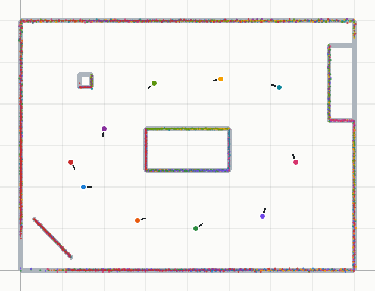
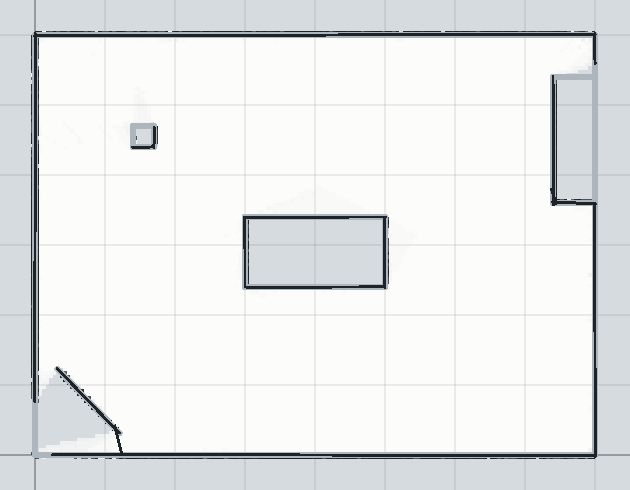

# Test sur des données générées par MapTool

Énoncé, « Remarques complémentaires » : tester ses outils avec des données réelles **et** des données
artificielles générées avec mapTool. Les données réelles sont testées aux jours 1 à 3 ; ce document
teste les mêmes outils sur des données de MapTool.

**Comment les données ont été produites.** `node scripts/gen-maptool.mjs` lit le fichier
`RESSOURCES/Tools/MapTool/MapTool.html` fourni, en extrait ses fonctions de calcul et d'export
(`computeScan`, `raySegmentIntersection`, `rasterizeSegment`, `exportScanCSV`, `exportVectorTXT`,
`exportGridCSV`…) sans les modifier, et les exécute : les fichiers de `data/maptool/` sont ceux que
MapTool exporterait. Scène : salle de 8 × 6 m (murs du bord ajoutés par MapTool), table, armoire,
pilier, tableau en biais ; 10 poses en tour de salle ; 450 rayons par scan ; bruit de MapTool : ±1 cm
sur la distance, ±0,5° sur l'angle (uniforme). Pose vraie dans l'en-tête de chaque scan.

Généré par `node scripts/test-maptool.mjs` (2 tirages par niveau de perturbation et par scan).

## A. Lecture

10 scans lus, format reconnu : **maptool** (colonnes `angle_deg,r_m,x_rel_m,y_rel_m`),
450 à 450 points valides par scan, pose lue dans la ligne `# Robot position`.

*Les 10 scans MapTool affichés par notre outil à leur pose, une couleur par scan, sur la carte
vectorielle de MapTool (gris épais).*

## B. Cartes (jour 1) comparées aux cartes de MapTool

| Mesure | Valeur |
| --- | --- |
| Grid map : cellules occupées de notre grille à moins d'une cellule (5 cm) d'un mur de MapTool | **100 %** |
| Grid map : cellules de mur de MapTool retrouvées par notre grille | 92 % |
| Carte vectorielle : écart médian de nos segments aux segments de MapTool | **0.1 cm** (99 % à moins de 5 cm) |
| Carte vectorielle : longueur des murs de MapTool couverte par nos segments (à 5 cm) | 86 % |

Les murs de MapTool non retrouvés sont des faces que le lidar ne peut pas voir depuis les 10 poses :
le dos de l'armoire contre le mur, l'intérieur du pilier et de la table, le dessous du tableau en biais.

*Notre grid map (blanc libre, noir occupé) et notre carte vectorielle (noir) sur la carte
vectorielle de MapTool (gris épais).*

## C. Localisation (jour 2) sur les références exportées par MapTool

Pour chaque scan : poses de départ perturbées de 5 cm / 2° à 45 cm / 18° (4 niveaux × 2 tirages),
les mêmes pour toutes les méthodes. **Réussite** : moins de 5 cm **et** moins de 2° (seuils du
[banc d'essai du jour 2](jour2_benchmark.md)).

| Référence | Méthode | Réussite | Erreur position médiane | Erreur angle médiane | Temps moyen |
| --- | --- | --- | --- | --- | --- |
| Grille exportée par MapTool | Force brute | 100 % | 3.0 cm | 0.00° | 387 ms |
| Grille exportée par MapTool | Multi-résolution | 100 % | 3.0 cm | 0.00° | 165 ms |
| Grille exportée par MapTool | Descente de gradient | 99 % | 3.0 cm | 0.17° | 5 ms |
| Grille exportée par MapTool | Filtre particulaire (probabiliste) | 45 % | 5.6 cm | 0.45° | 43 ms |
| Grille exportée par MapTool | ICP | 79 % | 1.7 cm | 0.14° | 13 ms |
| Grille exportée par MapTool | PL-ICP (ICP point-droite, Censi 2008) | 99 % | 2.6 cm | 0.10° | 8 ms |
| Grille exportée par MapTool | NDT (Biber 2003) | 93 % | 3.4 cm | 0.05° | 24 ms |
| Grille exportée par MapTool | Gauss-Newton sur la carte (Hector 2011) | 100 % | 2.4 cm | 0.14° | 3 ms |
| Carte vectorielle exportée par MapTool | Calcul direct (moindres carrés point-droite) | 81 % | 0.1 cm | 0.02° | 4 ms |
| Carte vectorielle exportée par MapTool | Force brute | 100 % | 1.7 cm | 0.00° | 396 ms |
| Carte vectorielle exportée par MapTool | Multi-résolution | 100 % | 1.6 cm | 0.00° | 159 ms |
| Carte vectorielle exportée par MapTool | Descente de gradient | 99 % | 1.6 cm | 0.03° | 4 ms |
| Carte vectorielle exportée par MapTool | Filtre particulaire (probabiliste) | 84 % | 3.7 cm | 0.33° | 41 ms |
| Carte vectorielle exportée par MapTool | ICP | 80 % | 0.1 cm | 0.03° | 16 ms |
| Carte vectorielle exportée par MapTool | PL-ICP (ICP point-droite, Censi 2008) | 99 % | 0.1 cm | 0.02° | 6 ms |
| Carte vectorielle exportée par MapTool | NDT (Biber 2003) | 66 % | 0.4 cm | 0.08° | 23 ms |
| Carte vectorielle exportée par MapTool | Gauss-Newton sur la carte (Hector 2011) | 100 % | 1.5 cm | 0.04° | 3 ms |
| Scan MapTool le plus proche | ICP | 90 % | 0.5 cm | 0.13° | 15 ms |
| Scan MapTool le plus proche | Force brute | 100 % | 1.0 cm | 0.00° | 418 ms |
| Scan MapTool le plus proche | Multi-résolution | 100 % | 0.7 cm | 0.00° | 169 ms |
| Scan MapTool le plus proche | Descente de gradient | 100 % | 0.5 cm | 0.15° | 5 ms |
| Scan MapTool le plus proche | Filtre particulaire (probabiliste) | 86 % | 2.8 cm | 0.45° | 41 ms |
| Scan MapTool le plus proche | PL-ICP (ICP point-droite, Censi 2008) | 100 % | 0.1 cm | 0.05° | 8 ms |
| Scan MapTool le plus proche | NDT (Biber 2003) | 91 % | 0.2 cm | 0.07° | 28 ms |
| Scan MapTool le plus proche | Gauss-Newton sur la carte (Hector 2011) | 100 % | 0.6 cm | 0.08° | 3 ms |

Sur la **grille** de MapTool, l'erreur médiane de 2 à 3 cm vient de la grille elle-même : MapTool marque
un mur par la cellule de 5 cm qui le contient, sans valeur intermédiaire ; le centre de cette cellule est en
moyenne à 2,5 cm du vrai mur. Sur sa **carte vectorielle** et entre ses **scans**, les meilleures méthodes
retrouvent la pose au millimètre (ICP point-droite, calcul direct).

### Sensibilité à l'initialisation (taux de réussite)

| Référence | Méthode | 5 cm / 2° | 15 cm / 5° | 30 cm / 10° | 45 cm / 18° |
| --- | --- | --- | --- | --- | --- |
| Grille exportée par MapTool | Force brute | 100 % | 100 % | 100 % | 100 % |
| Grille exportée par MapTool | Multi-résolution | 100 % | 100 % | 100 % | 100 % |
| Grille exportée par MapTool | Descente de gradient | 100 % | 100 % | 100 % | 95 % |
| Grille exportée par MapTool | Filtre particulaire (probabiliste) | 45 % | 35 % | 50 % | 50 % |
| Grille exportée par MapTool | ICP | 100 % | 100 % | 100 % | 15 % |
| Grille exportée par MapTool | PL-ICP (ICP point-droite, Censi 2008) | 100 % | 100 % | 100 % | 95 % |
| Grille exportée par MapTool | NDT (Biber 2003) | 100 % | 100 % | 95 % | 75 % |
| Grille exportée par MapTool | Gauss-Newton sur la carte (Hector 2011) | 100 % | 100 % | 100 % | 100 % |
| Carte vectorielle exportée par MapTool | Calcul direct (moindres carrés point-droite) | 100 % | 100 % | 100 % | 25 % |
| Carte vectorielle exportée par MapTool | Force brute | 100 % | 100 % | 100 % | 100 % |
| Carte vectorielle exportée par MapTool | Multi-résolution | 100 % | 100 % | 100 % | 100 % |
| Carte vectorielle exportée par MapTool | Descente de gradient | 100 % | 100 % | 100 % | 95 % |
| Carte vectorielle exportée par MapTool | Filtre particulaire (probabiliste) | 90 % | 85 % | 75 % | 85 % |
| Carte vectorielle exportée par MapTool | ICP | 100 % | 100 % | 100 % | 20 % |
| Carte vectorielle exportée par MapTool | PL-ICP (ICP point-droite, Censi 2008) | 100 % | 100 % | 100 % | 95 % |
| Carte vectorielle exportée par MapTool | NDT (Biber 2003) | 100 % | 95 % | 65 % | 5 % |
| Carte vectorielle exportée par MapTool | Gauss-Newton sur la carte (Hector 2011) | 100 % | 100 % | 100 % | 100 % |
| Scan MapTool le plus proche | ICP | 100 % | 100 % | 100 % | 60 % |
| Scan MapTool le plus proche | Force brute | 100 % | 100 % | 100 % | 100 % |
| Scan MapTool le plus proche | Multi-résolution | 100 % | 100 % | 100 % | 100 % |
| Scan MapTool le plus proche | Descente de gradient | 100 % | 100 % | 100 % | 100 % |
| Scan MapTool le plus proche | Filtre particulaire (probabiliste) | 85 % | 95 % | 75 % | 90 % |
| Scan MapTool le plus proche | PL-ICP (ICP point-droite, Censi 2008) | 100 % | 100 % | 100 % | 100 % |
| Scan MapTool le plus proche | NDT (Biber 2003) | 100 % | 100 % | 100 % | 65 % |
| Scan MapTool le plus proche | Gauss-Newton sur la carte (Hector 2011) | 100 % | 100 % | 100 % | 100 % |
